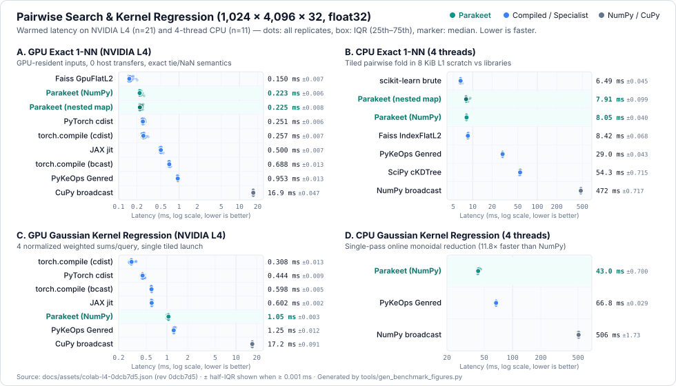

Parakeet
====

[](https://github.com/iskandr/parakeet/actions/workflows/ci.yml)
[](https://rubinsteyn.com/parakeet/)

Parakeet is a runtime compiler for an array-oriented subset of Python. It
generates a native specialization of a function for each distinct set of input
types, fuses and tiles array operations algebraically before lowering them to
loops, and runs those loops across CPU cores or on Apple Metal and NVIDIA CUDA
GPUs.

Underneath, ordinary NumPy expressions, comprehensions, explicit loops, and
Parakeet's data-parallel operators (`parakeet.map`, `imap`, `ireduce`, `reduce`,
`fold`, `scan`, `filter`, `scatter_add`, `allpairs`, `flatmap`, `wavefront`)
all lower to the same small algebra of index operators. Because the compiler
keeps that algebraic structure alive until code generation, fusion, cache and
GPU tiling, and reverse-mode differentiation (`parakeet.grad`) all fall out of
one representation.

Parakeet is not a general-purpose compiler for all of Python. It compiles the
numerical subset and reports a source-located compile error whenever you step
outside it.


Example
=======

Wrap a function with **`@parakeet.jit`** — or call data-parallel operators like
`parakeet.map` and `parakeet.imap` directly from Python (their callable
arguments are JIT-compiled automatically). NumPy expressions, explicit loops,
comprehensions, and data-parallel operators compile to the same fused native
code:

```python
import numpy as np
import parakeet as par

alpha = 0.5
beta = 0.3
x = np.array([1, 2, 3])
y = np.tanh(x * alpha) + beta


@par.jit
def fast(x, alpha=0.5, beta=0.3):
  return np.tanh(x * alpha) + beta


@par.jit
def loopy(x, alpha=0.5, beta=0.3):
  y = np.empty_like(x, dtype=float)
  for i in range(len(x)):
    y[i] = np.tanh(x[i] * alpha) + beta
  return y


@par.jit
def comprehension(x, alpha=0.5, beta=0.3):
  return np.array([np.tanh(xi * alpha) + beta for xi in x])


assert np.allclose(fast(x), y)
assert np.allclose(loopy(x), y)
assert np.allclose(comprehension(x), y)
```


Install
=======

Parakeet 1.0 requires Python 3.11 or later and a C compiler.

```bash
pip install parakeet                 # CPU backends
pip install "parakeet[metal]"        # + Apple GPUs
pip install "parakeet[cuda12]"       # + NVIDIA GPUs
```


Dependencies
============

Parakeet is written for Python 3.11+ and depends on:

* [NumPy](https://numpy.org) 2.0 or newer
* a C compiler: `clang` from the Xcode command line tools on macOS, `gcc` or
  `clang` on Linux, MinGW-w64 or LLVM on Windows

That's the whole list. If Parakeet can't find a compiler it says so and tells
you how to get one.

For Apple Metal you need a Mac and the
[PyObjC Metal bindings](https://pypi.org/project/pyobjc-framework-Metal/). For
NVIDIA CUDA you need an NVIDIA GPU and [CuPy](https://cupy.dev).


How does it work?
=================

Your untyped function acts as a template from which Parakeet generates one
*type specialization* for each distinct combination of argument dtypes, array
ranks, layouts, and container structure.

During elaboration, helper calls are inlined, closures and tuples disappear,
and array expressions stay *delayed* until something consumes them, so
`np.tanh(x * alpha) + beta` becomes a single loop with no temporary arrays.
What comes out is a small core operator IR (`IndexMap`, `IndexReduce`,
`IndexScan`, `IndexFilter`, `IndexExpand`, `IndexScatter`, `IndexWavefront`,
and `IndexTile`). Middle-end passes apply algebraic rewrites — vertical and
sibling fusion, filter fusion, contraction reassociation, rescaled-monoid and
pairwise fold tiling, chunkwise scans, and cache/GPU blocking — before lowering
to loops, emitting C (plus Metal or CUDA kernels for eligible parallel loops),
compiling with your system C compiler, and caching the result on disk.

Every stage is inspectable:

* `par.typed_repr(f, [x])` prints the typed IR,
* `par.show_rewrite(f, x)` summarizes which algebraic laws fired, and
* `f.specialize(x).source` prints the generated C, Metal, or CUDA source.


Supported language features
===========================

Parakeet compiles a static-type numerical subset of Python:

* Scalar arithmetic, bitwise, and comparison operations (`math`, `uint8`–`uint64`, `int8`–`int64`, `float32`, `float64`, `bool`, `bfloat16` conversions, `popcount`/`clz`/`ctz`)
* Control flow (`if`/`elif`/`else`, `for`, `while`, `for`/`while ... else`, `break`, `continue`, early `return`, scalar `match`/`case`)
* Nested functions, lambdas, and closures; default, keyword, and `*args` arguments
* Nested tuples, `NamedTuple`s, fixed string-key dicts, plain frozen dataclasses, `RaggedArray`, `SortedIndex`, `FrozenHashTable`, and `BlockMask`
* Slices, `range`, `zip`, `enumerate`
* NumPy array expressions (`x[1:, :] + 2 * y[:-1, ::2]`), with broadcasting, boolean masks, integer-array indexing, and in-place updates
* About 200 NumPy functions and methods (`np.ones`, `np.sin`, `x.sum(axis=0)`, `np.einsum`, `np.bincount`, `np.sort`, `np.argsort`, `np.searchsorted`, `np.random`, and the usual builtins — see the [full list](https://rubinsteyn.com/parakeet/supported/))
* Explicit data-parallel operators (`par.map`, `par.imap`, `par.ireduce`, `par.reduce`, `par.fold`, `par.scan`, `par.filter`, `par.filter_reduce`, `par.flatmap`, `par.filter_pairs`, `par.allpairs`, `par.outer_map`, `par.parfor`, `par.scatter_add`, `par.wavefront`)
* Reverse-mode automatic differentiation (`par.grad`, `par.value_and_grad`) with algebraic rematerialization for attention, cross-entropy, norms, and soft sequence alignment

Unsupported constructs fail loudly at compile time with the exact source line:

```text
parakeet.errors.UnsupportedError: numpy.fft.fft is not supported in compiled code
  File "demo.py", line 7, in spectrum
    return np.fft.fft(x)
           ^^^^^^^^^^^^^
```

Runtime failures raise the exception NumPy would have raised (`IndexError`,
`ValueError`, `ZeroDivisionError`) instead of crashing the interpreter, even
from inside a parallel loop or GPU kernel.


Backends
========

Parakeet compiles to sequential C, multi-core C, Metal, or CUDA. Switch
backends with `parakeet.config.backend`:

* `"auto"`: the best multi-core strategy available on your machine (default)
* `"c"`: lowers all parallel operators to sequential loops
* `"threads"` / `"multicore"`: runs parallel operators on Parakeet's own thread pool
* `"openmp"`: multi-core via OpenMP
* `"gcd"`: multi-core via Grand Central Dispatch (macOS)
* `"metal"` (or `"mps"`): runs eligible parallel operations on an Apple GPU
* `"cuda"`: runs eligible parallel operations on an NVIDIA GPU
* `"python"`: runs your original function uncompiled — handy for checking whether a bug is in your code or the compiler

You can also pick a backend per function (`@par.jit(backend="metal")`), per call
(`f(x, _backend="c")`), or for a block (`with par.options(backend="c"): ...`).
`par.available_backends()` reports which backends work on your machine and what
is missing for any that don't.

GPUs only run loops they can execute natively. Apple GPUs lack hardware
`float64`, so `float64` loops fall back to CPU cores with a warning unless you
use `float32`.


Benchmarks
==========

Parakeet wins where NumPy or CuPy allocates large intermediates (pairwise
distance matrices, attention scores, chained element-wise passes) or where you
would otherwise drop into a Python loop. Specialist libraries (`Faiss`,
`cuDNN SDPA`, `cuBLAS`, `PyTorch` / `JAX` on standard dense layers) still lead
on their tuned primitives — the benchmark suite reports both wins and gaps side
by side.



### Highlights (NVIDIA L4 GPU & 4-thread CPU, `float32`)

Warmed medians from [`docs/assets/colab-l4-0dcb7d5.json`](docs/assets/colab-l4-0dcb7d5.json)
(`n = 21` GPU / `n = 11` CPU, GPU inputs resident, zero host transfers):

| Workload | Parakeet | Baseline / Reference | Implementation |
|---|---:|---:|---|
| Exact 1-NN, GPU (`1,024 × 4,096 × 32`) | **0.223 ms** | Faiss `0.150`, `torch.compile(cdist)` `0.257`, JAX `0.500`, PyKeOps `0.953`, CuPy `16.93` ms | [`nearest_numpy`](examples/algebraic_gallery.py) / [`exact_1nn`](examples/algebraic_gallery.py) |
| Exact 1-NN, GPU scaling (`R = 16,384`) | **0.542 ms** (3 MiB scratch) | Parakeet 1.0.0 `2.597 ms` (64 MiB) — **4.8× faster, 21× less memory** | [`benchmarks/gpu_pairwise_fold.py`](benchmarks/gpu_pairwise_fold.py) |
| Exact 1-NN, 4-thread CPU (`1,024 × 4,096 × 32`) | **7.91 ms** | scikit-learn `6.49`, Faiss `8.42`, PyKeOps `29.0`, SciPy `54.3`, NumPy `472` ms | [`nearest_numpy`](examples/algebraic_gallery.py) / [`exact_1nn`](examples/algebraic_gallery.py) |
| Gaussian regression, 4-thread CPU (`1,024 × 4,096 × 32`) | **42.99 ms** | PyKeOps `66.77`, NumPy `505.8` ms (**11.8× faster than NumPy**) | [`rbf_kernel_regression`](examples/algebraic_gallery.py) |
| Gaussian regression, GPU (`1,024 × 4,096 × 32`) | **1.053 ms** | `torch.compile(cdist)` `0.308`, JAX `0.602`, PyKeOps `1.254`, CuPy `17.18` ms | [`rbf_kernel_regression`](examples/algebraic_gallery.py) |
| GBDT histogram split, GPU (`262,144 × 256`) | **0.370 ms** | `torch.compile` `0.208`, JAX `0.244`, PyTorch `0.335`, CuPy `0.647` ms | [`gbdt_best_split`](examples/algebraic_gallery.py) |
| Causal attention, GPU (`4 × 512 × 64`) | **0.493 ms** | PyTorch SDPA `0.104`, JAX `0.145`, CuPy `0.490` ms | [`causal_flash_attention`](examples/algebraic_gallery.py) |
| nanoGPT training step, GPU (`16×64×128×2`) | **6.83 ms** (TF32) / **8.44 ms** (FP32) | PyTorch eager `9.22`, `torch.compile` `3.52`, JAX `1.62` ms | [`examples/nanogpt.py`](examples/nanogpt.py) |

See the full [**Benchmarks report**](https://rubinsteyn.com/parakeet/release-benchmarks/)
for replicate distributions, IQR spreads, scaling curves, memory counters,
compile times, and reproduction commands, and the
[**Performance guide**](https://rubinsteyn.com/parakeet/performance/) for CPU/GPU
crossovers and Apple Metal timings.

### Local CPU micro-benchmarks (Apple M1 Pro, 10 cores, `float64`)

Best of 5 via `python benchmarks/run.py` ([`benchmarks/run.py`](benchmarks/run.py)):

| Benchmark | NumPy | Parakeet (1 thread) | Parakeet (10 threads) |
|---|---:|---:|---:|
| `np.tanh(x * a) + b`, 4M elements | 14.5 ms | 24.8 ms | **3.5 ms** |
| Euclidean norm, 4M elements | 3.4 ms | 1.1 ms | **0.65 ms** |
| Arc distance, 4M elements | 174 ms | 174 ms | **23 ms** |
| Harris corner response, 2000×2000 | 19.4 ms | 4.0 ms | **1.1 ms** |
| All-pairs distances, 40k×64×32 | 103 ms | 11.1 ms | **1.6 ms** |
| 3×3 convolution, 2000×2000 | 21.2 ms | 9.1 ms | **1.4 ms** |
| Julia set, 1000×1000 | 402 ms | 47 ms | **6.1 ms** |
| Matrix product, 300×300 (BLAS off) | **0.16 ms** | 4.1 ms | 0.72 ms |


More information
================

* Read the [documentation](https://rubinsteyn.com/parakeet/)
* Start with [Getting started](https://rubinsteyn.com/parakeet/quickstart/), the [Kernel gallery](https://rubinsteyn.com/parakeet/gallery/), and [Bioinformatics & structural biology](https://rubinsteyn.com/parakeet/bioinformatics/)
* Explore the [Algebraic laws](https://rubinsteyn.com/parakeet/algebra/) and [Benchmarks](https://rubinsteyn.com/parakeet/release-benchmarks/)
* Coming from Parakeet 0.x? Read the [migration notes](https://rubinsteyn.com/parakeet/migrating/)


History
=======

Parakeet began between 2012 and 2014 in the Computer Science Department at New
York University (Courant Institute), created by **Alex Rubinsteyn** and **Eric
Hielscher** with **Nathaniel Weinman** and advisor **Dennis Shasha** (with
early advice from **Russell Power**). Built for Python 2 and NumPy 1, it tested
a clean bet: instead of trying to recover array structure from opaque scalar
loops or forcing programmers into a static graph DSL, lower numerical Python to
a typed SSA IR whose core constructs are higher-order data-parallel adverbs
(`Map`, `Reduce`, `Scan`, `OuterMap`, `Filter`) — then fuse and tile
algebraically *before* emitting C, OpenMP, or CUDA.

The original research is documented in:

* **Alex Rubinsteyn**, [*Runtime Compilation of Array-Oriented Python Programs*](https://cs.nyu.edu/media/publications/rubinsteyn_alex.pdf)
  (PhD thesis, NYU, 2014) — runtime type and value specialization, typed
  adverb IR, algebraic vertical/nested/horizontal fusion, and multi-core/CUDA
  code generation.
* **Eric Hielscher, Alex Rubinsteyn, and Dennis Shasha**,
  [*Locality Optimization for Data Parallel Programs*](https://arxiv.org/abs/1304.1835)
  (NYU CS Technical Report TR2013-955 / Eric Hielscher's 2013 NYU PhD thesis
  work) — `TiledMap` / `TiledReduce` / `TiledScan` for unified cache and
  register tiling over adverb trees.
* **Alex Rubinsteyn, Eric Hielscher, Nathaniel Weinman, and Dennis Shasha**,
  [*Parakeet: A Just-In-Time Parallel Accelerator for Python*](https://www.usenix.org/conference/hotpar12/workshop-program/presentation/rubinsteyn)
  (USENIX HotPar '12), plus the [PyData Boston 2013](https://vimeo.com/73895275)
  and [PyData NYC 2013](https://vimeo.com/79556629) talks.

When the Python 2 codebase was retired, its closing note observed that
high-performance numerical code belongs on explicit data-parallel operators.
Parakeet 1.0 is a ground-up rewrite for Python 3.11+ and NumPy 2 that carries
that exact spirit forward: keeping ordinary `@jit` NumPy and explicit operators
unified in one namespace, generalizing the adverb algebra to scatter reductions,
structured multi-state folds, ragged compaction, wavefront DP, chunkwise scans,
rescaled-monoid GPU tiling, and reverse-mode `grad`, and targeting modern
multi-core CPUs, Apple Metal, and NVIDIA CUDA. The original 2012–2014 code
lives on in the Git history.

BSD 3-clause licensed; see [LICENSE](LICENSE).
