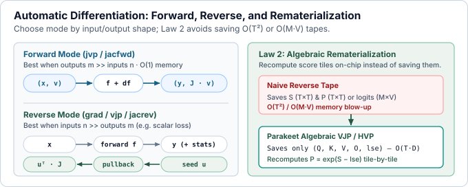
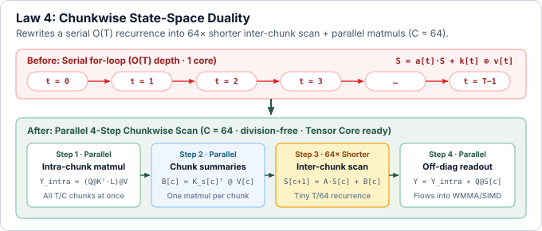
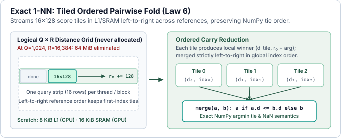

# Algebraic laws

Simple loop fusion eliminates element-wise temporaries, but harder bottlenecks
remain whenever a program normalizes across a whole row (`O(N²)` attention or
`O(M · V)` cross-entropy), chains matrix contractions, runs a long serial
recurrence (`O(T)` depth), or saves a giant tape for reverse-mode AD.

Instead of hardcoding model-specific "fused layers", Parakeet encodes these
optimizations as **six general algebraic laws** over its
[index-space primitives](primitives.md). Because the passes match operator
algebra rather than neural-network layer names, the exact same passes optimize
Gaussian kernel regression, exact 1-NN, GBDT histograms, and IIR filters
alongside attention, cross-entropy, and state-space models.

## Semantic contract: real algebra vs. exact order

* **Associative / commutative rewrites** (parallel reductions, monoidal tiling,
  contraction reassociation, chunkwise scans, privatized scatter-add) assume
  real-arithmetic associativity: floating-point rounding may differ in the last
  ULP relative to a left-to-right loop, just like NumPy's pairwise summation or
  cuBLAS.
* **Order-sensitive operations** (first-index ties and NaNs in
  `argmin`/`argmax`, non-commutative `par.fold` merges, arbitrary user folds)
  preserve **exact left-to-right merge order**.

## The six laws at a glance

| Law | Core idea | Compiler pass | Workloads |
|---|---|---|---|
| **1. Rescaled semiring monoids** | Associative rescaling state `(m, l, o)` | `monoidal tiling` | Softmax attention, Split-K decode, linear cross-entropy, RBF regression, 1-pass `logsumexp` |
| **2. Algebraic AD rematerialization** | Recompute score tiles from sufficient statistics | `algebraic_vjp` | Attention backward, cross-entropy backward, 1-pass LayerNorm / RMSNorm VJP |
| **3. Bilinear contraction reassociation** | Reorder `(U @ Vᵀ) @ Wᵀ` + share KV head tiles | `contraction reassociation` | Multi-head latent attention (MLA), grouped-query attention (GQA), low-rank chains |
| **4. Chunkwise state-space duality** | Block-parallel affine / bilinear composition | `chunkwise scan` | Parallel IIR / EMA / Kalman filters, Mamba-2 & gated linear attention |
| **5. Affine tile-interval pruning** | Propagate `[i₀, i₀+Bₘ-1] × [j₀, j₀+Bₙ-1]` bounds | `TileInterval` | Causal & sliding-window masks, banded matrices, spatial cutoffs |
| **6. Privatized scatter & ordered carries** | Thread-private histograms & tiled ordered folds | `IndexScatter`, `pairwise fold tiling` | GBDT tree splits, exact 1-NN, multi-channel BAM pileup, `par.fold` |

---

## Law 1: Rescaled semiring monoids

**The problem.** Softmax attention, linear cross-entropy, and Gaussian kernel
regression all normalize by a row-wide `max` and `sum(exp(...))` before taking a
weighted sum—naively requiring `O(N · M)` or `O(M · V)` buffers.

**The law.** Maintaining the running maximum `m`, normalizing sum `l`, and
unnormalized output `o` forms an associative monoid `(S, ⊕, e)`:

<div class="pk-eq">
m = max(m₁, m₂)<br>
(m₁, l₁, o₁) ⊕ (m₂, l₂, o₂) = (<br>
&nbsp;&nbsp;m,<br>
&nbsp;&nbsp;l₁ · exp(m₁ − m) + l₂ · exp(m₂ − m),<br>
&nbsp;&nbsp;o₁ · exp(m₁ − m) + o₂ · exp(m₂ − m)<br>
)
</div>

Because `⊕` is associative, tiles can be reduced in cache or GPU shared memory
and merged in any grouping without materializing the full score matrix:


**Where it fires:**

* **Tiled softmax attention (`flash_monoid`):** streams `K, V` tiles against `Q`
  with zero `S`/`P` allocation.
* **Split-K decoding (`split_k=True`):** when query count is tiny (decode) and
  `T_kv` is long, splits `T_kv` across GPU threadblocks and merges partial
  `(mₚ, lₚ, oₚ)` summaries with `⊕`.
* **Tiled linear cross-entropy (`monoid_lse`):** tiles `H @ W` over vocabulary
  `V` with the scalar `(m, l)` monoid, eliminating the `M × V` logit tensor.
* **Gaussian / RBF kernel regression (`score_op="sqdist"`):** fuses
  `-γ · ‖xᵢ − yⱼ‖²` into the same `O(N + M)` streaming kernel.

---

## Law 2: Algebraic rematerialization in reverse-mode AD

**The problem.** A naive reverse-mode tape saves every forward intermediate,
bringing back `O(T²)` memory for attention and `O(M · V)` memory for linear
cross-entropy.

**The law.** Before loop lowering, `parakeet/transforms/algebraic_vjp.py`
substitutes sufficient-statistic adjoints that save only compact `O(T · D)`
tensors and recompute score tiles on-chip during backpropagation:



**Where it fires:**

* **Attention backward (`flash_monoid_bwd`):** saves `(Q, K, V, O, lse)`,
  computes `Dᵢ = ∑_d dO[i, d] · O[i, d]`, and recomputes `P = exp(S − lse)` and
  `dS = P · (dO @ Vᵀ − D)` tile-by-tile (also composes with forward-over-reverse
  `par.hvp`).
* **Linear cross-entropy backward (`cce_bwd`):** saves `(H, W, targets, lse)`
  and recomputes `p[i, v] = exp(hᵢ · wᵥ − lseᵢ)` on-chip.
* **LayerNorm / RMSNorm & softmax VJPs:** collapses multi-pass backward graphs
  into one pass (`dS = P · (dP − ∑ P · dP)`, dropping the `max` adjoint).

---

## Law 3: Bilinear contraction reassociation & shared-KV tiling

**The problem.** Chaining two bilinear contractions (`(X @ A) @ B`, or latent
attention `K = C_kv @ W_uk`, `V = C_kv @ W_uv`, `O = softmax(Q @ Kᵀ) @ V`) can
cost orders of magnitude more FLOPs and memory in the wrong parenthesization.

**The law.** For a single-use intermediate `T = U @ Vᵀ` feeding `Y = W @ T`:

<div class="pk-eq">
(U · Vᵀ) · Wᵀ  =  U · (Vᵀ · Wᵀ) &nbsp;&nbsp;— pick min( U·K·(R + P),  P·R·(K + U) ) FLOPs
</div>

<div class="pk-xform" markdown>
<div class="pk-xform-col pk-xform-col--before" markdown>
<div class="pk-xform-title">Expanded (prefill optimal) <span class="pk-xform-badge">materializes K, V</span></div>

```python
K = C_kv @ W_uk
V = C_kv @ W_uv
O = softmax(Q @ K.T) @ V
```
</div>
<div class="pk-xform-col pk-xform-col--after" markdown>
<div class="pk-xform-title">Absorbed (decode optimal) <span class="pk-xform-badge">stays in latent C_kv</span></div>

```python
Q_abs = Q @ W_uk.T  # absorb W_uk into Q
O = (softmax(Q_abs @ C_kv.T) @ C_kv) @ W_uv
```
</div>
</div>

`parakeet/transforms/reassociate.py` emits a runtime shape-guarded branch so
short-query decode runs tiled Law 1 attention directly over the compressed
latent `C_kv`, while long-query prefill automatically takes the lower-FLOP
expanded branch.

**Shared-KV head-group tiling (GQA):** when a head-group axis `G` of `Q`
broadcasts against a single KV head, Parakeet folds `G` into the query row
(`i_eff = g * T_q + i`) so all `G` query heads share one SRAM load of `K` and
`V`.

---

## Law 4: Chunkwise state-space duality

**The problem.** Plain Python recurrences (`for t in range(T): s = a[t] * s + b[t]`)
have `O(T)` serial depth and leave multi-core CPUs and GPUs idle.

**The law.** Affine maps compose associatively,
`(a₂, b₂) ∘ (a₁, b₁) = (a₂ · a₁, a₂ · b₁ + b₂)`.
`parakeet/transforms/tile_scan.py` partitions time into chunks of `C = 64` and
rewrites both scalar affine loops (EMA, IIR, Kalman) and bilinear matrix-state
loops (Mamba-2 / gated linear attention) into a division-free parallel scan:



<div class="pk-xform" markdown>
<div class="pk-xform-col pk-xform-col--before" markdown>
<div class="pk-xform-title">What you write <span class="pk-xform-badge">O(T) serial depth</span></div>

```python
for t in range(T):
  S = a[t] * S + k[t][:, None] * v[t][None, :]
  out[t] = q[t] @ S
```
</div>
<div class="pk-xform-col pk-xform-col--after" markdown>
<div class="pk-xform-title">Compiled schedule (C = 64) <span class="pk-xform-badge">64× shorter scan + GEMMs</span></div>

```python
L, A = chunk_decay_products(a, C=64)  # parallel, zero-safe
Y_intra = ((Q_c @ K_c.T) * L) @ V_c  # parallel over chunks
B_c = K_scaled.T @ V_c  # parallel chunk summaries
S_in = scan_affine(A, B_c)  # 64x shorter recurrence
out = Y_intra + (Q_c @ S_in)  # parallel readout
```
</div>
</div>

Because `chunkwise scan` runs before `tiling`, the matrix products in Steps 1,
2, and 4 flow directly into CPU register tiling, Metal `simdgroup_matrix`, and
CUDA TF32 WMMA Tensor Cores.

---

## Law 5: Affine tile-interval mask pruning

**The problem.** Causal masks (`j <= i`), sliding windows (`i - j <= W`), and
banded matrices evaluate millions of entries that are immediately discarded.

**The law.** `TileInterval` (`parakeet/transforms/analysis.py`) propagates
coordinate intervals `[i₀, i₀ + Bₘ − 1] × [j₀, j₀ + Bₙ − 1]` through affine
index predicates to classify every tile statically:

| Tile condition | Example (causal `j <= i`) | Action emitted |
|---|---|---|
| Always false | `j₀ > i₀ + Bₘ − 1` | **Skip tile** before loading `K` or `V` |
| Always true | `j₀ + Bₙ − 1 ≤ i₀` | **Branchless inner loop** (mask check removed) |
| Boundary / mixed | `i₀ − Bₙ < j₀ ≤ i₀ + Bₘ − 1` | Evaluate per-element mask |

Sliding-window masks (`(j <= i) & (i - j <= W)`) automatically drop from
`O(N²)` to `O(N · W)` work. For runtime boolean mask arrays, GPU threadblocks
cooperatively check whether any entry in the tile is true and skip empty tiles
before loading values.

---

## Law 6: Privatized scatter & ordered multi-state carries

Two patterns dominate outside dense linear algebra: accumulating into shared
bins (`np.bincount`, `par.scatter_add`) and folding structured state (`argmin`,
Welford variance, `par.fold`).

* **Keyed histogram fusion:** sibling `IndexScatter` statements sharing an index
  array (e.g. GBDT gradient/Hessian histograms or 6-channel BAM pileups) merge
  into one traversal, lowered with thread-private bins on CPU and parallel
  atomics on GPU.
* **Ordered pairwise tile folds:** `Fold.carries` tracks multiple scalar fields
  in one pass while preserving chunk order. `pairwise fold tiling` fuses a
  pairwise score producer directly into an ordered fold over L1 / shared-memory
  tiles, eliminating `O(Q · R)` distance matrices in both broadcasting NumPy and
  nested-map 1-NN:



---

**Next:** [Rewrite rules catalog](rewrites.md) lists every fusion, tiling, and
differentiation rule and compares Parakeet 1.x with the 2013–2014 theses. See
also the [Kernel gallery](gallery.md) for runnable examples across all six laws.
