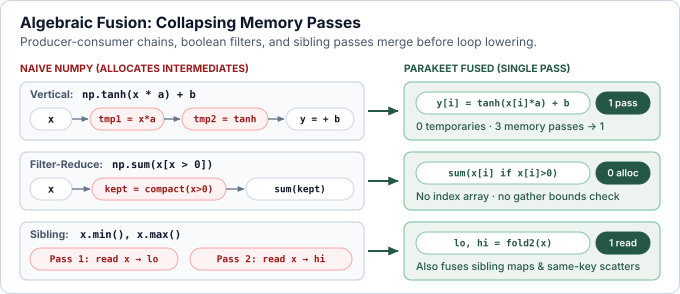
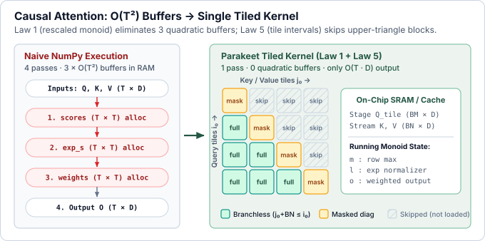
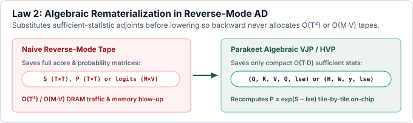

# Algebraic optimization

Parakeet does not optimize programs by matching hardcoded neural-network layer
names ("FuseAttention", "FuseLinearCrossEntropy"). Instead, every optimization
lives at the level of [coordinate-driven array operators](primitives.md) and
follows one three-stage progression:

1. **Eliminate temporaries (Fusion):** merge producer-consumer chains, boolean
   filters, and sibling traversals into single-pass loops.
2. **Stay in fast memory (Tiling):** block map-of-reduction nests into L1/L2
   cache, registers, and GPU shared memory.
3. **Break three algebraic walls (Laws 1–6):** overcome row-wide normalizations,
   chained contractions/recurrences, and masked or differentiated intermediates
   that defeat classical fusion alone.

Because these rewrites match mathematical structure rather than library APIs,
the exact same passes accelerate Gaussian kernel regression, exact 1-NN, GBDT
histograms, and IIR filters alongside causal attention, linear cross-entropy,
and state-space models.

---

## Semantic contract: real algebra vs. exact order

* **Associative rewrites** (parallel reductions, monoidal tiling, contraction
  reassociation, chunkwise scans, privatized scatter-add) assume
  real-arithmetic associativity: floating-point rounding may differ in the last
  ULP relative to a left-to-right loop, just like NumPy's pairwise summation or
  cuBLAS.
* **Order-sensitive operations** (first-index ties and NaNs in
  `argmin`/`argmax`, non-commutative `par.fold` merges, arbitrary user folds)
  preserve **exact left-to-right merge order**.

---

## Stage 1: Classical fusion (eliminating temporaries)

Before lowering operators to loops, Parakeet collapses three kinds of wasted
memory traffic:

<figure markdown="span">
  
  <figcaption><strong>Figure 1.</strong> Stage 1 fusion merges vertical producer-consumer chains, boolean filter-reductions, and sibling passes into single-pass loops with zero temporary arrays.</figcaption>
</figure>

<div class="pk-xform" markdown>
<div class="pk-xform-col pk-xform-col--before" markdown>
<div class="pk-xform-title">Naive execution <span class="pk-xform-badge">allocates intermediates</span></div>

```python
# Vertical chain: 3 passes, 2 temporaries
y = np.tanh(x * alpha) + beta

# Filter-reduce: allocates compacted array
s = np.sum(x[x > 0])

# Sibling passes: reads x (or idx) twice
lo, hi = np.min(x), np.max(x)
```
</div>
<div class="pk-xform-col pk-xform-col--after" markdown>
<div class="pk-xform-title">After Stage 1 fusion <span class="pk-xform-badge">1 pass · 0 temporaries</span></div>

```python
# Single fused parallel map
y[i] = tanh(x[i] * alpha) + beta

# Guarded reduction, zero index allocation
s = sum(x[i] for i in range(N) if x[i] > 0)

# Single-pass multi-fold (or multi-channel scatter)
lo, hi = fold2(min, max, x)
```
</div>
</div>

---

## Stage 2: Classical tiling (staying in cache and SRAM)

Fusion alone does not fix nested contractions like `C = A @ B` or min-plus
matrix products: computing `C[i, j]` reads an entire row of `A` and column of
`B`, sweeping DRAM over and over.

When an `IndexMap` wraps an `IndexReduce`, Parakeet blocks the iteration space
into an `IndexTile` with explicit `TileStage` buffers:

* **CPU:** L1/L2 cache blocking + `2×4` register jamming + target-aware
  reduction interchange (`np.sum(X, axis=0)` hoists strided inner reductions
  outside contiguous strips).
* **Apple Metal:** `threadgroup` shared-memory staging + automatic IEEE FP32
  `simdgroup_matrix` hardware tiles.
* **NVIDIA CUDA:** `__shared__` double-buffered `cp.async` staging + opt-in
  TF32 `mma.sync` Tensor Cores (`config.tensor_cores = True`).

---

## Stage 3: Breaking three walls (the six algebraic laws)

Classical fusion and tiling hit **three hard walls** on modern workloads:

<div class="pk-prim-grid" markdown>

<div class="pk-prim-card" markdown>
<div class="pk-prim-head"><strong>Wall 1: Row-wide nonlinear bottlenecks</strong></div>

Softmax (`max` + `sum(exp)`), `argmin`, and shared-bin histograms depend on a
whole row before producing outputs. **Laws 1 &amp; 6** lift the accumulator into
an associative carry state (rescaled `(m, l, o)` monoids or ordered
`(best, idx)` carries) so tiles stream in `O(1)` scratch memory.
</div>

<div class="pk-prim-card" markdown>
<div class="pk-prim-head"><strong>Wall 2: Chained contractions &amp; serial recurrences</strong></div>

Matrix chains `(U @ Vᵀ) @ Wᵀ` blow up FLOPs in the wrong order, and `for t:`
recurrences have `O(T)` serial depth. **Laws 3 &amp; 4** reassociate bilinear
contractions and fold recurrences into parallel `C = 64` chunkwise GEMMs.
</div>

<div class="pk-prim-card pk-prim-card--wide" markdown>
<div class="pk-prim-head"><strong>Wall 3: Giant backward tapes &amp; masked-out tiles</strong></div>

Reverse-mode AD naively saves `O(T²)` attention scores, and causal/window masks
waste half (or 99%) of the tiles. **Laws 2 &amp; 5** save only compact `O(T·D)`
sufficient statistics for on-chip recomputation and prune dead tiles statically
via coordinate intervals.
</div>

</div>

Below is each law paired with the exact code transformation it performs.

---

## Wall 1: Associative carry monoids (Laws 1 & 6)

### Law 1: Rescaled semiring monoids {#law-1-rescaled-semiring-monoids}

Softmax attention, linear cross-entropy, and Gaussian/RBF kernel regression all
normalize by a row-wide `max` and `sum(exp(...))` before taking a weighted
sum—naively allocating `O(N · M)` or `O(M · V)` intermediates.

Tracking the running maximum `m`, normalizing denominator `l`, and unnormalized
output `o` forms an associative monoid `(S, ⊕, e)`:

<div class="pk-eq">
m = max(m₁, m₂)<br>
(m₁, l₁, o₁) ⊕ (m₂, l₂, o₂) = (<br>
&nbsp;&nbsp;m,<br>
&nbsp;&nbsp;l₁ · exp(m₁ − m) + l₂ · exp(m₂ − m),<br>
&nbsp;&nbsp;o₁ · exp(m₁ − m) + o₂ · exp(m₂ − m)<br>
)
</div>

Because `⊕` is associative, tiles reduce in cache or GPU shared memory and
merge in any grouping with zero score-matrix allocation:

<figure markdown="span">
  
  <figcaption><strong>Figure 2.</strong> Law 1 + Law 5: naive causal attention allocates three O(T²) buffers, while Parakeet streams (m, l, o) tiles on-chip and skips upper-triangular blocks before loading K or V.</figcaption>
</figure>

**Triggered automatically by `monoidal tiling` on:**

* **Softmax attention (`flash_monoid`):** streams `K, V` tiles against `Q` with
  zero `S`/`P` allocation (and splits `T_kv` across threadblocks for short-query
  `split_k` decode).
* **Linear cross-entropy (`monoid_lse`):** tiles `H @ W` over vocabulary `V`
  using the scalar `(m, l)` monoid, eliminating the `M × V` logit tensor.
* **Gaussian / RBF kernel regression (`score_op="sqdist"`):** fuses
  `-γ · ‖xᵢ − yⱼ‖²` into the exact same streaming kernel.

### Law 6: Privatized scatter & ordered multi-state carries {#law-6-privatized-scatter-ordered-multi-state-carries}

Two core patterns sit outside standard dense linear algebra:

* **Ordered pairwise tile folds (`pairwise fold tiling`):** `Fold.carries`
  tracks multiple scalar fields `(min_dist, idx)` or `(weight_sum, value_sum)`
  across L1/SRAM score tiles merged strictly left-to-right—eliminating
  `O(Q · R)` distance matrices in exact 1-NN and inverse-distance smoothing
  while preserving NumPy's exact first-index rule on ties and NaNs.
* **Keyed histogram fusion (`IndexScatter`):** sibling `par.scatter_add`,
  `np.add.at`, inverted `[np.sum(v[idx == b]) for b in range(n)]`, or
  `for i: h[idx[i]] += v[i]` loops sharing an index array merge into one
  thread-privatized CPU pass or atomic GPU pass (e.g. GBDT grad/Hessian
  histograms and 6-channel BAM pileups).

<figure markdown="span">
  
  <figcaption><strong>Figure 3.</strong> Law 6: exact 1-NN streams 16×128 score tiles in 8 KiB L1 / 16 KiB SRAM and merges (min_dist, idx) carries in strict left-to-right order.</figcaption>
</figure>

---

## Wall 2: Reassociation & chunkwise duality (Laws 3 & 4)

### Law 3: Bilinear contraction reassociation & shared-KV tiling {#law-3-bilinear-contraction-reassociation-shared-kv-tiling}

Chaining two bilinear contractions (`(U @ Vᵀ) @ Wᵀ`, such as latent attention
`K = C_kv @ W_uk`, `V = C_kv @ W_uv`) can cost orders of magnitude more FLOPs
and memory in the wrong parenthesization:

<div class="pk-eq">
For A: (M, K), B: (K, R), C: (R, P): &nbsp;&nbsp;(A · B) · C  =  A · (B · C) &nbsp;&nbsp;— pick min( M·R·(K + P),  K·P·(M + R) ) FLOPs
</div>

<div class="pk-xform" markdown>
<div class="pk-xform-col pk-xform-col--before" markdown>
<div class="pk-xform-title">Expanded (prefill optimal) <span class="pk-xform-badge">materializes K, V</span></div>

```python
K = C_kv @ W_uk
V = C_kv @ W_uv
O = softmax(Q @ K.T) @ V
```
</div>
<div class="pk-xform-col pk-xform-col--after" markdown>
<div class="pk-xform-title">Absorbed (decode optimal) <span class="pk-xform-badge">stays in latent C_kv</span></div>

```python
Q_abs = Q @ W_uk.T  # absorb W_uk into Q
O = (softmax(Q_abs @ C_kv.T) @ C_kv) @ W_uv
```
</div>
</div>

`contraction reassociation` emits a runtime shape-guarded branch so short-query
decode runs tiled Law 1 attention directly over compressed `C_kv`, while
long-query prefill takes the lower-FLOP expanded branch. For grouped-query
attention (GQA), the head-group axis `G` folds into the query tile so all `G`
query heads share one SRAM load of `K` and `V`.

### Law 4: Chunkwise state-space duality {#law-4-chunkwise-state-space-duality}

Plain Python recurrences (`for t in range(T): s = a[t] * s + b[t]`) have `O(T)`
serial depth. Because affine maps compose associatively,
`(a₂, b₂) ∘ (a₁, b₁) = (a₂ · a₁, a₂ · b₁ + b₂)`, `chunkwise scan` partitions
time into chunks of `C = 64` and turns both scalar affine loops (EMA, IIR,
Kalman) and bilinear matrix-state loops (Mamba-2) into division-free parallel
scans and GEMMs:

<figure markdown="span">
  
  <figcaption><strong>Figure 4.</strong> Law 4: chunkwise state-space duality splits an O(T) serial recurrence into parallel intra-chunk matmuls, a 64× shorter inter-chunk scan, and parallel state readout.</figcaption>
</figure>

<div class="pk-xform" markdown>
<div class="pk-xform-col pk-xform-col--before" markdown>
<div class="pk-xform-title">What you write <span class="pk-xform-badge">O(T) serial depth</span></div>

```python
for t in range(T):
  S = a[t] * S + k[t][:, None] * v[t][None, :]
  out[t] = q[t] @ S
```
</div>
<div class="pk-xform-col pk-xform-col--after" markdown>
<div class="pk-xform-title">Compiled schedule (C = 64) <span class="pk-xform-badge">64× shorter scan + GEMMs</span></div>

```python
L, A = chunk_decay_products(a, C=64)  # parallel, zero-safe
Y_intra = ((Q_c @ K_c.T) * L) @ V_c  # parallel over chunks
B_c = K_scaled.T @ V_c  # parallel chunk summaries
S_in = scan_affine(A, B_c)  # 64× shorter recurrence
out = Y_intra + (Q_c @ S_in)  # parallel readout
```
</div>
</div>

Because `chunkwise scan` runs before Stage 2 tiling, the chunk GEMMs flow
directly into CPU register tiles, Metal `simdgroup_matrix`, and CUDA TF32
Tensor Cores.

---

## Wall 3: Structure-preserving shortcuts (Laws 2 & 5)

### Law 2: Algebraic rematerialization in reverse-mode AD {#law-2-algebraic-rematerialization-in-reverse-mode-ad}

A naive reverse-mode tape saves every forward intermediate, bringing back
`O(T²)` memory for attention and `O(M · V)` memory for cross-entropy. Before
loop lowering, `algebraic_vjp` substitutes sufficient-statistic adjoints that
save only `O(T · D)` tensors and recompute score tiles on-chip during
backpropagation:

<figure markdown="span">
  
  <figcaption><strong>Figure 5.</strong> Law 2: algebraic rematerialization replaces O(T²) attention tapes and O(M·V) logit tapes with O(T·D) sufficient statistics, recomputing score tiles on-chip during backpropagation.</figcaption>
</figure>

* **Attention backward (`flash_monoid_bwd`):** saves `(Q, K, V, O, lse)`,
  recomputes `P = exp(S − lse)` and `dS = P · (dO @ Vᵀ − D)` tile-by-tile, and
  composes with forward-over-reverse `par.hvp`.
* **Cross-entropy backward (`cce_bwd`):** saves `(H, W, targets, lse)` and
  recomputes `p[i, v] = exp(hᵢ · wᵥ − lseᵢ)` on-chip.
* **LayerNorm / RMSNorm & softmax VJPs:** collapse multi-pass backward graphs
  into one pass (`dS = P · (dP − ∑ P · dP)`, dropping the `max` adjoint).

### Law 5: Affine tile-interval mask pruning {#law-5-affine-tile-interval-mask-pruning}

Causal masks (`j <= i`), sliding windows (`i - j <= W`), and banded matrices
evaluate millions of entries that are immediately discarded. `TileInterval`
propagates each tile's coordinate box `[i₀, i₀ + Bₘ − 1] × [j₀, j₀ + Bₙ − 1]`
through affine index predicates to classify every tile before loading data:

<div class="pk-xform" markdown>
<div class="pk-xform-col pk-xform-col--before" markdown>
<div class="pk-xform-title">Causal predicate on tile (i₀, j₀) <span class="pk-xform-badge">naive: check every element</span></div>

```python
# Naive: loads K, V for every (i0, j0) tile
# and evaluates (i >= j) inside the inner loop.
for j0 in range(0, T, BN):
  load(K[j0 : j0 + BN], V[j0 : j0 + BN])
  score = dot(Q, K) if i >= j else -1e9
```
</div>
<div class="pk-xform-col pk-xform-col--after" markdown>
<div class="pk-xform-title">TileInterval classification <span class="pk-xform-badge">skip empty · branchless interior</span></div>

```python
for j0 in range(0, T, BN):
  if j0 > i0 + BM - 1:  # always false -> skip tile
    continue
  load(K[j0 : j0 + BN], V[j0 : j0 + BN])
  if j0 + BN - 1 <= i0:  # always true  -> branchless inner loop
    accumulate_branchless(Q, K, V)
  else:  # diagonal tile -> per-element mask
    accumulate_masked(Q, K, V)
```
</div>
</div>

Sliding-window masks (`(j <= i) & (i - j <= W)`) drop automatically from
`O(N²)` to `O(N · W)` work. For runtime boolean mask arrays, GPU threadblocks
cooperatively check whether any entry in the tile is true and skip empty tiles
before loading values.

---

**Next:** [Rewrite rules & thesis lineage](rewrites.md) gives the exact pass-by-pass
reference and shows how Parakeet 1.x evolved from the 2013–2014 NYU theses. See
the [Kernel gallery](gallery.md) for runnable examples of every law.
