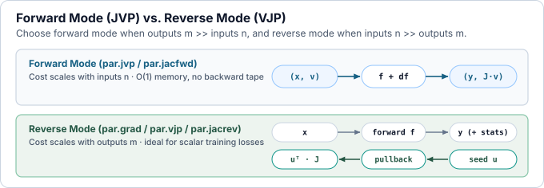

# Automatic differentiation

Parakeet differentiates functions directly at the operator level, so derivatives
go through the same fusion, cache/GPU tiling, and parallel code generation as
the forward pass.

## Forward mode vs. reverse mode

For a function `f: Rⁿ → Rᵐ` with Jacobian `J` (shape `m × n`), choose the mode
that matches your input/output shape:

* **Reverse mode (`par.grad`, `par.vjp`, `par.jacrev`)** computes a
  vector-Jacobian product `uᵀ · J` in cost proportional to **outputs `m`**. Use
  it when `n ≫ m` (scalar training losses, inverse problems).
* **Forward mode (`par.jvp`, `par.jacfwd`)** computes a Jacobian-vector product
  `J · v` in cost proportional to **inputs `n`** with **`O(1)` extra memory**
  and no backward tape—even through long loops. Use it when `m ≫ n`, for
  directional derivatives, or inside forward-over-reverse `par.hvp`.

<figure markdown="span">
  
  <figcaption><strong>Figure 1.</strong> Forward-mode JVP propagates tangents in one O(1)-memory pass (best when outputs m &gt;&gt; inputs n); reverse-mode VJP pulls cotangents back from scalar losses (best when inputs n &gt;&gt; outputs m).</figcaption>
</figure>

The two modes are exact linear transposes of one another for any input `x`,
tangent `v`, and cotangent `u`:

<div class="pk-eq">
⟨ jvp(f, x, v), u ⟩  =  ⟨ v, vjp(f, x)(u) ⟩
</div>

## API overview

| API | Mode | What it computes |
|---|---|---|
| `par.grad(f, wrt=0)` | Reverse | Gradient of a scalar loss by position (`0`) or parameter name (`"w"`) |
| `par.value_and_grad(f, wrt=0)` | Reverse | Forward scalar value and gradient in one compiled call |
| `par.vjp(f, *primals)` | Reverse | `(y, pullback)` for array, tuple, record, or `RaggedArray` outputs |
| `par.jvp(f, primals, tangents)` | Forward | Directional derivative `(f(*primals), J · tangents)` in one forward pass |
| `par.linearize(f, *primals)` | Forward | Forward value `y` plus reusable linear map `v -> J · v` |
| `par.linear_transpose(L, *example_inputs)` | Transpose | Exact linear adjoint `u -> Lᵀ(u)` of a linear function `L` |
| `par.hvp(f, primals, tangents)` | Fwd-over-rev | Hessian-vector product `H(x) · v` |
| `par.jacfwd(f)` / `par.jacrev(f)` | Fwd / Rev | Full Jacobian (`jacfwd` for `n ≤ m`, `jacrev` for `m < n`) |
| `par.hessian(f, argnum=0)` | Fwd-over-rev | Full Hessian matrix |
| `@par.checkpoint` | Memory | Recompute a block during backprop instead of saving intermediates |
| `@par.jit(jvp=..., vjp=...)` | Custom | Attach flat forward or closure-style reverse rules directly |
| `@par.jvp_for(fn)` / `@par.vjp_for(fn)` | Custom | Register custom rules on an existing function |

## Reverse-mode gradients (`grad` and `value_and_grad`)

```python
import numpy as np
import parakeet as par


def loss(w, b, x, y):
  return np.mean((np.tanh(x @ w + b) - y) ** 2)


g = par.grad(loss)(w, b, x, y)  # d loss / d w
value, g = par.value_and_grad(loss, wrt="w")(w, b, x, y)  # by parameter name
gw, gb = par.grad(loss, wrt=("w", "b"))(x=x, y=y, w=w, b=b)  # keyword args work too
```

Differentiated arguments may be floats, float/complex arrays, `RaggedArray`s, or
nested tuples, `NamedTuple`s, fixed-key dicts, and `@dataclass` records
(discrete fields like `int`, `bool`, or `str` pass through as zero-tangent
leaves):

```python
def mlp(params, x, y):
  (w1, b1), (w2, b2) = params
  h = np.tanh(x @ w1 + b1)
  return np.mean((h @ w2 + b2 - y) ** 2)


(gw1, gb1), (gw2, gb2) = par.grad(mlp)(params, x, y)
```

Calling `par.grad` inside `@par.jit` compiles the entire training loop into one
native function (see [Train nanoGPT](gallery/nanogpt.md) and
[`examples/convnet.py`](https://github.com/iskandr/parakeet/blob/master/examples/convnet.py)):

```python
@par.jit
def descend(w, x, y, rate, steps):
  for _ in range(steps):
    w = w - rate * par.grad(loss)(w, x, y)
  return w
```

## Forward mode (`jvp`), general `vjp`, and higher-order AD

```python
def f(x, w):
  z = np.tanh(x @ w)
  return z, np.sum(z * z, axis=1)


# Forward-mode JVP (O(1) extra memory, single forward pass)
(y1, y2), (dy1, dy2) = par.jvp(f, (x, w), (vx, vw))

# General non-scalar VJP
(y1, y2), pullback = par.vjp(f, x, w)
gx, gw = pullback((u1, u2))
```

`par.hvp` computes Hessian-vector products via **forward-over-reverse**
(`jvp(grad(f))`) in one fused pass—including through checkpointed loops,
LayerNorm, and tiled attention (recomputing score tiles on the fly without
allocating `T × T` matrices):

```python
def objective(w, x):
  h = np.tanh(x @ w)
  return np.sum(h * h * h)


hv = par.hvp(lambda w_: objective(w_, x), w, v)  # H(w) · v
H = par.hessian(lambda w_: objective(w_, x))(w)  # full Hessian
J_fwd = par.jacfwd(lambda w_: np.tanh(x @ w_))(w)
J_rev = par.jacrev(lambda w_: np.tanh(x @ w_))(w)
```

Nested reverse-over-reverse (`par.grad(par.grad(...))`) also works through
element-wise ops, reductions, matmuls, views, `stack`/`concatenate`, `cumsum`,
gather/scatter-add, and scalar `par.map`.

## Supported operations

| Category | Supported operations |
|---|---|
| Arithmetic & math | `+ - * / **`, `exp`, `tanh`, `maximum`, `where`, `abs`, `clip`, … with broadcasting (ties in `min`/`max`/`abs`/`topk` split derivatives equally) |
| Reductions | `sum`, `mean`, `var`, `std`, `max`, `min`, `prod` (zero-safe), `linalg.norm`, `par.reduce` (including arbitrary user folds) |
| Linear algebra | `@`, `dot`, `matmul` (vectors, matrices, batches), `einsum`; `linalg.det`, `inv`, `solve`, `cholesky` (rev + fwd), `eigh`, `eigvalsh`, `svd`, `pinv` (rev) |
| Scans, sort & select | `cumsum`, `par.scan`, `sort`, `par.topk`, `par.topk_fold` |
| Views, gather & scatter | Slicing, `.T`, `reshape`, `transpose`, gather `x[idx]`, `FrozenHashTable.get`, `SortedIndex.get`, `np.add.at`, `out[idx[i]] += v`, `par.scatter_add` |
| Array building & operators | `concatenate`, `stack`, comprehensions, `par.map`, `par.allpairs`, `par.imap`, `par.fold`, `par.wavefront`, `par.soft_align` |
| Containers | Nested tuples, `NamedTuple`, fixed string-key dicts, `@dataclass`, `RaggedArray` |

## Loops and branches

| Construct | Reverse-mode strategy | Forward-mode strategy |
|---|---|---|
| Small static `for` (`≤ 32` iters or heterogeneous tuple) | Unrolled onto tape (zero checkpoint cost) | Unrolled in single forward pass |
| Long or runtime-bound `for` (`range(n)`, 10k+ iters) | `O(√T)` checkpointed reverse loop (constant IR size) | Single forward pass, `O(1)` memory |
| Data-dependent `while` loop | Fixed-slot stride-doubling checkpointed reverse (`O(log T)` slots) | Single forward pass, `O(1)` memory |
| Custom `par.reduce` / 1-D `par.scan` | `O(√N)` checkpointed reverse / direct reverse scan | Single forward pass |
| Runtime `if` / `else` | Evaluates both pure branches and selects (guard-only `raise` skips unselected side) | Selects tangent alongside value |

Loops not touching differentiated state are left untouched. Loops with `break`,
`continue`, or early `return` over differentiated state—and runtime `if`
branches containing array stores, `return`, `break`, or `raise`—fail loudly at
compile time.

## Custom rules, `stop_gradient`, and `checkpoint`

* **`@par.jit(jvp=..., vjp=...)`** attaches custom rules with plain flat
  signatures:
  - `jvp(*primals, *tangents) -> (output, d_output)`
  - `vjp(*primals) -> (output, pullback)` where `pullback(d_output) -> d_inputs`
    (or pass a `(fwd, bwd)` tuple for explicit residuals)

  ```python
  def smooth_relu_jvp(x, dx):
    return np.maximum(x, 0.0), dx / (1.0 + np.exp(-x))


  def smooth_relu_vjp(x):
    return np.maximum(x, 0.0), lambda dy: dy / (1.0 + np.exp(-x))


  @par.jit(jvp=smooth_relu_jvp, vjp=smooth_relu_vjp)
  def smooth_relu(x):
    return np.maximum(x, 0.0)
  ```

* **`@par.jvp_for(fn)` / `@par.vjp_for(fn)`** register rules on an existing
  function (JAX-style `@par.custom_jvp` / `@par.custom_vjp` remain as aliases).
* **`par.stop_gradient(x)`** detaches any scalar, array, record, or
  `RaggedArray` from both forward and reverse AD with zero copy.
* **`@par.checkpoint`** discards forward intermediates for a block and
  rematerializes them during backprop, composing automatically with
  [Law 2 algebraic rematerialization](algebra.md#law-2-algebraic-rematerialization-in-reverse-mode-ad)
  for attention, linear cross-entropy, softmax, and LayerNorm / RMSNorm.

## In-place stores and fail-loud guarantees

Slice assignments, indexed updates, and in-place additions (`out[:3] = ...`,
`out += bias`, `np.add.at`) are differentiated accurately. Overwriting a buffer
that an earlier backward rule still requires (`y = np.tanh(h); h[0] = 5.0`) is
detected and refused at compile time.

Parakeet never silently drops gradients. Any unsupported operation on the
differentiated path (such as `np.cumprod`, `np.convolve`, or arbitrary indexed
overwrites `out[idx] = v`) raises an `UnsupportedError` naming the line:

```text
UnsupportedError: cannot differentiate through cumprod() (line 12): its derivative is not implemented
```

Implementation modules:
[`autodiff.py`](https://github.com/iskandr/parakeet/blob/master/parakeet/transforms/autodiff.py),
[`jvp.py`](https://github.com/iskandr/parakeet/blob/master/parakeet/transforms/jvp.py),
[`algebraic_vjp.py`](https://github.com/iskandr/parakeet/blob/master/parakeet/transforms/algebraic_vjp.py).
