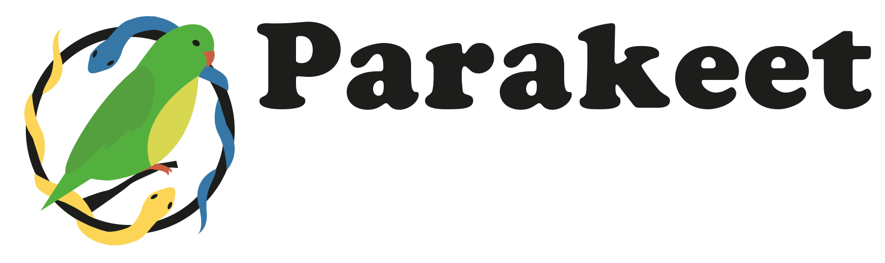

<div class="pk-intro" markdown>
<div class="pk-identity" markdown>

# { .pk-wordmark width="1746" height="520" }

<p class="pk-lead">A data-parallel compiler for numerical Python.</p>

Write ordinary NumPy, loops, comprehensions, or explicit data-parallel
operators (`map`, `reduce`, `scan`, `allpairs`). Parakeet specializes your
function for its input types, fuses and tiles the array algebra, and compiles
native code for multi-core CPUs, Apple Metal, and NVIDIA CUDA.

[Get started](quickstart.md){ .md-button .md-button--primary }
[Explore the gallery](gallery.md){ .md-button }

</div>
<div class="pk-example" markdown>

## Exact nearest neighbor

```python
import numpy as np
import parakeet as par


@par.jit
def nearest(x, y):
  delta = x[:, None, :] - y[None, :, :]
  d2 = np.sum(delta ** np.float32(2), axis=2)
  return np.argmin(d2, axis=1)
```

Parakeet computes distances a tile at a time on both CPU and GPU, keeping only
the winning reference index per tile rather than allocating the full `N × M`
distance matrix. Ties preserve NumPy's first-index rule.

[Compare timings, scaling, and memory](release-benchmarks.md#at-a-glance-nvidia-l4-4-thread-cpu)

</div>
</div>

## Install

```bash
python -m pip install parakeet
```

Requires Python 3.11+, NumPy 2, and a system C compiler. For GPU backends,
install `parakeet[metal]` on Apple Silicon or `parakeet[cuda12]` with an NVIDIA
GPU.

## Algebraic primitives

Rather than building hundreds of one-off C or GPU kernels for individual NumPy
functions, Parakeet lowers array expressions, comprehensions, matrix products,
and explicit parallel operators onto a small set of composable array
primitives:

| Primitive | What it expresses | Examples in Python / NumPy |
|---|---|---|
| **Map (`IndexMap`)** | Independent per-element computation over an N-D index space | Element-wise NumPy, broadcasting, comprehensions, `par.map`, `par.allpairs` |
| **Reduce / Fold (`IndexReduce`)** | Associative or ordered reductions, including multi-field carries | `np.sum`, `np.argmin`, `logsumexp`, Welford variance, `par.fold` |
| **Scan (`IndexScan`)** | Prefix accumulations and associative recurrences | `np.cumsum`, `par.scan`, affine/bilinear `for` loops (IIR filters, SSMs) |
| **Filter & Expand (`IndexFilter`, `IndexExpand`)** | Stream compaction (1-to-0/1) and ragged expansion (1-to-K) | Boolean masking `x[x > 0]`, `par.flatmap`, `par.filter_pairs` |
| **Scatter (`IndexScatter`)** | Associative accumulation into shared bins | `np.bincount`, `np.add.at`, indexed `+=` loops, `par.scatter_add` |
| **Wavefront (`IndexWavefront`)** | Anti-diagonal and banded 2D dynamic programming | `par.wavefront`, `par.soft_align` |
| **Tile (`IndexTile`)** | Cache and GPU shared-memory staging emitted by the middle end | Matrix products, `einsum`, tiled pairwise folds, online softmax / attention |

```python
@par.jit
def scaled_tanh_numpy(x, alpha=0.5, beta=0.3):
  return np.tanh(x * alpha) + beta


@par.jit
def scaled_tanh_comp(x, alpha=0.5, beta=0.3):
  return np.array([np.tanh(xi * alpha) + beta for xi in x])
```

Both versions lower to the same single fused parallel loop with no temporary
arrays. Because programs stay in this operator representation until code
generation, a small set of general passes does the optimization work across
domains:

- **Fusion.** Producer-consumer chains, filtered reductions (`np.sum(x[x > 0])`),
  and sibling histograms sharing the same bin IDs merge into one traversal.
  [See the tree-split example](gallery.md#histograms-and-tree-splits).
- **Tiling and single-pass reductions.** Associative reductions and bilinear
  products tile into CPU cache or GPU shared memory, so Gaussian kernel
  regression, nearest-neighbor search, and attention stream blocks instead of
  allocating giant pairwise matrices. [Read the algebraic laws](algebra.md).
- **Differentiation.** `par.grad`, `par.value_and_grad`, and `par.jvp`
  differentiate the primitives directly, compiling a full training step into
  one native function. [Learn about gradients](autodiff.md).
- **Inspection.** Every stage is visible: inspect the operator IR, see which
  rewrites fired with `par.show_rewrite`, or read the generated C, Metal, or
  CUDA source. [Inspect a rewrite](gallery.md#inspecting-algebraic-rewrites).

## Where to go next

- **New to Parakeet?** Start with [Getting started](quickstart.md): five
  minutes from `pip install` to your first compiled function and generated C.
- **Learn by example:** Browse the [Kernel gallery](gallery.md) for runnable
  NumPy and data-parallel kernels, or check the [Release benchmarks](release-benchmarks.md).
- **Go deeper:** Read [Ideas, history, and boundaries](philosophy.md) for the
  design principles, project history, and what Parakeet does and does not
  support.
