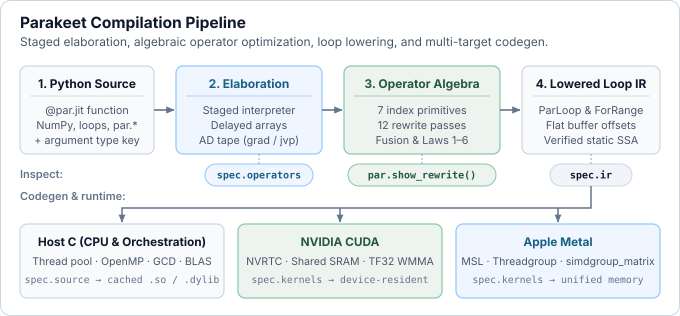

# Compiler architecture

Parakeet compiles a decorated Python function through four clean stages:
**elaboration**, **algebraic optimization**, **loop lowering**, and
**multi-target codegen**.



## 1. Specialization

Calling a `@par.jit` function classifies its arguments—array dtype, rank,
contiguity/layout, scalar types, container structure, and callable identity—into
a **type key**. Each distinct key compiles to one cached native specialization.
Globals and closed-over variables are classified the same way on every call and
passed as hidden arguments so compiled code never reads stale values.

When a tiled or GPU kernel queries shape divisibility or bucket bounds (for
example, aligned 16-byte vector loads or tile multiples), Parakeet guards only
those queried dimensions via a finite power-of-2 lattice (`DimInfo(lo, hi, align)`),
so aligned sizes like `128, 256, 512, 1024, 4096` share one fast-path binary.

## 2. Elaboration

The frontend (`parakeet/frontend/`) is a **staged interpreter** that walks the
Python AST with compile-time values and emits IR only for runtime work:

* **Scalars** become typed SSA expressions.
* **Compile-time structures** (tuples, `NamedTuple`s, fixed-key dicts,
  `@dataclass`es, slices, functions, dtypes) dissolve completely—helper calls
  inline with zero Python frame or object overhead.
* **Arrays** are either *concrete* (buffer pointer, offset, shape, strides—so
  views are pure integer arithmetic) or *delayed* (an index-to-value function
  that fuses into its consumer before any middle-end pass runs).

Three events trigger an automatic elaboration restart with refined information:

1. **Loop type promotion:** a loop-carried variable widens (`x = 0` then
   `x += 0.5` restarts with `x: float64`).
2. **Eager materialization:** an expensive delayed array is read more than once,
   read inside a loop, or invalidated by an aliasing store.
3. **Value specialization:** a compile-time parameter (`axis=`, `keepdims=`,
   tuple length, or size-1 broadcast axis) is needed from a function argument.

**Automatic differentiation** (`autodiff.py`, `jvp.py`, `algebraic_vjp.py`)
runs during elaboration: forward mode propagates symbolic tangents alongside
primals, while reverse mode records operators on an algebraic tape, applies
[Law 2 rematerialization](algebra.md#law-2-algebraic-rematerialization-in-reverse-mode-ad),
and emits adjoint operators back into the same pipeline.

## 3. Middle-end passes

`parakeet/transforms/pipeline.py` runs **12 passes** over the operator IR in
order (`parakeet.transforms.pipeline.names()`). When `config.verify` is enabled,
`parakeet.verify` checks types, scoping, and buffer ownership after every pass;
individual passes can be disabled via `config.skip_transforms`.

| # | Pass | Module | Responsibility |
|---:|---|---|---|
| 1 | `dead code` | `simplify.py` | Drop pure unused operators and allocations to a fixed point |
| 2 | `normalize` | `normalize.py` | Squeeze unit `keepdims` map axes and hoist row-invariant inner reductions |
| 3 | `vertical fusion` | `fusion.py` | Fuse `Map→Map` (incl. affine views/epilogues), `Scan→Map`, `Map→Reduce/Filter/Scatter`, and flatten nested maps |
| 4 | `filter fusion` | `fusion.py` | Merge adjacent `IndexFilter`s and fold `Filter→Reduce` into zero-alloc guarded `IndexReduce` |
| 5 | `sibling fusion` | `fusion.py` | Merge sibling reductions, maps (plus CUDA disjoint-union batching), same-key scatters, and online `logsumexp` |
| 6 | `contraction reassociation` | `reassociate.py` | Reorder chained bilinear contractions by FLOP cost (incl. MLA absorption) |
| 7 | `monoidal tiling` | `monoid_tile.py` | Tile rescaled semiring reductions (attention, Split-K, CCE, RBF) with Law 5 tile-interval mask pruning |
| 8 | `row pipeline fusion` | `fusion.py` | Collapse multi-stage per-row reduction + normalization chains (LayerNorm / RMSNorm) into single-pass GPU warp pipelines |
| 9 | `chunkwise scan` | `tile_scan.py` | Rewrite affine and bilinear matrix-state `for` loops into parallel chunkwise scans |
| 10 | `pairwise fold tiling` | `pairwise_fold.py` | Fuse pairwise score producers into ordered CPU/GPU tile-summary folds (e.g. 1-NN) |
| 11 | `reduction interchange` | `tiling.py` | Hoist strided associative inner reductions outside L1 strips on CPU (`PermuteReductions`) |
| 12 | `tiling` | `tiling.py` | Emit cache/register tiles on CPU, shared-memory / matrix-unit tiles on CUDA & Metal, and single-pass CUDA atomic reductions |

After these 12 passes, **lowering** (`lowering.py`) turns all operator
statements into scalar `ForRange` loops and the single parallel loop construct,
`ParLoop`.

## 4. Lowered IR (`spec.operators` and `spec.ir`) {#lowered-ir}

Underneath the algebraic passes lies a typed, explicit-offset SSA IR with
scoped static memory management (buffers free on scope exit; refcounting is
used only when a buffer escapes).

Inspect both the pre-pass operator IR and post-lowering loop IR on any
`@par.jit` function:

```python
import numpy as np
import parakeet as par


@par.jit
def rms(x):
  return np.sqrt(np.mean(x * x))


spec = rms.specialize(np.ones(1024, dtype=np.float64))
print(spec.operators)  # operator IR before the 12 middle-end passes
print(spec.ir)  # lowered loop IR after all passes + lowering
```

Example lowered IR for `rms(x)`:

```text
def rms(x_1: array[float64, 1d]):
    nchunks_9: int64? = @num_chunks(x_n0_3, True)
    partials_10 = alloc(float64, nchunks_9)
    parallel[reduce] for chunk_11, (start_12, stop_13) in chunks(x_n0_3, n=nchunks_9):
        x_15: float64 = (x_1[(x_off_2 + start_12)] * x_1[(x_off_2 + start_12)])
        acc_14: float64 = x_15
        for i_16 in range((start_12 + 1), stop_13, 1):  # simd
            x_17: float64 = (x_1[(x_off_2 + i_16)] * x_1[(x_off_2 + i_16)])
            acc_14: float64 = (acc_14 + x_17)
        partials_10[chunk_11] = acc_14
    acc_8: float64 = 0.0
    for i_18 in range(0, nchunks_9, 1):
        acc_8: float64 = (acc_8 + partials_10[i_18])
    res_20: float64 = sqrt((acc_8 / float64(x_n0_3)))
    return res_20
```

To trace every pass that modifies a function, pass a callback to `trace_passes`:

```python
from parakeet.syntax import ir

prev = None


def on_pass(stage, fn):
  global prev
  text = ir.fmt_function(fn)
  if text != prev:
    print(f"=== {stage} ===\n{text}")
    prev = text


rms.trace_passes(np.ones(1024), _trace=on_pass)
```

## 5. Backends and calling convention

All targets share one C-family scalar emitter (`backends/cfamily.py`) and one
set of scalar math helpers (NumPy floor division/modulo, NaN-propagating
min/max, RNG) so CPU, Metal, and CUDA agree bit-for-bit on integer results.

* **Host C (`backends/c.py`):** outlines each `ParLoop` into a function taking
  a context struct (alpha-identical bodies deduplicate) and dispatches through a
  runtime function pointer (thread pool, OpenMP, GCD, or sequential), so one
  compiled library serves every CPU backend.
* **GPU kernels (`backends/metal.py`, `cuda.py`, `tiled_gpu.py`, `monoidal_gpu.py`):**
  eligible `ParLoop`s and tiled plans emit MSL or CUDA kernels. On CUDA,
  alpha-canonical kernel deduplication collapses structurally identical kernels
  across repeated layers (such as transformer blocks) into one NVRTC compile.
  Arrays remain device-resident across consecutive GPU kernels and across calls
  via `par.to_device`.
* **Calling convention:** entry points receive flat 64-bit slots (scalars, plus
  pointer, offset, shape, and strides per array). Newly allocated outputs wrap
  into NumPy arrays without copying using a finalizer that releases the native
  buffer; returned input views alias caller memory directly.

---

**Next:** [Design, boundaries, and history](philosophy.md) summarizes the core
design principles, current compiler limits, and Parakeet's academic lineage.
