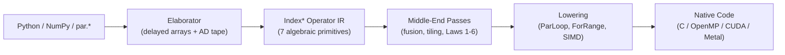
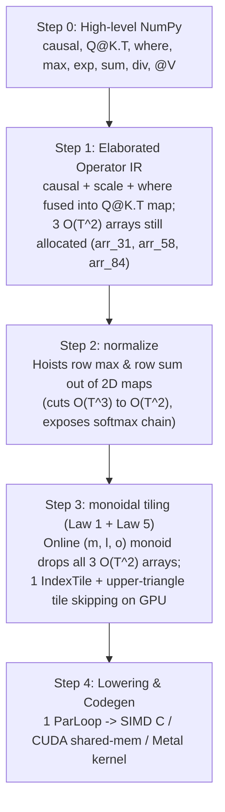

# Algebraic primitives & compilation walkthrough

When you write NumPy code, Python comprehensions, or `par.*` operators inside
`@par.jit`, Parakeet does not dispatch to a catalog of hand-written C or CUDA
kernels. Instead, it lowers your program onto **seven composable index-space
operators**, rewrites them with general algebraic passes, and lowers the result
into parallel loops for CPU threads, Apple Metal, or NVIDIA CUDA.



## Python API vs. internal `Index*` IR

A common source of confusion when reading compiler IR is the `Index` prefix
(`IndexMap`, `IndexReduce`, `IndexScan`, ...). The rule is simple:

* **What you write in Python** operates on *values and arrays*: standard NumPy
  (`np.sum`, `np.cumsum`, `x[x > 0]`, `a @ b`) or Parakeet's data-parallel
  operators (`par.map`, `par.reduce`, `par.fold`, `par.scan`, `par.flatmap`,
  `par.scatter_add`, `par.wavefront`).
* **What the compiler builds internally** operates on *N-D index spaces*
  `(0..N₀-1, 0..N₁-1, ...)` so that arrays of different shapes, slices,
  broadcasts, and transposed views all share one uniform representation. Every
  internal IR operator carries the `Index` prefix to mark that it iterates over
  an explicit coordinate tuple rather than an opaque array object.

| What you write in Python | What it lowers to in the IR | Why |
|---|---|---|
| `np.tanh(x) + 1`, `[f(xi) for xi in x]`, `par.map`, `par.imap`, `par.allpairs` | [`IndexMap`](#map) | Independent per-coordinate computation |
| `np.sum`, `np.argmin`, `par.reduce`, `par.fold`, `par.ireduce` | [`IndexReduce`](#reduce-and-fold) | Associative or ordered fold (with optional multi-field carries) |
| `np.cumsum`, `par.scan`, affine/bilinear `for` loops | [`IndexScan`](#scan) | Running prefix accumulation or associative recurrence |
| `x[x > 0]`, `par.filter`, `par.flatmap`, `par.filter_pairs` | [`IndexFilter` / `IndexExpand`](#filter-and-expand) | Stream compaction (1-to-0/1) and ragged expansion (1-to-K) |
| `np.bincount`, `np.add.at`, `out[idx[i]] += v`, `par.scatter_add` | [`IndexScatter`](#scatter) | Associative accumulation into shared bins |
| `par.wavefront`, `par.soft_align` | [`IndexWavefront`](#wavefront) | Anti-diagonal and banded 2D dynamic programming |
| Emitted by the optimizer for matmul, `einsum`, attention, 1-NN | [`IndexTile`](#tile) | Cache, register, and GPU shared-memory staging |

---

## The seven primitives

### Map (`IndexMap`) {#map}

**What it expresses:** Independent evaluation of a pure body at every coordinate
`(i₀, i₁, ...)` of an N-D index space, writing into one or more output arrays.

**What you write:** Element-wise NumPy expressions, broadcasting, array
comprehensions, `par.map`, `par.allpairs`, or `par.imap`.

```python
# All three lower to the same single IndexMap:
y = np.tanh(x * 0.5) + 0.3
y = np.array([np.tanh(xi * 0.5) + 0.3 for xi in x])
y = par.imap(lambda i: np.tanh(x[i] * 0.5) + 0.3, x.shape)
```

**In the operator IR:**

```text
map i_4 over (x_n0_3):
    arr_5[i_4] = (tanh((x_1[i_4] * 0.5)) + 0.3)
```

**Rewrites that fire on it:** Vertical producer-consumer fusion (both during
elaboration via delayed arrays and in `vertical fusion`), sibling fusion
(`sin(x), cos(x)` share one loop), nested map flattening, and affine
coordinate inversion for slices and transposes. See
[Fusion rules](rewrites.md#fusion).

---

### Reduce and Fold (`IndexReduce`) {#reduce-and-fold}

**What it expresses:** Combining values across a reduction index space into one
or more scalar accumulators.

**Clearing up `par.reduce` vs. `par.fold` vs. `par.ireduce`:**

* **`np.sum` / `np.max` / `np.argmin` / `par.reduce(op, x)`** reduce a single
  value with a binary combiner (`np.add`, `np.maximum`, or a custom function).
* **`par.fold(lift, merge, x, init)`** reduces structured multi-field state
  (such as `(best_val, best_idx)` or Welford `(count, mean, m2)`) while
  preserving exact left-to-right chunk merge order for ties and non-commutative
  merges.
* **`par.ireduce(fn, shape, combine=np.add)`** reduces directly over an index
  space without constructing an input array first.
* Internally, all of them become one **`IndexReduce`** statement holding one or
  more `Fold` clauses (with optional `Carry` fields for multi-state folds like
  `argmin` or online `logsumexp`).

```python
total = np.sum(x, axis=1)  # single associative fold (add)
idx = np.argmin(scores, axis=1)  # fold(min) carrying the winning index
best = par.fold(  # explicit multi-field structured fold
  lambda v, i: (v, i),
  lambda a, b: a if a[0] <= b[0] else b,
  scores,
  axis=1,
  indexed=True,
)
```

**In the operator IR:**

```text
reduce i_42 over (y_n0_8):
    best_57, arg_58 = fold(argmin, (dist_51, int64(i_42)))
```

**Rewrites that fire on it:** Parallel chunk reduction for associative ops,
sibling reduction fusion (`x.min(), x.max()` in one pass), online `logsumexp`
merging, CPU L1 reduction interchange (`np.sum(X, axis=0)`), and
[Law 1 monoidal tiling](algebra.md#law-1-rescaled-semiring-monoids).

---

### Scan (`IndexScan`) {#scan}

**What it expresses:** Prefix accumulation where element `t` depends on all
preceding elements `0..t`.

**What you write:** `np.cumsum`, `np.cumprod`, `par.scan(op, x, init=..., emit=...)`,
or plain Python `for t in range(T):` loops expressing affine (`s = a[t]*s + b[t]`)
or bilinear matrix-state recurrences (`S = a[t]*S + outer(k[t], v[t])`).

```python
prefix = np.cumsum(x)  # additive scan -> 3-stage parallel prefix
ema = par.scan(lambda acc, v: 0.9 * acc + 0.1 * v, x)  # custom combiner
```

**Rewrites that fire on it:** Producer-consumer fusion into the scan's `emit`
block (`np.cumsum(x) * 2.0 + 1.0` runs in one pass), 3-stage parallel prefix
lowering for associative combiners, and
[Law 4 chunkwise state-space duality](algebra.md#law-4-chunkwise-state-space-duality)
for affine IIR filters and Mamba-2 bilinear recurrences.

---

### Filter and Expand (`IndexFilter`, `IndexExpand`) {#filter-and-expand}

**What it expresses:** Data-dependent output sizing.

* **`IndexFilter`** (1-to-0/1 compaction) keeps the indices where a predicate
  holds.
* **`IndexExpand`** (1-to-K ragged expansion) runs a two-pass count, prefix-sum
  offsets, and parallel emit into a flat `RaggedArray` buffer.

**What you write:** Boolean masking `x[x > 0]`, `np.nonzero`, `par.filter`,
`par.filter_reduce`, `par.flatmap`, and `par.filter_pairs`.

```python
positives = x[x > 0.0]  # IndexFilter
pos_total = np.sum(x[x > 0.0])  # Filter + Reduce -> fused FilterReduce (0 allocs)
cigar_ops = par.flatmap(lambda op, n: n, lambda op, n, k: op, ops, lengths)  # IndexExpand
```

**Rewrites that fire on it:** Filter-filter fusion (`x[p][q]` becomes one
short-circuiting predicate `p and q`) and filter-reduce fusion
(`np.sum(x[x > 0])` drops the index array completely; see
[Walkthrough 3](#walkthrough-filter)).

---

### Scatter (`IndexScatter`) {#scatter}

**What it expresses:** Associative accumulation (`add`, `mul`, `min`, `max`) into
shared output bins indexed by runtime keys.

**What you write:** `np.bincount`, `np.add.at`, canonical `for i: out[idx[i]] += v[i]`
loops, filtered comprehensions like `[np.sum(v[idx == b]) for b in range(n)]`,
or `par.scatter_add`.

```python
grad_hist = np.bincount(bin_ids, weights=grads, minlength=256)
hess_hist = np.bincount(bin_ids, weights=hess, minlength=256)
```

**Rewrites that fire on it:** Sibling keyed-histogram fusion merges `grad_hist`
and `hess_hist` into one traversal over `bin_ids`, lowered with thread-private
bins on CPU and parallel atomics/privatization on GPU. Under `par.grad`,
`IndexScatter(add)` differentiates cleanly into a gather (`g[idx]`). See
[Law 6](algebra.md#law-6-privatized-scatter-multi-state-carries).

---

### Wavefront (`IndexWavefront`) {#wavefront}

**What it expresses:** 2D dynamic programming recurrences where cell `(i, j)`
depends on `(i - 1, j)`, `(i, j - 1)`, and `(i - 1, j - 1)`, executed along
parallel anti-diagonals (with optional diagonal banding).

**What you write:** `par.wavefront` (or `par.batched_wavefront` / `par.soft_align`
for differentiable soft-min sequence alignment).

```python
scores = par.wavefront(
  m,
  n,
  init_top=...,
  init_left=...,
  init_corner=0.0,
  step=lambda i, j, top, left, diag: max(diag + match(i, j), top - 2.0, left - 2.0),
)
```

---

### Tile (`IndexTile`) {#tile}

**What it expresses:** Explicit blocked execution over sub-tiles of an index
space with staged local buffers (`TileStage`) for CPU L1/L2 cache, register
micro-tiles, or GPU shared memory (`__shared__` / `threadgroup`).

**What you write:** Nothing special. You write ordinary matrix products
(`a @ b`), `np.einsum`, nearest-neighbor search, or softmax attention, and the
middle-end passes (`monoidal tiling`, `pairwise fold tiling`, `tiling`) emit
`IndexTile` automatically based on the target hardware's `TargetProfile`.

---

## Worked end-to-end compilation walkthroughs

Every IR listing below is captured verbatim from Parakeet's compiler pipeline
using `fn.trace_passes(...)` and `par.show_rewrite(...)`.

### Walkthrough 1: Causal self-attention (`O(T²)` NumPy to `O(T)` tiled kernel) {#walkthrough-attention}

Start from four lines of ordinary NumPy with no custom attention primitive:

```python
import numpy as np
import parakeet as par


@par.jit
def causal_attention(q, k, v):
  causal = par.imap(lambda i, j: i >= j, (q.shape[0], k.shape[0]))
  s = np.where(causal, (q @ k.T) * np.float32(0.125), np.float32(-1e9))
  e = np.exp(s - np.max(s, axis=-1, keepdims=True))
  return (e / np.sum(e, axis=-1, keepdims=True)) @ v
```



#### Step 1: Elaborated operator IR (before middle-end passes)

Even before any middle-end pass runs, Parakeet's delayed arrays have already
fused `causal`, `* 0.125`, and `np.where` straight into the `Q @ K.T` map (no
boolean `T × T` mask array is ever allocated). However, three `O(T²)` float
matrices (`arr_31`, `arr_58`, `arr_84`) remain:

```text
def causal_attention(q_1: array[float32, 2d], k_6: array[float32, 2d], v_11: array[float32, 2d]):
    arr_31 = alloc(float32, q_n0_3 * k_n0_8)            # O(T^2) masked scores
    map i_34, i_35 over (q_n0_3, k_n0_8):
        reduce i_42 over (q_n1_4):
            red_46 = fold(add, q_1[i_34, i_42] * k_6[i_35, i_42], init=0.0)
        arr_31[i_34, i_35] = select(i_34 >= i_35, red_46 * 0.125, -1e9)

    arr_58 = alloc(float32, q_n0_3 * k_n0_8)            # O(T^2) exp(s - max)
    map i_61, i_62 over (q_n0_3, k_n0_8):
        reduce i_68 over (k_n0_8):
            red_72 = fold(max, arr_31[i_61, i_68])
        arr_58[i_61, i_62] = exp(arr_31[i_61, i_62] - red_72)

    arr_84 = alloc(float32, q_n0_3 * k_n0_8)            # O(T^2) weights P
    map i_87, i_88 over (q_n0_3, k_n0_8):
        reduce i_94 over (k_n0_8):
            red_98 = fold(add, arr_58[i_87, i_94], init=0.0)
        arr_84[i_87, i_88] = arr_58[i_87, i_88] / red_98

    arr_117 = alloc(float32, q_n0_3 * v_n1_14)          # O(T * D) output
    map i_120, i_121 over (q_n0_3, v_n1_14):
        reduce i_128 over (k_n0_8):
            red_132 = fold(add, arr_84[i_120, i_128] * bt_99[i_121, i_128], init=0.0)
        arr_117[i_120, i_121] = red_132
```

#### Step 2: After `normalize` (hoisting invariant reductions)

Inside `arr_58` and `arr_84`, the row `max` (`red_72`) and row `sum` (`red_98`)
depend only on the row index `i`, never the column index `j`. `normalize` splits
each 2D map so each row reduction runs once per row rather than `T` times:

```text
    map i_61 over (q_n0_3):
        reduce i_68 over (k_n0_8):
            red_72 = fold(max, arr_31[i_61, i_68])
        nested map i_62 over (k_n0_8):
            arr_58[i_61, i_62] = exp(arr_31[i_61, i_62] - red_72)

    map i_87 over (q_n0_3):
        reduce i_94 over (k_n0_8):
            red_98 = fold(add, arr_58[i_87, i_94], init=0.0)
        nested map i_88 over (k_n0_8):
            arr_84[i_87, i_88] = arr_58[i_87, i_88] / red_98
```

#### Step 3: After `monoidal tiling` (Law 1 + Law 5)

`monoidal tiling` matches the chain `Q @ K.T -> select(i >= j, ...) -> max -> exp -> sum -> div -> @ V`
as an associative rescaled semiring monoid `(m, l, o)`. All three `O(T²)`
allocations (`arr_31`, `arr_58`, `arr_84`) disappear, replaced by **one**
`IndexTile` carrying a `MonoidalTilePlan(kind="flash_monoid")`:

```text
    arr_117 = alloc(float32, q_n0_3 * v_n1_14)          # ONLY the O(T * D) output!
    parallel tile[shared] (fo_178:fe_179) over (q_n0_3) by (1):
        for d0_185 in range(0, v_n1_14, 1):  # simd
            arr_117[o_base + d0_185] = 0.0
        fm_acc_186 = -inf
        fl_acc_187 = 0.0
        for fj_188 in range(0, k_n0_8, 1):
            fs_acc_190 = 0.0
            for fk_189 in range(0, q_n1_4, 1):  # simd
                fs_acc_190 += q_1[fo_178, fk_189] * k_6[fj_188, fk_189]
            fs_cur_191 = select(fo_178 >= fj_188, fs_acc_190 * 0.125, -1e9)
            fm_new_192 = select(fj_188 == 0, fs_cur_191, max(fm_acc_186, fs_cur_191))
            falpha_193 = select(fj_188 == 0, 0.0, exp(fm_acc_186 - fm_new_192))
            fbeta_194  = select(fj_188 == 0, 1.0, exp(fs_cur_191 - fm_new_192))
            fl_acc_187 = fl_acc_187 * falpha_193 + fbeta_194
            fm_acc_186 = fm_new_192
            for fd_195 in range(0, v_n1_14, 1):  # simd
                arr_117[o_base + fd_195] = arr_117[o_base + fd_195] * falpha_193 + fbeta_194 * bt_99[fd_195, fj_188]
        finv_l_196 = 1.0 / fl_acc_187
        for fd_end_197 in range(0, v_n1_14, 1):  # simd
            arr_117[o_base + fd_end_197] *= finv_l_196
```

On GPU (`cuda` / `metal`), the attached `MonoidalTilePlan` lowers directly into
a shared-memory tiled kernel where **Law 5 (`TileInterval`)** proves every tile
with `j₀ > i₀ + B_M - 1` is strictly upper-triangular (skipped before loading
`K` or `V`) and every tile with `j₀ + B_N - 1 <= i₀` is strictly interior
(evaluated without masking).

#### Step 4: Lowering & code generation

`lowering` turns `parallel tile[shared]` into a single `ParLoop`: on CPU, each
worker thread owns a contiguous range of query rows with `#pragma omp simd`
inner dot-product and accumulation loops; on CUDA/Metal, each threadblock owns a
query tile in `__shared__` / `threadgroup` memory.

```text
Parakeet Algebraic Rewrite Report for `causal_attention`
  Laws triggered : Law 1: Rescaled Semiring Monoid Tile Fusion, Law 5: Affine Tile-Interval Mask Pruning
  Monoidal plans : flash_monoid
  Operators      : IndexMap 5 -> 1 | IndexTile 1 | IndexScatter 0 -> 0 | Carry folds 0
```

---

### Walkthrough 2: Exact 1-NN (broadcasting NumPy to register-jammed tiles) {#walkthrough-1nn}

```python
@par.jit
def nearest(x, y):
  delta = x[:, None, :] - y[None, :, :]
  d2 = np.sum(delta ** np.float32(2), axis=2)
  return np.argmin(d2, axis=1)
```

1. **Before middle-end passes:** Delayed arrays fuse `delta` and `d2` directly
   into `np.argmin`, so neither the `(N, M, D)` difference tensor nor the
   `(N, M)` distance matrix is ever allocated:
   ```text
   arr_40 = alloc(int64, x_n0_3)
   map i_41 over (x_n0_3):
       reduce i_42 over (y_n0_8):
           reduce i_47 over (x_n1_4):
               x_48 = (x_1[i_41, i_47] - y_6[i_42, i_47]) * (x_1[i_41, i_47] - y_6[i_42, i_47])
               red_51 = fold(add, x_48, init=0.0)
           best_57, arg_58 = fold(argmin, (red_51, int64(i_42)))
       arr_40[i_41] = arg_58
   ```
2. **After `pairwise fold tiling` (Law 6):** The compiler tiles queries in strips
   of `16` and references in blocks of `128`, computing a `16 × 128` L1-resident
   score tile (`8 KiB`) with `2 × 4` register-jammed micro-tiles, folding each
   row inside the tile, and merging tile winners in left-to-right reference
   order so equal-distance ties and NaNs keep NumPy's exact first-index rule:
   ```text
   parallel tile[cache] (query_base:query_count) over (x_n0_3) by (16):
       score_tile = alloc(float32, 2048)              # 16 x 128 in L1 cache
       row_best   = alloc(float32, 16)
       row_arg    = alloc(int64, 16)
       ordered map ref_tile over (ceil(y_n0_8 / 128)):
           tile[register] (mb_i, mb_j) over (query_count, ref_count) by (2, 4):
               # jammed 2x4 inner dot/squared-distance micro-kernel -> score_tile
           nested map r over (query_count):
               reduce j over (ref_count):
                   best, arg = fold(argmin, (score_tile[r, j], ref_base + j))
               # merge (best, arg) into (row_best[r], row_arg[r]) in reference order
       nested map r over (query_count):
           arr_40[query_base + r] = row_arg[r]
   ```
3. **On CUDA/Metal:** The same pass emits a 2-stage shared-memory schedule: Stage
   1 computes per-block `16 KiB` shared-memory score tiles and writes only
   `O(Q · #tiles)` partial winners to global memory; Stage 2 merges the partial
   winners across tiles.

---

### Walkthrough 3: Boolean masking to zero-allocation `FilterReduce` {#walkthrough-filter}

```python
@par.jit
def pos_sum(x):
  return np.sum(x[x > 0.0])
```

1. **Before passes:** `x[x > 0.0]` elaborates to an `IndexFilter` collecting
   surviving indices into `idx_7`, followed by an `IndexReduce` gathering
   `x[idx_7[i]]` with a bounds check:
   ```text
   parallel filter i_4 over (x_n0_3):
       keep_5 = (x_1[i_4] > 0.0)
       idx_7, nnz_6 = keep(i_4, where=keep_5)
   parallel reduce i_14 over (nnz_6):
       check (0 <= idx_7[i_14] < x_n0_3)
       red_20 = fold(add, x_1[idx_7[i_14]], init=0.0)
   ```
2. **After `filter fusion`:** Because `idx_7` has no other consumer and `add`
   has identity `0.0`, the filter and reduction collapse into a single guarded
   parallel `IndexReduce` with zero allocation and no bounds check:
   ```text
   parallel reduce i_4 over (x_n0_3):
       keep_5 = (x_1[i_4] > 0.0)
       where keep_5:
           x_17 = x_1[i_4]
       red_20 = fold(add, x_17, init=0.0)
   ```

---

## Try it on your own functions

Inspect any `@par.jit` function's rewrites, pass-by-pass IR, or generated native
source directly from Python:

```python
import numpy as np
import parakeet as par
from parakeet.syntax import ir

# 1. High-level summary of laws triggered and operator counts
print(par.show_rewrite(causal_attention, q, k, v).summary())

# 2. Print the IR after every middle-end pass that changes the function
prev = None


def on_pass(stage, fn):
  global prev
  text = ir.fmt_function(fn)
  if text != prev:
    print(f"=== {stage} ===\n{text}")
    prev = text


causal_attention.trace_passes(q, k, v, _trace=on_pass)

# 3. Read the generated C, CUDA, or Metal source
spec = causal_attention.specialize(q, k, v)
print(spec.source)  # host C source
print(spec.kernels)  # GPU kernel sources (when targeting cuda or metal)
```

Continue to [Algebraic laws](algebra.md) for the mathematical identities behind
Laws 1 through 6, or [Rewrite rules and optimizations](rewrites.md) for the
complete catalog of fusion, tiling, and AD rules.
