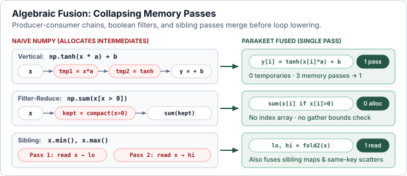
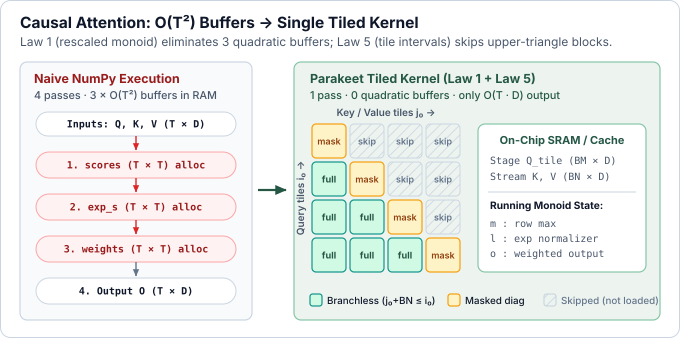
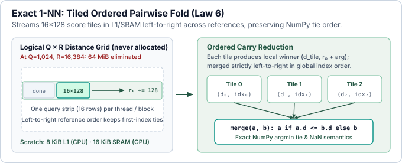

# Operators & compilation walkthrough

## Why compile through an operator IR?

In eager NumPy, every array operation allocates a full output buffer and sweeps
main memory. Even a one-line expression like `np.tanh(x * a) + b` makes three
passes over memory and allocates two temporary arrays; a four-line attention
block allocates three `O(T²)` matrices.

Parakeet avoids hand-writing hundreds of special-case C or GPU kernels by
lowering NumPy expressions, comprehensions, matrix products, and `par.*` calls
onto **seven composable index-space operators**. Keeping programs in operator
form until code generation lets fusion, tiling, and differentiation run as
simple algebraic rewrites:



---

## The seven operator primitives

In compiler output (`par.show_rewrite`, `spec.operators`), internal operator
nodes carry an `Index` prefix (`IndexMap`, `IndexReduce`, …) because each runs
over an explicit N-D coordinate grid `(0..N₀-1, 0..N₁-1, ...)`. That uniform
coordinate space lets broadcasts, slices, transposes, and `einsum` fuse without
special cases.

| What you write in Python | Internal IR node | Role |
|---|---|---|
| `np.tanh(x) + 1`, `[f(xi) for xi in x]`, [`par.map`](operators.md#map), [`par.imap`](operators.md#imap), [`par.allpairs`](operators.md#allpairs) | [`IndexMap`](#map) | Independent per-coordinate computation |
| `np.sum`, `np.argmin`, [`par.reduce`](operators.md#reduce), [`par.fold`](operators.md#fold), [`par.ireduce`](operators.md#ireduce) | [`IndexReduce`](#reduce-and-fold) | Associative reduction or ordered multi-field fold |
| `np.cumsum`, [`par.scan`](operators.md#scan), affine/bilinear `for` loops | [`IndexScan`](#scan) | Running prefix sum or associative recurrence |
| `x[x > 0]`, [`par.filter`](operators.md#filter), [`par.flatmap`](operators.md#flatmap), [`par.filter_pairs`](operators.md#filter_pairs) | [`IndexFilter` / `IndexExpand`](#filter-and-expand) | Stream compaction (1-to-0/1) and ragged expansion (1-to-K) |
| `np.bincount`, `np.add.at`, `out[idx[i]] += v`, [`par.scatter_add`](operators.md#scatter_add) | [`IndexScatter`](#scatter) | Associative accumulation into shared bins |
| [`par.wavefront`](operators.md#wavefront), [`par.soft_align`](operators.md#soft_align) | [`IndexWavefront`](#wavefront) | Anti-diagonal and banded 2D dynamic programming |
| Emitted automatically for matmul, `einsum`, attention, 1-NN | [`IndexTile`](#tile) | Cache, register, and GPU shared-memory staging |

### Map (`IndexMap`) {#map}

Independent evaluation over an N-D coordinate grid. Element-wise NumPy,
broadcasting, comprehensions, `par.map`, `par.imap`, and `par.allpairs` all
lower to `IndexMap`:

```python
# All three lower to one fused IndexMap with zero temporaries:
y = np.tanh(x * 0.5) + 0.3
y = np.array([np.tanh(xi * 0.5) + 0.3 for xi in x])
y = par.imap(lambda i: np.tanh(x[i] * 0.5) + 0.3, x.shape)
```

*Key rewrites:* vertical producer-consumer fusion (including transposes,
shifted slices, and stencils), sibling map fusion (`sin(x), cos(x)` in one
pass), and nested map flattening.

### Reduce and Fold (`IndexReduce`) {#reduce-and-fold}

Reduces values across an axis into one or more scalar accumulators (`Carry`
fields for structured state):

* `np.sum` / `np.max` / [`par.reduce`](operators.md#reduce) — single-value
  associative reduction.
* `np.argmin` / [`par.fold`](operators.md#fold) — multi-field ordered fold
  such as `(best_val, best_idx)`, preserving exact left-to-right tie order.
* [`par.ireduce`](operators.md#ireduce) — reduces directly over an index grid
  without building an intermediate array.

*Key rewrites:* chunked parallel reduction, sibling fusion (`x.min(), x.max()`
in one pass), online `logsumexp`, CPU L1 reduction interchange
(`np.sum(X, axis=0)`), and [Law 1 monoidal tiling](algebra.md#law-1-rescaled-semiring-monoids).

### Scan (`IndexScan`) {#scan}

Prefix accumulation where element `t` depends on `0..t`: `np.cumsum`,
`np.cumprod`, [`par.scan`](operators.md#scan), and plain `for t in range(T):`
affine or bilinear recurrences.

*Key rewrites:* consumer map fusion into the scan's `emit` pass
(`np.cumsum(x) * 2.0 + 1.0` in one pass) and
[Law 4 chunkwise state-space duality](algebra.md#law-4-chunkwise-state-space-duality).

### Filter and Expand (`IndexFilter`, `IndexExpand`) {#filter-and-expand}

Data-dependent compaction: **`IndexFilter`** keeps indices matching a predicate
(`x[x > 0]`, `np.nonzero`, `par.filter`), while **`IndexExpand`** runs two-pass
count, prefix sum, and parallel emit into a `RaggedArray` (`par.flatmap`,
`par.filter_pairs`).

*Key rewrites:* `x[p][q]` merges into one short-circuiting predicate `p and q`,
and `np.sum(x[x > 0])` collapses into a zero-allocation guarded reduction.

### Scatter (`IndexScatter`) {#scatter}

Associative accumulation (`add`, `mul`, `min`, `max`) into shared output bins:
`np.bincount`, `np.add.at`, canonical `out[idx[i]] += v` loops, inverted
comprehensions `[np.sum(v[idx == b]) for b in range(n)]`, and
[`par.scatter_add`](operators.md#scatter_add).

*Key rewrites:* sibling histograms sharing an index array fuse into one pass,
lowered with thread-privatized bins on CPU and atomics on GPU, and differentiate
to a gather (`g[idx]`) under `par.grad`.

### Wavefront (`IndexWavefront`) {#wavefront}

2D dynamic programming where cell `(i, j)` depends on `(i - 1, j)`, `(i, j - 1)`,
and `(i - 1, j - 1)`, scheduled along parallel anti-diagonals in `O(M)` rolling
memory ([`par.wavefront`](operators.md#wavefront),
[`par.batched_wavefront`](operators.md#batched_wavefront),
[`par.soft_align`](operators.md#soft_align)).

### Tile (`IndexTile`) {#tile}

Blocked execution with staged local buffers (`TileStage`) for CPU L1/L2 cache,
register micro-tiles, or GPU shared memory (`__shared__` / `threadgroup`). You
never write `IndexTile` directly—middle-end passes emit it automatically from
ordinary matmuls, `einsum`, 1-NN, and attention using the target's
`TargetProfile`.

---

## Worked compilation walkthroughs {#worked-end-to-end-compilation-walkthroughs}

Each walkthrough below contrasts the naive execution of idiomatic Python with
the compiled schedule Parakeet emits. (For raw low-level SSA/loop IR, see
[Compiler architecture: Lowered IR](internals.md#lowered-ir).)

### 1. Causal self-attention (`O(T²)` NumPy → `O(T)` tiled kernel) {#walkthrough-attention}

Start from four lines of ordinary NumPy:

```python
@par.jit
def causal_attention(q, k, v):
  causal = par.imap(lambda i, j: i >= j, (q.shape[0], k.shape[0]))
  s = np.where(causal, (q @ k.T) * np.float32(0.125), np.float32(-1e9))
  e = np.exp(s - np.max(s, axis=-1, keepdims=True))
  return (e / np.sum(e, axis=-1, keepdims=True)) @ v
```



How the compiler transforms it:

1. **Elaboration** fuses `causal`, `* 0.125`, and `np.where` directly into
   `Q @ K.T` (no `T × T` boolean mask), leaving three `O(T²)` float buffers
   (`scores`, `exp_s`, `weights`).
2. **`normalize`** hoists `row_max` and `row_sum` out of the column loop so
   each row reduction runs once instead of `T` times.
3. **`monoidal tiling` (Law 1 + Law 5)** matches the softmax-weighted
   contraction as an associative rescaled monoid `(m, l, o)` and drops all three
   `O(T²)` buffers. `TileInterval` (Law 5) proves upper-triangular tiles
   (`j0 > i0 + BM - 1`) are fully masked and skips loading them, while interior
   tiles run branchless.

<div class="pk-xform" markdown>
<div class="pk-xform-col pk-xform-col--before" markdown>
<div class="pk-xform-title">Before (after elaboration) <span class="pk-xform-badge">4 passes · 3 × O(T²) buffers</span></div>

```python
# 3 quadratic buffers allocated in RAM
scores = empty((T, T), float32)
# map(i, j): dot(q[i], k[j])*0.125 if i>=j else -1e9

exp_s = empty((T, T), float32)
# per row i: row_max = max(scores[i, :])
#            exp_s[i, :] = exp(scores[i, :] - row_max)

weights = empty((T, T), float32)
# per row i: row_sum = sum(exp_s[i, :])
#            weights[i, :] = exp_s[i, :] / row_sum

out = weights @ v  # (T, D)
```
</div>
<div class="pk-xform-col pk-xform-col--after" markdown>
<div class="pk-xform-title">After (Law 1 + Law 5) <span class="pk-xform-badge">1 pass · 0 O(T²) buffers</span></div>

```python
# Only output O(T, D) is allocated
out = empty((T, D), float32)
# parallel over query tiles i0 = 0, BM, 2*BM, ...:
#   stage Q_tile in cache / shared memory
#   m, l, o = -inf, 0.0, zeros((BM, D))
#   for j0 in range(0, T, BN):
#     if j0 > i0 + BM - 1: continue  # Law 5 skip
#     stage K_tile, V_tile
#     branchless = (j0 + BN - 1 <= i0)
#     update (m, l, o) across (BM x BN) tile
#   out[i0:i0+BM] = o / l[:, None]
```
</div>
</div>

Verify what fired with `par.show_rewrite(causal_attention, q, k, v).summary()`:

```text
Parakeet Algebraic Rewrite Report for `causal_attention`
  Laws triggered : Law 1: Rescaled Semiring Monoid Tile Fusion, Law 5: Affine Tile-Interval Mask Pruning
  Monoidal plans : flash_monoid
  Operators      : IndexMap 5 -> 1 | IndexTile 1 | IndexScatter 0 -> 0 | Carry folds 0
```

---

### 2. Exact 1-NN (broadcasting NumPy → tiled pairwise fold) {#walkthrough-1nn}

```python
@par.jit
def nearest(x, y):
  delta = x[:, None, :] - y[None, :, :]
  d2 = np.sum(delta ** np.float32(2), axis=2)
  return np.argmin(d2, axis=1)
```



Delayed arrays fuse `delta` and `d2` directly into `argmin` (eliminating the
`(Q, R, D)` difference tensor and `(Q, R)` distance matrix), and **Law 6
(`pairwise fold tiling`)** blocks the search into `16 × 128` L1/SRAM score tiles
merged strictly left-to-right in reference order so equal-distance ties and NaNs
match NumPy bit-for-bit:

<div class="pk-xform" markdown>
<div class="pk-xform-col pk-xform-col--before" markdown>
<div class="pk-xform-title">Naive NumPy <span class="pk-xform-badge">O(Q · R · D) + O(Q · R) RAM</span></div>

```python
delta = x[:, None, :] - y[None, :, :]  # (Q, R, D)
d2 = np.sum(delta**2, axis=2)  # (Q, R): 64 MiB
out = np.argmin(d2, axis=1)  # (Q,)
```
</div>
<div class="pk-xform-col pk-xform-col--after" markdown>
<div class="pk-xform-title">Parakeet Tiled Fold <span class="pk-xform-badge">8 KiB L1 / 16 KiB SRAM</span></div>

```python
# parallel over query strips q0 = 0, 16, 32, ...:
#   best_d, best_j = +inf, 0
#   for r0 in range(0, R, 128):      # ordered in r0
#     tile = microtile_2x4_d2(x[q0:], y[r0:])
#     merge_left_to_right(best_d, best_j, tile, r0)
#   out[q0:q0+16] = best_j
```
</div>
</div>

On CUDA and Metal, the same pass emits a 2-stage schedule: Stage 1 computes
`16 KiB` shared-memory tiles and writes `O(Q · #tiles)` partial winners; Stage 2
merges partial winners in global reference order.

---

### 3. Boolean masking → zero-allocation `FilterReduce` {#walkthrough-filter}

```python
@par.jit
def pos_sum(x):
  return np.sum(x[x > 0.0])
```

Because the compacted index array has no other consumer and `add` has identity
`0.0`, **`filter fusion`** collapses compaction and summation into one guarded
parallel loop with zero allocation and no gather bounds check:

<div class="pk-xform" markdown>
<div class="pk-xform-col pk-xform-col--before" markdown>
<div class="pk-xform-title">Before filter fusion <span class="pk-xform-badge">2 passes · index alloc</span></div>

```python
kept = [i for i in range(N) if x[i] > 0.0]
total = sum(x[i] for i in kept)
```
</div>
<div class="pk-xform-col pk-xform-col--after" markdown>
<div class="pk-xform-title">After filter fusion <span class="pk-xform-badge">1 pass · 0 allocations</span></div>

```python
# parallel chunked reduction:
#   acc = 0.0
#   for i in chunk:
#     if x[i] > 0.0: acc += x[i]
```
</div>
</div>

---

## Inspecting your own functions

```python
import parakeet as par

# 1. Summary of algebraic laws triggered and operator counts
print(par.show_rewrite(causal_attention, q, k, v).summary())

# 2. Generated C and GPU kernel source
spec = causal_attention.specialize(q, k, v)
print(spec.source)  # host C
print(spec.kernels)  # CUDA or Metal kernels
```

Continue to [Algebraic laws](algebra.md) for the mathematical identities behind
Laws 1–6, [Rewrite rules catalog](rewrites.md) for the full rule reference, or
[Compiler architecture](internals.md) for the 12-pass pipeline and raw loop IR.
