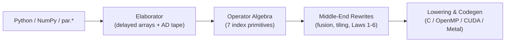
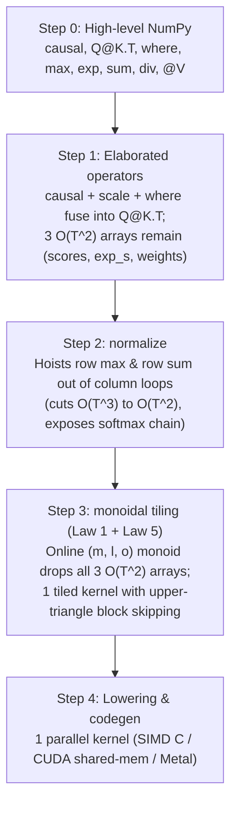

# Algebraic primitives & compilation walkthrough

Inside `@par.jit`, Parakeet lowers NumPy expressions, comprehensions, and
`par.*` calls onto **seven composable index-space operators**. General
algebraic passes fuse and tile those operators before lowering them to CPU
threads, Apple Metal, or NVIDIA CUDA.



## Python API vs. internal `Index*` names

In compiler output (`par.show_rewrite`, `spec.operators`), each internal
operator carries an `Index` prefix (`IndexMap`, `IndexReduce`, ...).

* **In Python**, you write array-oriented NumPy (`np.sum`, `x[x > 0]`, `a @ b`)
  or Parakeet operators ([`par.map`](operators.md#map),
  [`par.reduce`](operators.md#reduce), [`par.fold`](operators.md#fold),
  [`par.scan`](operators.md#scan), [`par.flatmap`](operators.md#flatmap),
  [`par.scatter_add`](operators.md#scatter_add),
  [`par.wavefront`](operators.md#wavefront)).
* **In the IR**, every operator iterates over an explicit N-D coordinate grid
  `(0..N₀-1, 0..N₁-1, ...)` so broadcasts, slices, and transposes share one
  uniform representation.

| What you write in Python | Internal IR node | Role |
|---|---|---|
| `np.tanh(x) + 1`, `[f(xi) for xi in x]`, [`par.map`](operators.md#map), [`par.imap`](operators.md#imap), [`par.allpairs`](operators.md#allpairs) | [`IndexMap`](#map) | Independent per-coordinate computation |
| `np.sum`, `np.argmin`, [`par.reduce`](operators.md#reduce), [`par.fold`](operators.md#fold), [`par.ireduce`](operators.md#ireduce) | [`IndexReduce`](#reduce-and-fold) | Associative or ordered fold (with optional multi-field carries) |
| `np.cumsum`, [`par.scan`](operators.md#scan), affine/bilinear `for` loops | [`IndexScan`](#scan) | Running prefix accumulation or associative recurrence |
| `x[x > 0]`, [`par.filter`](operators.md#filter), [`par.flatmap`](operators.md#flatmap), [`par.filter_pairs`](operators.md#filter_pairs) | [`IndexFilter` / `IndexExpand`](#filter-and-expand) | Stream compaction (1-to-0/1) and ragged expansion (1-to-K) |
| `np.bincount`, `np.add.at`, `out[idx[i]] += v`, [`par.scatter_add`](operators.md#scatter_add) | [`IndexScatter`](#scatter) | Associative accumulation into shared bins |
| [`par.wavefront`](operators.md#wavefront), [`par.soft_align`](operators.md#soft_align) | [`IndexWavefront`](#wavefront) | Anti-diagonal and banded 2D dynamic programming |
| Emitted automatically for matmul, `einsum`, attention, 1-NN | [`IndexTile`](#tile) | Cache, register, and GPU shared-memory staging |

---

## The seven primitives

### Map (`IndexMap`) {#map}

Independent evaluation of a pure body across an N-D coordinate grid. Element-wise
NumPy, broadcasting, comprehensions, [`par.map`](operators.md#map),
[`par.allpairs`](operators.md#allpairs), and [`par.imap`](operators.md#imap) all
lower here:

```python
# All three lower to the same fused Map:
y = np.tanh(x * 0.5) + 0.3
y = np.array([np.tanh(xi * 0.5) + 0.3 for xi in x])
y = par.imap(lambda i: np.tanh(x[i] * 0.5) + 0.3, x.shape)

# Algebraic form (pseudocode):
# parallel for i in range(len(x)):
#     y[i] = tanh(x[i] * 0.5) + 0.3
```

**Key rewrites:** vertical producer-consumer fusion (including slices,
transposes, and stencils), sibling map fusion (`sin(x), cos(x)` in one pass),
and nested map flattening. See [Fusion rules](rewrites.md#fusion).

---

### Reduce and Fold (`IndexReduce`) {#reduce-and-fold}

Combines values across a reduction axis into one or more scalar accumulators.

**Choosing between [`par.reduce`](operators.md#reduce),
[`par.fold`](operators.md#fold), and [`par.ireduce`](operators.md#ireduce):**

* **`np.sum` / `np.max` / `np.argmin` / [`par.reduce(op, x)`](operators.md#reduce):**
  single-value reduction with a binary combiner (`np.add`, `np.maximum`, or a
  custom function).
* **[`par.fold(lift, merge, x, init)`](operators.md#fold):** structured
  multi-field reduction such as `(best_val, best_idx)` or Welford
  `(count, mean, m2)`, preserving left-to-right merge order for ties and
  non-commutative merges.
* **[`par.ireduce(fn, shape, combine=np.add)`](operators.md#ireduce):** reduces
  directly over an index grid without building an input array first.

All three lower to `IndexReduce` (with `Carry` fields for multi-state folds):

```python
total = np.sum(x, axis=1)  # single associative fold (add)
idx = np.argmin(scores, axis=1)  # fold(min) carrying winning index
best = par.fold(  # explicit multi-field fold
  lambda v, i: (v, i),
  lambda a, b: a if a[0] <= b[0] else b,
  scores,
  axis=1,
  indexed=True,
)
```

**Key rewrites:** chunked parallel reduction, sibling reduction fusion
(`x.min(), x.max()` in one pass), online `logsumexp`, CPU L1 reduction
interchange (`np.sum(X, axis=0)`), and
[Law 1 monoidal tiling](algebra.md#law-1-rescaled-semiring-monoids).

---

### Scan (`IndexScan`) {#scan}

Prefix accumulation where element `t` depends on `0..t`. Covers `np.cumsum`,
`np.cumprod`, [`par.scan`](operators.md#scan), and plain `for t in range(T):`
loops expressing affine (`s = a[t] * s + b[t]`) or bilinear matrix-state
recurrences (`S = a[t] * S + outer(k[t], v[t])`):

```python
prefix = np.cumsum(x)  # 3-stage parallel prefix scan
ema = par.scan(lambda acc, v: 0.9 * acc + 0.1 * v, x)  # custom combiner
```

**Key rewrites:** consumer map fusion into the scan's `emit` stage
(`np.cumsum(x) * 2.0 + 1.0` runs in one pass) and
[Law 4 chunkwise state-space duality](algebra.md#law-4-chunkwise-state-space-duality)
for affine IIR filters and Mamba-2 recurrences.

---

### Filter and Expand (`IndexFilter`, `IndexExpand`) {#filter-and-expand}

Data-dependent output compaction:

* **`IndexFilter`** (1-to-0/1): keeps indices matching a predicate
  (`x[x > 0]`, `np.nonzero`, [`par.filter`](operators.md#filter)).
* **`IndexExpand`** (1-to-K): two-pass count, prefix sum, and parallel emit into
  a `RaggedArray` ([`par.flatmap`](operators.md#flatmap),
  [`par.filter_pairs`](operators.md#filter_pairs)).

```python
positives = x[x > 0.0]  # IndexFilter
pos_total = np.sum(x[x > 0.0])  # Filter + Reduce -> 0-alloc FilterReduce
cigar_ops = par.flatmap(lambda op, n: n, lambda op, n, k: op, ops, lengths)  # IndexExpand
```

**Key rewrites:** `x[p][q]` merges into one short-circuiting predicate `p and q`,
and `np.sum(x[x > 0])` eliminates the index array completely
([Walkthrough 3](#walkthrough-filter)).

---

### Scatter (`IndexScatter`) {#scatter}

Associative accumulation (`add`, `mul`, `min`, `max`) into shared output bins:
`np.bincount`, `np.add.at`, `for i: out[idx[i]] += v[i]`, filtered
comprehensions `[np.sum(v[idx == b]) for b in range(n)]`, and
[`par.scatter_add`](operators.md#scatter_add).

```python
grad_hist = np.bincount(bin_ids, weights=grads, minlength=256)
hess_hist = np.bincount(bin_ids, weights=hess, minlength=256)
```

**Key rewrites:** sibling histograms with the same `bin_ids` fuse into one
pass, lowered with thread-private bins on CPU and atomics on GPU. Under
`par.grad`, `IndexScatter(add)` differentiates to a gather (`g[idx]`). See
[Law 6](algebra.md#law-6-privatized-scatter-multi-state-carries).

---

### Wavefront (`IndexWavefront`) {#wavefront}

2D dynamic programming where cell `(i, j)` depends on `(i - 1, j)`, `(i, j - 1)`,
and `(i - 1, j - 1)`, scheduled along parallel anti-diagonals in `O(M)` rolling
memory ([`par.wavefront`](operators.md#wavefront),
[`par.batched_wavefront`](operators.md#batched_wavefront),
[`par.soft_align`](operators.md#soft_align)).

```python
scores = par.wavefront(
  lambda top, left, diag, i, j: max(diag + match(i, j), top - 2.0, left - 2.0),
  (m, n),
  init_top=...,
  init_left=...,
  init_corner=0.0,
)
```

---

### Tile (`IndexTile`) {#tile}

Blocked execution with staged local buffers (`TileStage`) for CPU L1/L2 cache,
register micro-tiles, or GPU shared memory (`__shared__` / `threadgroup`). You
never write `IndexTile` directly; middle-end passes emit it automatically from
ordinary matmuls, `einsum`, 1-NN, and attention based on the target's
`TargetProfile`.

---

## Worked end-to-end compilation walkthroughs

The stages below show each compiler rewrite in readable Python pseudocode so the
algebraic structure stays clear. To see the raw low-level SSA/loop IR that the
compiler lowers to before C/CUDA/Metal emission, see
[Compiler architecture: Lowered IR](internals.md#lowered-ir).

### Walkthrough 1: Causal self-attention (`O(T²)` NumPy to `O(T)` tiled kernel) {#walkthrough-attention}

Start from four lines of ordinary NumPy:

```python
import numpy as np
import parakeet as par


@par.jit
def causal_attention(q, k, v):
  causal = par.imap(lambda i, j: i >= j, (q.shape[0], k.shape[0]))
  s = np.where(causal, (q @ k.T) * np.float32(0.125), np.float32(-1e9))
  e = np.exp(s - np.max(s, axis=-1, keepdims=True))
  return (e / np.sum(e, axis=-1, keepdims=True)) @ v
```



#### Step 1: After elaboration (delayed-array fusion)

Delayed arrays fuse `causal`, `* 0.125`, and `np.where` straight into the
`Q @ K.T` scores pass, so no `T × T` boolean mask is ever allocated. Three
`O(T²)` float buffers still remain:

```python
# Pseudocode after elaboration (3 O(T^2) buffers allocated)
scores = empty((T, T), float32)
parallel for i in range(T), j in range(T):
    dot = sum(q[i, d] * k[j, d] for d in range(D))
    scores[i, j] = dot * 0.125 if i >= j else -1e9

exp_s = empty((T, T), float32)
parallel for i in range(T), j in range(T):
    row_max = max(scores[i, c] for c in range(T))
    exp_s[i, j] = exp(scores[i, j] - row_max)

weights = empty((T, T), float32)
parallel for i in range(T), j in range(T):
    row_sum = sum(exp_s[i, c] for c in range(T))
    weights[i, j] = exp_s[i, j] / row_sum

out = empty((T, D), float32)
parallel for i in range(T), d in range(D):
    out[i, d] = sum(weights[i, j] * v[j, d] for j in range(T))
```

#### Step 2: After `normalize` (invariant row-reduction hoisting)

`row_max` and `row_sum` depend only on `i`, not `j`. `normalize` splits the
2D maps so each reduction runs once per row instead of `T` times:

```python
# Pseudocode after normalize (row reductions hoisted out of j)
parallel for i in range(T):
    row_max = max(scores[i, c] for c in range(T))
    for j in range(T):
        exp_s[i, j] = exp(scores[i, j] - row_max)

parallel for i in range(T):
    row_sum = sum(exp_s[i, c] for c in range(T))
    for j in range(T):
        weights[i, j] = exp_s[i, j] / row_sum
```

#### Step 3: After `monoidal tiling` (Law 1 + Law 5)

`monoidal tiling` matches the chain `Q @ K.T -> select(i >= j) -> max -> exp -> sum -> div -> @ V`
as an associative rescaled monoid `(m, l, o)`. All three `O(T²)` buffers
(`scores`, `exp_s`, `weights`) disappear, leaving one tiled pass over blocks of
`K` and `V`. **Law 5 (`TileInterval`)** proves blocks strictly above the
diagonal (`j0 > i0 + BM - 1`) are all masked out and skips loading them:

```python
# Pseudocode after monoidal tiling (ONLY the O(T * D) output is allocated)
out = empty((T, D), float32)

parallel for i0 in range(0, T, BM):                      # query tile (one threadblock on GPU)
    Q_tile = stage(q[i0 : i0 + BM, :])                   # staged in cache / shared memory
    m, l, o = fill(-inf), fill(0.0), zeros((BM, D))

    for j0 in range(0, T, BN):                           # key/value tile
        if j0 > i0 + BM - 1:                             # Law 5: strictly upper-triangular -> skip
            continue
        K_tile = stage(k[j0 : j0 + BN, :])
        V_tile = stage(v[j0 : j0 + BN, :])
        full_tile = (j0 + BN - 1 <= i0)                  # interior tile -> no per-element mask

        for r in range(BM):
            for c in range(BN):
                s = dot(Q_tile[r], K_tile[c]) * 0.125
                if not full_tile and (i0 + r < j0 + c):
                    s = -1e9
                m_new = max(m[r], s)
                alpha = exp(m[r] - m_new)
                beta  = exp(s - m_new)
                l[r]  = l[r] * alpha + beta
                o[r]  = o[r] * alpha + beta * V_tile[c]
                m[r]  = m_new

    out[i0 : i0 + BM, :] = o / l[:, None]
```

#### Step 4: Rewrite report & code generation

Lowering turns that single `IndexTile` into one parallel kernel (SIMD C loops on
CPU; shared-memory CUDA or Metal threadblocks on GPU):

```text
Parakeet Algebraic Rewrite Report for `causal_attention`
  Laws triggered : Law 1: Rescaled Semiring Monoid Tile Fusion, Law 5: Affine Tile-Interval Mask Pruning
  Monoidal plans : flash_monoid
  Operators      : IndexMap 5 -> 1 | IndexTile 1 | IndexScatter 0 -> 0 | Carry folds 0
```

---

### Walkthrough 2: Exact 1-NN (broadcasting NumPy to tiled pairwise fold) {#walkthrough-1nn}

```python
@par.jit
def nearest(x, y):
  delta = x[:, None, :] - y[None, :, :]
  d2 = np.sum(delta ** np.float32(2), axis=2)
  return np.argmin(d2, axis=1)
```

1. **After elaboration:** delayed arrays fuse `delta` and `d2` directly into
   `argmin`, eliminating both the `(Q, R, D)` difference tensor and the
   `(Q, R)` distance matrix:
   ```python
   # Pseudocode after elaboration (0 intermediate allocations)
   out = empty(Q, int64)
   parallel for i in range(Q):
       best_d, best_j = +inf, 0
       for j in range(R):
           d2 = sum((x[i, d] - y[j, d]) ** 2 for d in range(D))
           if d2 < best_d:
               best_d, best_j = d2, j
       out[i] = best_j
   ```
2. **After `pairwise fold tiling` (Law 6):** tiles queries by `16` and
   references by `128`, evaluates a `16 × 128` L1-resident score block (`8 KiB`)
   with `2 × 4` register micro-tiles, folds each row inside the tile, and merges
   tile winners in left-to-right reference order so ties and NaNs keep NumPy's
   exact first-index rule:
   ```python
   # Pseudocode after pairwise fold tiling (CPU schedule)
   out = empty(Q, int64)
   parallel for q0 in range(0, Q, 16):
       row_best, row_arg = fill(+inf), zeros(16, int64)
       for r0 in range(0, R, 128):                          # ordered in reference index
           score_tile = compute_2x4_microtiles(x[q0:q0+16], y[r0:r0+128])  # 8 KiB in L1
           for r in range(16):
               tile_best, tile_arg = argmin_with_offset(score_tile[r], offset=r0)
               if tile_best < row_best[r]:
                   row_best[r], row_arg[r] = tile_best, tile_arg
       out[q0 : q0 + 16] = row_arg
   ```
3. **On CUDA / Metal:** the same pass emits a 2-stage schedule. Stage 1 computes
   `16 KiB` shared-memory score tiles and writes only `O(Q · #tiles)` partial
   winners; Stage 2 merges partial winners in reference order.

---

### Walkthrough 3: Boolean masking to zero-allocation `FilterReduce` {#walkthrough-filter}

```python
@par.jit
def pos_sum(x):
  return np.sum(x[x > 0.0])
```

1. **After elaboration:** two passes (compact surviving indices into `kept`,
   then gather and sum):
   ```python
   # Pseudocode before filter fusion (allocates `kept`)
   kept = [i for i in range(N) if x[i] > 0.0]
   total = sum(x[i] for i in kept)
   ```
2. **After `filter fusion`:** because `kept` has no other consumer and `add`
   has identity `0.0`, both passes collapse into one guarded parallel reduction
   with zero allocation and no gather bounds check:
   ```python
   # Pseudocode after filter fusion (0 allocations)
   total = parallel_sum(x[i] for i in range(N) if x[i] > 0.0)
   ```

---

## Inspecting rewrites on your own functions

```python
import parakeet as par

# 1. Summary of laws triggered and operator counts
print(par.show_rewrite(causal_attention, q, k, v).summary())

# 2. Generated C, CUDA, or Metal source
spec = causal_attention.specialize(q, k, v)
print(spec.source)  # host C
print(spec.kernels)  # GPU kernels (cuda or metal)
```

For inspecting raw pass-by-pass IR (`spec.operators`, `spec.ir`,
`fn.trace_passes`), see [Compiler architecture: Lowered IR](internals.md#lowered-ir).
For the mathematical identities behind Laws 1 through 6, see
[Algebraic laws](algebra.md), and for the full pass catalog see
[Rewrite rules and optimizations](rewrites.md).
