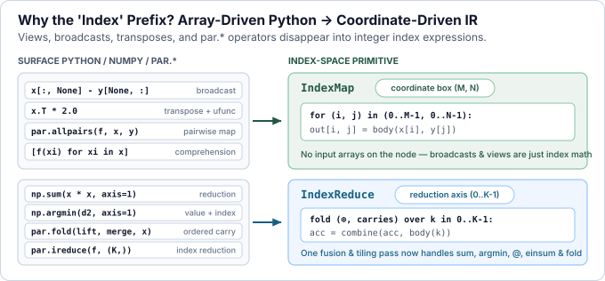

# Operators & compilation walkthrough

## Why compile through an operator algebra?

NumPy is fast on any single operation because each call drops into compiled C
or Fortran. The bottleneck shows up when you **compose** operations:

* **Streaming expressions allocate and re-read memory.** A one-line formula
  like `np.tanh(x * a) + b` makes three sweeps over RAM and allocates two
  temporary arrays. A four-line attention function allocates three `O(T²)`
  matrices.
* **Custom algorithms fall back to Python.** Anything that does not fit a
  single NumPy ufunc (pairwise distances, custom folds, banded DP, tree splits)
  either explodes memory with broadcasting or drops into a slow CPython loop.

Traditional compilers lower array code straight into nested C `for`-loops and
then try to *re-discover* parallelism, associativity, and cache reuse through
fragile loop-nest dependence analysis. Following the NYU Parakeet theses
([Rubinsteyn 2014](https://cs.nyu.edu/media/publications/rubinsteyn_alex.pdf),
[Hielscher 2013](https://cs.nyu.edu/media/publications/eric_h.pdf)), Parakeet
does the opposite: **it keeps array programs in algebraic operator form until
the final lowering step.** Because independence, associativity, and data reuse
stay explicit in the IR, fusion, cache/GPU tiling, and differentiation become
small, sound algebraic rewrites.

---

## What does the `Index` prefix mean? {#what-the-index-prefix-means}

In compiler output (`par.show_rewrite`, `spec.operators`), internal primitives
carry an `Index` prefix: `IndexMap`, `IndexReduce`, `IndexScan`, `IndexFilter`,
`IndexExpand`, `IndexScatter`, `IndexWavefront`, and `IndexTile`.

Why not just `Map` and `Reduce`?

At the Python surface, operators are **array-driven**: `par.map(f, X)` iterates
over elements of `X`, `par.allpairs(f, X, Y)` takes pairs of slices,
`X[:, None] - Y[None, :]` broadcasts shapes, `X.T` permutes axes, and `X[::2]`
strides. If the optimizer worked directly on array-driven nodes, it would need
separate fusion and tiling rules for every combination (`Map ∘ Transpose`,
`Reduce ∘ Broadcast`, `Reduce ∘ AllPairs`, `Map ∘ Slice`, …).

Instead, elaboration **indexifies** every array expression into a
**coordinate-driven** operator:

* An `Index*` node takes **no input arrays of its own**—only a rectangular
  integer coordinate box `shape = (N₀, N₁, …)` and a body parameterized by
  integer coordinates `(i, j, …)` that explicitly indexes whatever arrays it
  needs (`A[i, k]`, `B[k, j]`).
* **Broadcasting, transposes, slices, views, comprehensions, and `allpairs`
  vanish into simple index expressions** before any middle-end pass runs.



That single normalization is why one fusion pass (`IndexMap` into `IndexReduce`)
automatically handles `np.sum(x * x)`, `np.sum(x.T[::2])`, `a @ b.T`,
`np.einsum('ij,jk->ik', a, b)`, and `np.argmin(np.sum((x[:, None] - y[None, :])**2, axis=2), axis=1)`
without a single special case for broadcasting or transposes.

---

## From Python and `par.*` to the seven primitives

Everything you write in NumPy, Python, or `par.*` lowers into **six source
primitives**, and the locality optimizer adds a **seventh (`IndexTile`)** when
blocking reductions for CPU cache or GPU shared memory:

| Internal primitive | Surface NumPy / Python idioms | `par.*` operators that reduce here | What it captures |
|---|---|---|---|
| **[`IndexMap`](#map)** | Element-wise ufuncs, broadcasting, slices/views materialized, `np.where`, comprehensions, `@` / `einsum` outer grid | `par.map`, `par.each`, `par.imap`, `par.allpairs`, `par.outer_map`, `par.parfor`, `par.pmap1`/`pmap2` | Independent work at every coordinate `(i, j, …)` |
| **[`IndexReduce`](#reduce-and-fold)** | `np.sum`, `prod`, `min`, `max`, `mean`, `var`, `std`, `all`, `any`, `argmin`, `argmax`, inner dot of `@` / `einsum` | `par.reduce`, `par.ireduce`, `par.fold`, `par.topk_fold` | Associative reduction or ordered multi-field (`Carry`) fold |
| **[`IndexScan`](#scan)** | `np.cumsum`, `np.cumprod`, affine/bilinear `for t in range(T):` loops | `par.scan` | Running prefix accumulation where step `t` depends on `0..t` |
| **[`IndexFilter`](#filter-and-expand)** | Boolean masking `x[mask]`, `np.nonzero`, `np.flatnonzero` | `par.filter`, `par.filter_reduce` (with `IndexReduce`), `par.split_bytes` | 1-to-0/1 stream compaction by predicate |
| **[`IndexExpand`](#filter-and-expand)** | Variable-length emission into `RaggedArray` | `par.flatmap`, `par.filter_pairs` | Two-pass 1-to-K ragged compaction (count → prefix sum → emit) |
| **[`IndexScatter`](#scatter)** | `np.bincount`, `np.add.at`, canonical `for i: out[idx[i]] += v`, inverted `[np.sum(v[idx == b]) for b in range(n)]` | `par.scatter_add`, `par.segmented_histogram2d` | Associative accumulation into shared output bins |
| **[`IndexWavefront`](#wavefront)** | Anti-diagonal and banded 2D DP recurrences | `par.wavefront`, `par.batched_wavefront`, `par.soft_align` | Cell `(i, j)` depends on `(i−1, j)`, `(i, j−1)`, `(i−1, j−1)` |
| **[`IndexTile`](#tile)** *(optimizer-emitted)* | Emitted automatically from `IndexMap` wrapping `IndexReduce` (`@`, `einsum`, 1-NN, attention, RBF) | *(Never written directly)* | Blocked execution with staged L1/L2 cache, register, or GPU SRAM tiles |

### The seven primitives in brief

#### Map (`IndexMap`) {#map}

Evaluates a pure body independently at every coordinate of an N-D box. Because
iterations are independent, vertical chains collapse (`np.tanh(x * a) + b`),
sibling maps merge (`sin(x), cos(x)`), and nested maps flatten into one
multi-dimensional grid for CPU threads and GPUs.

#### Reduce and Fold (`IndexReduce`) {#reduce-and-fold}

Combines values across a reduction box into one or more scalar accumulators.
Associative combiners (`+`, `*`, `min`, `max`, bitwise ops) split across
threads and SIMD lanes. Structured state—like `(best_val, best_idx)` in
`argmin` or Welford variance in `par.fold`—attaches as `Carry` fields that
merge in strict left-to-right order so ties and NaNs stay exact.

#### Scan (`IndexScan`) {#scan}

Computes running prefixes (`np.cumsum`, `par.scan`) via a 3-stage parallel
chunk scan. Consumer maps fuse directly into the scan's `emit` block
(`np.cumsum(x) * 2 + 1` in one pass), and plain Python affine/bilinear `for`
loops rewrite via [Law 4 chunkwise duality](algebra.md#law-4-chunkwise-state-space-duality).

#### Filter and Expand (`IndexFilter`, `IndexExpand`) {#filter-and-expand}

Compacts sparse or variable-length outputs without serial locks. Chained
filters merge (`x[p][q]` → `p and q`), and `IndexFilter` followed by
`IndexReduce` collapses into a zero-allocation guarded loop (`np.sum(x[x > 0])`).

#### Scatter (`IndexScatter`) {#scatter}

Accumulates associatively into indexed bins. Sibling histograms sharing an
index array merge into a single pass, lower to thread-privatized bins on CPU
and atomics on GPU, and differentiate to a gather (`g[idx]`) under `par.grad`.

#### Wavefront (`IndexWavefront`) {#wavefront}

Schedules 2D dynamic programming along parallel anti-diagonals in `O(M)`
rolling memory, never allocating the full `M × N` DP table.

#### Tile (`IndexTile`) {#tile}

Following [Hielscher (2013)](https://cs.nyu.edu/media/publications/eric_h.pdf),
middle-end locality passes rewrite `IndexMap` wrapping `IndexReduce` into
nested `IndexTile` operators with explicit `TileStage` buffers—driving CPU
L1/L2 cache blocking, `2×4` register jamming, GPU `__shared__` /
`threadgroup` memory, Metal `simdgroup_matrix`, and CUDA TF32 WMMA from one
representation.


---

## Worked compilation walkthroughs {#worked-end-to-end-compilation-walkthroughs}

Each walkthrough below starts from ordinary Python/NumPy and shows the exact
compiled schedule Parakeet produces. (To inspect raw SSA loop IR, see
[Compiler architecture: Lowered IR](internals.md#lowered-ir).)

### 1. Causal self-attention (`O(T²)` NumPy → `O(T)` tiled kernel) {#walkthrough-attention}

Start from four lines of ordinary NumPy:

```python
@par.jit
def causal_attention(q, k, v):
  causal = par.imap(lambda i, j: i >= j, (q.shape[0], k.shape[0]))
  s = np.where(causal, (q @ k.T) * np.float32(0.125), np.float32(-1e9))
  e = np.exp(s - np.max(s, axis=-1, keepdims=True))
  return (e / np.sum(e, axis=-1, keepdims=True)) @ v
```


Three general passes transform this function:

1. **Indexification & delayed fusion** fold `causal`, `* 0.125`, and `np.where`
   directly into `Q @ K.T` (so no `T × T` boolean mask is ever allocated),
   leaving three `O(T²)` float buffers (`scores`, `exp_s`, `weights`).
2. **`normalize`** hoists `row_max` and `row_sum` out of the column loop so
   each row reduction runs once instead of `T` times.
3. **`monoidal tiling` (Law 1 + Law 5)** recognizes the softmax-weighted
   contraction as an associative rescaled monoid `(m, l, o)` and drops all three
   `O(T²)` buffers. `TileInterval` (Law 5) proves upper-triangular tiles
   (`j0 > i0 + BM - 1`) are fully masked and skips loading them, while interior
   tiles run branchless.

<div class="pk-xform" markdown>
<div class="pk-xform-col pk-xform-col--before" markdown>
<div class="pk-xform-title">Naive execution <span class="pk-xform-badge">4 passes · 3 × O(T²) buffers</span></div>

```python
scores = np.empty((T, T), np.float32)
for i in range(T):
  for j in range(T):
    dot = sum(q[i, d] * k[j, d] for d in range(D))
    scores[i, j] = dot * 0.125 if i >= j else -1e9

exp_s = np.empty((T, T), np.float32)
for i in range(T):
  row_max = max(scores[i, :])
  exp_s[i, :] = np.exp(scores[i, :] - row_max)

weights = exp_s / np.sum(exp_s, axis=1, keepdims=True)
out = weights @ v
```
</div>
<div class="pk-xform-col pk-xform-col--after" markdown>
<div class="pk-xform-title">Compiled schedule (Law 1 + Law 5) <span class="pk-xform-badge">1 pass · 0 O(T²) buffers</span></div>

```python
out = np.empty((T, D), np.float32)
for i0 in parallel_range(0, T, BM):
  Q_tile = stage(q[i0 : i0 + BM])
  m, l, o = fill(-inf), fill(0.0), zeros((BM, D))

  for j0 in range(0, T, BN):
    if j0 > i0 + BM - 1:  # Law 5: skip upper triangle
      continue
    K_tile = stage(k[j0 : j0 + BN])
    V_tile = stage(v[j0 : j0 + BN])
    full = j0 + BN - 1 <= i0  # interior -> branchless
    m, l, o = monoid_step(m, l, o, Q_tile, K_tile, V_tile, full)

  out[i0 : i0 + BM] = o / l[:, None]
```
</div>
</div>

Verify what fired with `par.show_rewrite(causal_attention, q, k, v).summary()`:

```text
Parakeet Algebraic Rewrite Report for `causal_attention`
  Laws triggered : Law 1: Rescaled Semiring Monoid Tile Fusion, Law 5: Affine Tile-Interval Mask Pruning
  Monoidal plans : flash_monoid
  Operators      : IndexMap 5 -> 1 | IndexTile 1 | IndexScatter 0 -> 0 | Carry folds 0
```

---

### 2. Exact 1-NN (broadcasting NumPy → tiled pairwise fold) {#walkthrough-1nn}

```python
@par.jit
def nearest(x, y):
  delta = x[:, None, :] - y[None, :, :]
  d2 = np.sum(delta ** np.float32(2), axis=2)
  return np.argmin(d2, axis=1)
```


Indexification turns the 3D broadcast `delta` and squared sum `d2` directly
into index expressions inside `argmin`—eliminating both the `(Q, R, D)`
difference tensor and `(Q, R)` distance matrix. **Law 6 (`pairwise fold tiling`)**
then blocks the search into `16 × 128` L1/SRAM score tiles merged strictly
left-to-right so ties and NaNs keep NumPy's exact first-index rule:

<div class="pk-xform" markdown>
<div class="pk-xform-col pk-xform-col--before" markdown>
<div class="pk-xform-title">Naive NumPy <span class="pk-xform-badge">O(Q · R · D) + O(Q · R) RAM</span></div>

```python
delta = x[:, None, :] - y[None, :, :]  # (Q, R, D)
d2 = np.sum(delta**2, axis=2)  # (Q, R): 64 MiB
out = np.argmin(d2, axis=1)  # (Q,)
```
</div>
<div class="pk-xform-col pk-xform-col--after" markdown>
<div class="pk-xform-title">Parakeet Tiled Fold <span class="pk-xform-badge">8 KiB L1 / 16 KiB SRAM</span></div>

```python
out = np.empty(Q, np.int64)
for q0 in parallel_range(0, Q, 16):
  best_d, best_j = fill(+inf), zeros(16, np.int64)
  for r0 in range(0, R, 128):  # ordered in r0
    tile = microtile_2x4(x[q0 : q0 + 16], y[r0 : r0 + 128])
    best_d, best_j = merge_ordered(best_d, best_j, tile, r0)
  out[q0 : q0 + 16] = best_j
```
</div>
</div>

On CUDA and Metal, the same pass emits a 2-stage schedule: Stage 1 computes
`16 KiB` shared-memory tiles and writes `O(Q · #tiles)` partial winners; Stage 2
merges partial winners in global reference order.

---

### 3. Boolean masking → zero-allocation `FilterReduce` {#walkthrough-filter}

```python
@par.jit
def pos_sum(x):
  return np.sum(x[x > 0.0])
```

Because the compacted index array has no other consumer and `add` has identity
`0.0`, **`filter fusion`** collapses `IndexFilter` + `IndexReduce` into a single
guarded parallel reduction with zero allocation and no gather bounds check:

<div class="pk-xform" markdown>
<div class="pk-xform-col pk-xform-col--before" markdown>
<div class="pk-xform-title">Before filter fusion <span class="pk-xform-badge">2 passes · index alloc</span></div>

```python
kept = [i for i in range(N) if x[i] > 0.0]
total = sum(x[i] for i in kept)
```
</div>
<div class="pk-xform-col pk-xform-col--after" markdown>
<div class="pk-xform-title">After filter fusion <span class="pk-xform-badge">1 pass · 0 allocations</span></div>

```python
partials = parallel_chunks(N)
for chunk in partials:
  acc = 0.0
  for i in chunk:
    if x[i] > 0.0:
      acc += x[i]
total = sum(partials)
```
</div>
</div>

---

## Inspecting your own functions

```python
import parakeet as par

# 1. Summary of algebraic laws triggered and operator counts
print(par.show_rewrite(causal_attention, q, k, v).summary())

# 2. Generated C and GPU kernel source
spec = causal_attention.specialize(q, k, v)
print(spec.source)  # host C
print(spec.kernels)  # CUDA or Metal kernels
```

**Next:** [Algebraic laws](algebra.md) explains the six mathematical identities
that eliminate `O(N²)` memory, parallelize `O(T)` recurrences, and rematerialize
gradients without quadratic tapes.
