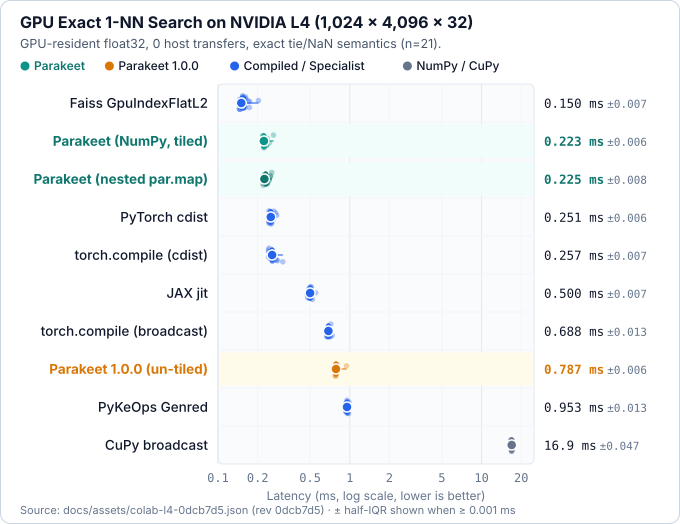
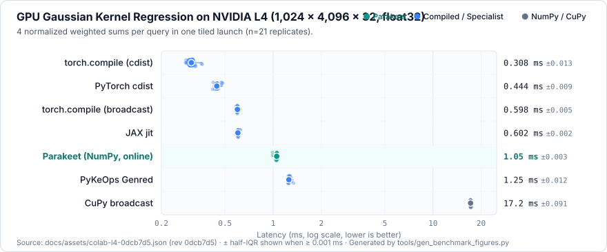
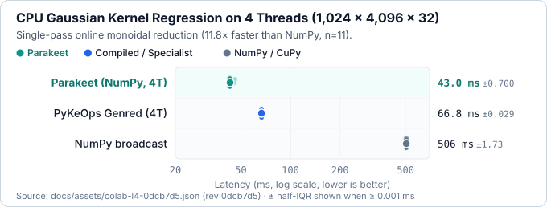
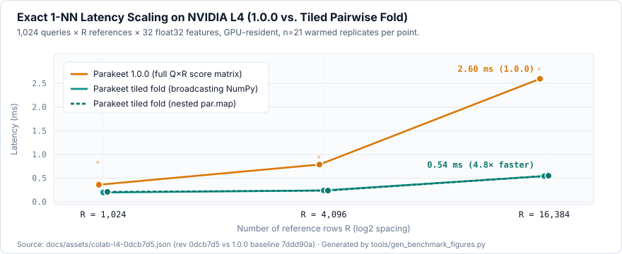
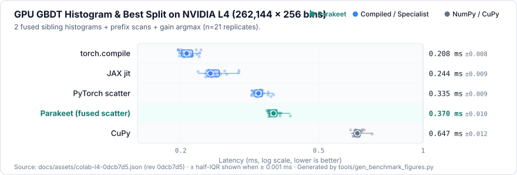
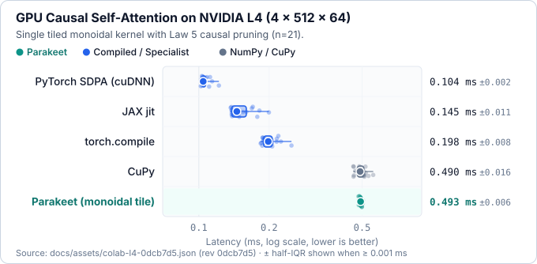
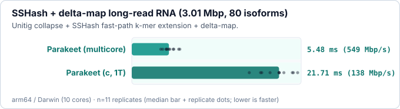
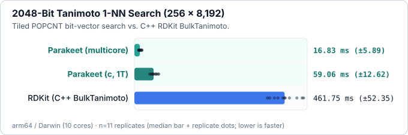
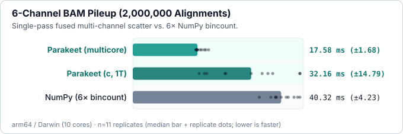

# Benchmarks

Parakeet is benchmarked head-to-head against general array compilers
([`torch.compile`](https://pytorch.org/docs/stable/generated/torch.compile.html),
[JAX `jit`](https://docs.jax.dev/en/latest/jit-compilation.html),
[CuPy](https://cupy.dev/), [NumPy](https://numpy.org/)) and specialist libraries
([Faiss](https://github.com/facebookresearch/faiss),
[PyKeOps](https://www.kernel-operations.io/keops/),
[scikit-learn](https://scikit-learn.org/), [SciPy](https://scipy.org/),
[PyTorch SDPA](https://pytorch.org/docs/stable/generated/torch.nn.functional.scaled_dot_product_attention.html) /
[`cross_entropy`](https://pytorch.org/docs/stable/generated/torch.nn.functional.cross_entropy.html),
[edlib](https://github.com/Martinsos/edlib), [Biopython](https://biopython.org/),
[Biotite](https://www.biotite-python.org/), and [RDKit](https://www.rdkit.org/)).
Every figure plots **all individual warmed replicates** (where recorded), the
**interquartile range (IQR, 25th–75th percentile)**, and the **median** directly
from the committed raw JSON logs, and every workload links to its runnable
source code.

## At a glance (NVIDIA L4 & 4-thread CPU)

GPU and CPU cross-framework measurements come from Google Colab VMs with an
**NVIDIA L4** GPU and a **4-thread CPU** (`float32`, GPU inputs resident on
device, explicit synchronization, reference-checked outputs, `n = 21` GPU
replicates / `n = 11` CPU replicates).
[Download forward-suite raw JSON (`0dcb7d5`)](assets/colab-l4-0dcb7d5.json) ·
[Download updated nanoGPT L4 JSON (`7bb1dcc`)](assets/colab-l4-nanogpt.json).

> **Baseline policy & Parakeet variants:** Every GPU benchmark includes the same
> general array-compiler matrix (**Parakeet**,
> [**PyTorch eager**](https://pytorch.org/),
> [**`torch.compile`**](https://pytorch.org/docs/stable/generated/torch.compile.html),
> [**JAX `jit`**](https://docs.jax.dev/en/latest/jit-compilation.html), and
> [**CuPy**](https://cupy.dev/)), plus domain-specific libraries on the tasks
> they support ([Faiss](https://github.com/facebookresearch/faiss) /
> [scikit-learn](https://scikit-learn.org/) / [SciPy](https://scipy.org/) for
> nearest-neighbor search; [PyKeOps](https://www.kernel-operations.io/keops/)
> for pairwise kernels; [edlib](https://github.com/Martinsos/edlib) /
> [Biopython](https://biopython.org/) / [Biotite](https://www.biotite-python.org/) /
> [RDKit](https://www.rdkit.org/) for bioinformatics). Where multiple Parakeet
> spellings, precision modes, or compiler revisions were measured on the same
> hardware (NumPy vs. [`par.map`](operators.md#map), current vs. earlier
> revision, FP32 vs. TF32, multicore vs. 1-thread), all Parakeet variants are
> plotted together.

**Key takeaways:**

* **Exact 1-NN (`1,024 × 4,096 × 32`):**
  - **L4 GPU:** Parakeet broadcasting NumPy (**0.223 ms**) and nested
    [`par.map`](operators.md#map) (**0.225 ms**) beat `torch.compile(cdist)`
    (0.257 ms), PyTorch `cdist` (0.251 ms), JAX `jit` (0.500 ms), PyKeOps
    (0.953 ms), and CuPy (16.93 ms), trailing only
    [Faiss `GpuIndexFlatL2`](https://github.com/facebookresearch/faiss) (0.150 ms).
  - **4-thread CPU:** Parakeet (**7.91 ms**) beats Faiss Flat (8.42 ms),
    PyKeOps (29.03 ms), SciPy `cKDTree` (54.27 ms), and NumPy (472.3 ms), just
    behind scikit-learn brute (6.49 ms).
* **Scaling to 16,384 references (L4 GPU):** Tiled pairwise folds cut latency
  **4.8×** (`2.597 → 0.542 ms`) and global scratch memory **21×**
  (`64 → 3 MiB`, plus a `16 KiB` shared-memory tile per block).
* **Gaussian kernel regression (`1,024 × 4,096 × 32`):**
  - **4-thread CPU:** Parakeet (**42.99 ms**) beats PyKeOps (66.77 ms) and
    NumPy (505.8 ms, **11.8× faster**).
  - **L4 GPU:** Parakeet (**1.053 ms**) beats PyKeOps (1.254 ms) and CuPy
    (17.18 ms), while `torch.compile(cdist)` (0.308 ms) and JAX `jit` (0.602 ms) lead.
* **End-to-end nanoGPT training (L4 GPU, zero cuBLAS in Parakeet):**
  - Launches/step dropped **63%–66%** (`214 → 80` on `L=2`, `437 → 147` on `L=4`).
  - **Small (`L=2`):** **4.57 ms** (**1.95× faster** than PyTorch eager at 8.88 ms).
  - **Medium (`L=4`):** **17.81 ms** TF32 (beating PyTorch eager at 18.93 ms,
    within **1.21×** of `torch.compile` at 14.76 ms), with faster compile times
    (`9.35 s` / `18.15 s` vs. `torch.compile` `29.3 s` and JAX `23.8 s`).

---

## Pairwise search and kernel regression

### Exact 1-NN (`1,024 × 4,096 × 32`, `float32`)

### Gaussian kernel regression (`1,024 × 4,096 × 32`, `float32`)

### Summary table (`1,024 × 4,096 × 32`, `float32`)

Warmed medians in milliseconds (lower is faster). Faiss and scikit-learn times
exclude index construction. Implementations:
[`nearest_numpy`](gallery.md#exact-nearest-neighbor),
[`exact_1nn`](gallery.md#exact-nearest-neighbor),
[`rbf_kernel_regression`](gallery.md#gaussian-kernel-regression).

| Implementation | CPU 1-NN (ms) | GPU 1-NN (ms) | CPU Gaussian (ms) | GPU Gaussian (ms) |
|---|---:|---:|---:|---:|
| **Parakeet (broadcasting NumPy)** | **8.050** | **0.223** | **42.990** | **1.053** |
| **Parakeet (nested [`par.map`](operators.md#map))** | **7.907** | **0.225** | - | - |
| [Faiss Flat](https://github.com/facebookresearch/faiss) (`IndexFlatL2` / `GpuIndexFlatL2`) | 8.417 | 0.150 | - | - |
| [scikit-learn brute](https://scikit-learn.org/stable/modules/generated/sklearn.neighbors.NearestNeighbors.html) | 6.492 | - | - | - |
| [`torch.compile`](https://pytorch.org/docs/stable/generated/torch.compile.html) over `cdist` | - | 0.257 | - | 0.308 |
| [PyTorch `cdist`](https://pytorch.org/docs/stable/generated/torch.cdist.html) | - | 0.251 | - | 0.444 |
| [`torch.compile`](https://pytorch.org/docs/stable/generated/torch.compile.html) over broadcasting | - | 0.688 | - | 0.598 |
| [JAX `jit`](https://docs.jax.dev/en/latest/jit-compilation.html) | - | 0.500 | - | 0.602 |
| [PyKeOps `Genred`](https://www.kernel-operations.io/keops/) | 29.027 | 0.953 | 66.769 | 1.254 |
| [SciPy `cKDTree`](https://docs.scipy.org/doc/scipy/reference/generated/scipy.spatial.cKDTree.html) (exact) | 54.266 | - | - | - |
| [NumPy](https://numpy.org/) / [CuPy](https://cupy.dev/) broadcasting | 472.283 | 16.932 | 505.780 | 17.177 |

At the smaller `256 × 1,024 × 3` shape, CPU PyKeOps led at `0.219 ms`
(interleaved sweep: `0.241 ms`) vs. `0.559 ms` for Parakeet broadcasting, and
GPU JAX `jit` led at `0.079 ms` vs. `0.179 ms` for Parakeet broadcasting. Note
that on the large Gaussian workload, JAX's first-call compilation took `672 s`
before reaching its `0.602 ms` warmed median (all tables report warmed
execution times).

### Scaling exact 1-NN with reference count

Eliminating the materialized `Q × R` distance matrix changes both memory
scaling and GPU throughput. On both NVIDIA L4 (`0dcb7d5` vs. `1.0.0` baseline
`7ddd90a`) and NVIDIA A10G ([raw A10G JSON](assets/gpu-pairwise-fold.json)),
both the broadcasting NumPy form and the explicit operator form compile to the
same tiled pairwise fold with zero host transfers and exact first-index
tie/NaN semantics.

| References (`Q = 1,024, D = 32`) | L4 `1.0.0` NumPy | L4 Tiled NumPy | L4 Tiled [`par.map`](operators.md#map) | A10G `1.0.0` NumPy | A10G Tiled NumPy | A10G Tiled [`par.map`](operators.md#map) | `1.0.0` Global Scratch | Tiled Global Scratch |
|---:|---:|---:|---:|---:|---:|---:|---:|---:|
| 1,024 | 0.361 ms | **0.197 ms** | **0.210 ms** | 0.296 ms | **0.135 ms** | **0.139 ms** | 4 MiB | **192 KiB** |
| 4,096 | 0.787 ms | **0.241 ms** | **0.236 ms** | 0.853 ms | **0.190 ms** | **0.180 ms** | 16 MiB | **768 KiB** |
| 16,384 | 2.597 ms | **0.542 ms** | **0.550 ms** | 2.898 ms | **0.458 ms** | **0.470 ms** | 64 MiB | **3.0 MiB** |

Each active tiled threadblock also uses a `16 KiB` shared-memory score tile.
The `1.0.0` nested-map form was not GPU-eligible (it required CPU fallback);
the tiled pairwise fold executes both spellings strictly on CUDA with zero
fallbacks.

### Structured state ([`par.fold`](operators.md#fold) vs. NumPy)

At `1,024 × 4,096 × 32` on the L4 with strict CUDA dispatch and zero timed host
transfers ([browse both programs](gallery.md#inverse-distance-smoothing)):

* **Exact 1-NN:** explicit [`par.fold`](operators.md#fold) (`nearest_fold`) took
  **0.235 ms** vs. broadcasting NumPy (`nearest_numpy`) at **0.222 ms**.
* **Inverse-distance smoothing:** explicit [`par.fold`](operators.md#fold)
  (`smooth_fold`) took **0.270 ms** (2 kernel launches) vs. broadcasting NumPy
  (`smooth_numpy`) at **0.275 ms** (3 kernel launches).

---

## Forward GPU kernels and nanoGPT training

### Forward GPU workloads (NVIDIA L4, `n = 21` warmed calls)

| Workload | Parakeet | PyTorch | [`torch.compile`](https://pytorch.org/docs/stable/generated/torch.compile.html) | [JAX `jit`](https://docs.jax.dev/en/latest/jit-compilation.html) | [CuPy](https://cupy.dev/) | Implementation |
|---|---:|---:|---:|---:|---:|---|
| GBDT split (`262,144 × 256` bins) | **0.370 ms** | 0.335 ms | 0.208 ms | 0.244 ms | 0.647 ms | [`gbdt_best_split`](gallery.md#histograms-and-tree-splits) |
| Causal attention (`4 × 512 × 64`) | **0.493 ms** | 0.104 ms ([SDPA](https://pytorch.org/docs/stable/generated/torch.nn.functional.scaled_dot_product_attention.html)) | 0.198 ms | 0.145 ms | 0.490 ms | [`causal_flash_attention`](gallery.md#causal-attention) |
| Linear cross-entropy (`512 × 128 × 2,048`) | **1.447 ms** | 0.068 ms ([`cross_entropy`](https://pytorch.org/docs/stable/generated/torch.nn.functional.cross_entropy.html)) | 0.155 ms | 0.189 ms | 0.431 ms | [`cut_cross_entropy`](gallery.md#linear-cross-entropy) |

### End-to-end nanoGPT training (NVIDIA L4)

Each step runs the full forward pass, reverse-mode backpropagation, and Adam
update (4 attention heads, median of 20 warmed steps in milliseconds). Parakeet
and [JAX `jit`](https://docs.jax.dev/en/latest/jit-compilation.html) compile the
optimizer directly into the training step;
[`torch.compile`](https://pytorch.org/docs/stable/generated/torch.compile.html)
wraps the forward/loss and runs the optimizer separately. Parakeet compiles all
GEMM, attention, LayerNorm, and Adam kernels natively via NVRTC with **zero
cuBLAS calls** (cutting launches/step from `437` to `147` on `L=4` and from
`214` to `80` on `L=2`, with `429 → 44` alpha-unique NVRTC kernels on `L=4`).
FP32 loss curves match PyTorch (`4.20043 → 1.42628` vs. `1.42628` on `L=2`;
`4.21668 → 3.38995` vs. `3.38972` on `L=4`), and TF32 loss curves track JAX's
TF32. [Follow the complete nanoGPT walkthrough](gallery/nanogpt.md).

| Batch × context × width × layers | Parakeet FP32 | Parakeet TF32 (WMMA) | Parakeet `0dcb7d5` TF32 | PyTorch eager | `torch.compile` | JAX `jit` |
|---|---:|---:|---:|---:|---:|---:|
| `16 × 64 × 128 × 2` | **4.565 ms** | **4.670 ms** | 6.833 ms | 8.881 ms | 3.634 ms | 1.594 ms |
| `32 × 128 × 256 × 4` | **35.238 ms** | **17.808 ms** | 32.317 ms | 18.925 ms | 14.759 ms | 9.184 ms |

---

## Bioinformatics and structural biology (Apple M1 Pro, 10 cores)

Head-to-head comparison of compiled Parakeet `1.8.0` kernels against
specialist C/C++/Cython libraries
([`edlib 1.3.9`](https://github.com/Martinsos/edlib),
[`Biopython 1.88`](https://biopython.org/) C `PairwiseAligner`,
[`Biotite 2.0.0`](https://www.biotite-python.org/),
[`RDKit 2026.9.2`](https://www.rdkit.org/), and
[`NumPy 2.5.5`](https://numpy.org/)), verified for exact output agreement before
timing (`n = 11` warmed replicates).
[Download raw JSON](assets/bio-benchmarks-m1pro.json).

### Sequence alignment and long-read RNA mapping

### Cheminformatics, structural biology, and BAM pileup

| Workload | Parakeet (multicore) | Parakeet (`c`, 1T) | Specialist / Baseline | Speedup vs. Baseline | Implementation |
|---|---:|---:|---:|---:|---|
| Edit distance (`1,000 × 256 bp`, Myers) | **2.043 ms** (±0.61) | 3.778 ms (±0.08) | [edlib](https://github.com/Martinsos/edlib) (C++ Myers): 7.577 ms | **3.7×** (2.0× at 1T) | [`examples/bio_algorithms.py`](https://github.com/iskandr/parakeet/blob/master/examples/bio_algorithms.py) |
| Affine-gap Gotoh + traceback (`200 × 128 bp`) | **3.816 ms** (±1.39) | 19.685 ms (±2.46) | [Biopython](https://biopython.org/) C (score-only): 8.555 ms; [Biotite](https://www.biotite-python.org/) Cython: 22.723 ms | **2.2×** vs Biopython, **6.0×** vs Biotite | [`examples/bio_algorithms.py`](https://github.com/iskandr/parakeet/blob/master/examples/bio_algorithms.py) |
| 2048-bit Tanimoto 1-NN (`256 × 8,192`) | **16.829 ms** (±5.89) | 59.056 ms (±12.62) | [RDKit](https://www.rdkit.org/) (C++ `BulkTanimoto`): 461.748 ms | **27.4×** (7.8× at 1T) | [`examples/bio_gallery.py`](https://github.com/iskandr/parakeet/blob/master/examples/bio_gallery.py) |
| Batched Kabsch 3D RMSD (`2,000 × 128` CA) | **2.915 ms** (±0.73) | 12.094 ms (±5.69) | [Biotite](https://www.biotite-python.org/) (batched f32): 21.352 ms; [NumPy](https://numpy.org/) batched SVD (f64): 25.152 ms | **7.3×** vs Biotite, **8.6×** vs NumPy | [`examples/bio_algorithms.py`](https://github.com/iskandr/parakeet/blob/master/examples/bio_algorithms.py) |
| 6-channel BAM pileup (`2M` alignments) | **17.576 ms** (±1.68) | 32.160 ms (±14.79) | [NumPy](https://numpy.org/) (6× `bincount`): 40.317 ms | **2.3×** (1.3× at 1T) | [`examples/bio_gallery.py`](https://github.com/iskandr/parakeet/blob/master/examples/bio_gallery.py) |
| [SSHash](https://github.com/jermp/sshash) + delta-map long-read RNA (`3.01 Mbp`, 80 human Ensembl isoforms) | **5.480 ms** (**548.6 Mbp/s**) | 21.705 ms (138.5 Mbp/s) | 9.70× unitig collapse, 92.2% hash-probe skip, [Oarfish](https://github.com/COMBINE-lab/oarfish) EM `r = 0.965` | 4.0× multicore scaling | [`examples/patro_longread_rna.py`](https://github.com/iskandr/parakeet/blob/master/examples/patro_longread_rna.py) |

Notes on fairness:

* On single-threaded Gotoh alignment, Biopython's C `PairwiseAligner.score()`
  (`8.555 ms`) is 2.3× faster than Parakeet 1T (`19.685 ms`) because Biopython
  computes scores only whereas Parakeet's `gotoh_global_align` populates full
  traceback tables and builds run-length-encoded CIGAR arrays; across cores,
  Parakeet multicore (`3.816 ms`) finishes 2.2× ahead.
* On Kabsch 3D RMSD, Biotite internally converts coordinates to `float32`, while
  both Parakeet (compiled `np.linalg.svd` + `det`) and NumPy compute in `float64`.
* On `edlib` and `RDKit`, part of Parakeet's advantage comes from batching the
  entire query set inside one GIL-free compiled loop instead of crossing the
  Python-to-C boundary once per read or fingerprint.

---

## Benchmark implementations and reproduction

Every table and figure on this page is backed by runnable repository code and
raw JSON samples:

| Suite / Workload | Runnable code | Repro command |
|---|---|---|
| Release cross-framework suite (CPU & GPU) | [`benchmarks/release_comparison.py`](https://github.com/iskandr/parakeet/blob/master/benchmarks/release_comparison.py) | `python benchmarks/release_comparison.py` / `modal run tools/modal_release_bench.py` |
| nanoGPT GPU training suite | [`tools/colab_nanogpt_bench.py`](https://github.com/iskandr/parakeet/blob/master/tools/colab_nanogpt_bench.py) | `python tools/colab_nanogpt_bench.py` |
| Bioinformatics head-to-head suite | [`benchmarks/bio_head_to_head.py`](https://github.com/iskandr/parakeet/blob/master/benchmarks/bio_head_to_head.py) | `python benchmarks/bio_head_to_head.py` |
| GPU exact 1-NN pairwise fold scaling | [`benchmarks/gpu_pairwise_fold.py`](https://github.com/iskandr/parakeet/blob/master/benchmarks/gpu_pairwise_fold.py) | `python benchmarks/gpu_pairwise_fold.py` / `modal run tools/modal_pairwise_fold.py` |
| Gallery kernels (1-NN, smoothing, RBF, attention, CCE, MLA, GQA, Mamba-2, tropical, GBDT) | [`examples/algebraic_gallery.py`](https://github.com/iskandr/parakeet/blob/master/examples/algebraic_gallery.py) | `python -m examples.algebraic_gallery` |
| Character-level nanoGPT training | [`examples/nanogpt.py`](https://github.com/iskandr/parakeet/blob/master/examples/nanogpt.py) | `python examples/nanogpt.py` |
| Bioinformatics workloads | [`benchmarks/bio_workloads.py`](https://github.com/iskandr/parakeet/blob/master/benchmarks/bio_workloads.py) | `python benchmarks/bio_workloads.py` |
| Local CPU micro-benchmarks (NumPy vs. 1/N threads) | [`benchmarks/run.py`](https://github.com/iskandr/parakeet/blob/master/benchmarks/run.py) | `python benchmarks/run.py` |
| Regenerate all SVG figures on this page | [`tools/gen_benchmark_figures.py`](https://github.com/iskandr/parakeet/blob/master/tools/gen_benchmark_figures.py) | `python tools/gen_benchmark_figures.py` |

---

## Historical 1.0.0 baseline (Modal NVIDIA A10 & 4-vCPU)

For continuity with the original `1.0.0` release (compiler revision
`0345559f`, NVIDIA A10 24 GiB, driver `620.70.06`, 4-vCPU worker), the initial
pre-pairwise-fold release measurements are archived below.
[Download raw 1.0.0 Modal JSON](assets/modal-alpha-comparison.json).

### 1.0.0 Four-vCPU worker (warmed median, ms)

| Implementation | Small 1-NN (`256×1024×3`) | Large 1-NN (`1024×4096×32`) | Small Gaussian | Large Gaussian |
|---|---:|---:|---:|---:|
| Parakeet, broadcasting NumPy | 0.664 | 6.593 | 2.971 | 28.951 |
| Parakeet, nested [`par.map`](operators.md#map) | 0.638 | 6.132 | - | - |
| [PyKeOps `Genred`](https://www.kernel-operations.io/keops/) | 0.255 | 18.246 | 1.087 | 38.038 |
| [Faiss `IndexFlatL2`](https://github.com/facebookresearch/faiss) | 0.033 | 9.577 | - | - |
| [SciPy `cKDTree`](https://docs.scipy.org/doc/scipy/reference/generated/scipy.spatial.cKDTree.html) (exact) | 1.441 | 51.846 | - | - |
| [scikit-learn brute](https://scikit-learn.org/stable/modules/generated/sklearn.neighbors.NearestNeighbors.html) | 1.042 | 6.647 | - | - |
| [NumPy](https://numpy.org/) broadcasting | 9.899 | 326.690 | 10.915 | 359.939 |

### 1.0.0 NVIDIA A10 (warmed median, ms; prior to GPU pairwise-fold tiling)

| Implementation | Small 1-NN | Large 1-NN | Small Gaussian | Large Gaussian | Causal Attn | Linear CE | GBDT Split |
|---|---:|---:|---:|---:|---:|---:|---:|
| Parakeet `1.0.0` | 0.261 | 0.796 | 0.226 | 1.130 | 0.386 | 1.604 | 0.276 |
| [PyTorch](https://pytorch.org/) eager / specialist | 0.128 | 0.323 | 0.166 | 0.568 | 0.090 | 0.069 | 0.225 |
| [`torch.compile`](https://pytorch.org/docs/stable/generated/torch.compile.html) | 0.089 | 0.208 | 0.106 | 0.294 | 0.116 | 0.088 | 0.175 |
| [JAX `jit`](https://docs.jax.dev/en/latest/jit-compilation.html) | 0.115 | 0.424 | 0.098 | 0.663 | 0.217 | 0.133 | 0.188 |
| [PyKeOps `Genred`](https://www.kernel-operations.io/keops/) | 0.262 | 0.962 | 0.295 | 1.289 | - | - | - |
| [Faiss `GpuIndexFlatL2`](https://github.com/facebookresearch/faiss) | 0.079 | 0.154 | - | - | - | - | - |
| [CuPy](https://cupy.dev/) | 0.483 | 12.359 | 0.527 | 12.736 | 0.326 | 0.255 | 0.420 |

### Methodology notes

* Every benchmark arm is checked against a reference implementation (exact
  index equality for 1-NN and split finding; tight floating-point tolerance for
  reductions, attention, and training losses).
* GPU arms time GPU-resident inputs with explicit CUDA synchronization before
  and after each replicate; first-call compilation times are recorded
  separately in the JSON downloads and excluded from warmed medians.
* On CPU, Parakeet's pairwise fold allocates an `8 KiB` (`16 × 128` float32)
  score tile plus `192 B` of row summaries per active strip; on GPU, it uses a
  `16 KiB` shared-memory score tile per block and `O(Q · #tiles)` global
  partial winners rather than an `O(Q · R)` distance matrix.
