# Benchmarks

Parakeet is benchmarked head-to-head against general array compilers
([`torch.compile`](https://pytorch.org/docs/stable/generated/torch.compile.html),
[JAX `jit`](https://docs.jax.dev/en/latest/jit-compilation.html),
[Numba](https://numba.pydata.org/),
[CuPy](https://cupy.dev/), [NumPy](https://numpy.org/)) and specialist libraries
([Faiss](https://github.com/facebookresearch/faiss),
[PyKeOps](https://www.kernel-operations.io/keops/),
[scikit-learn](https://scikit-learn.org/), [SciPy](https://scipy.org/),
[LightGBM](https://lightgbm.readthedocs.io/),
[XGBoost](https://xgboost.readthedocs.io/),
[PyTorch SDPA](https://pytorch.org/docs/stable/generated/torch.nn.functional.scaled_dot_product_attention.html) /
[`cross_entropy`](https://pytorch.org/docs/stable/generated/torch.nn.functional.cross_entropy.html),
[edlib](https://github.com/Martinsos/edlib), [Biopython](https://biopython.org/),
[Biotite](https://www.biotite-python.org/), and [RDKit](https://www.rdkit.org/)).
Every figure on this page is a standalone single-panel chart plotting **all
individual warmed replicates** (where recorded), the **interquartile range
(IQR, 25th–75th percentile)**, and the **median** directly from the committed
raw JSON logs.

## At a glance (NVIDIA A100 & 24-core AMD EPYC)

Flagship GPU measurements come from an **NVIDIA A100-SXM4-40GB** (TF32 Tensor
Cores enabled where noted, GPU-resident `float32` inputs, explicit CUDA
synchronization, reference-checked outputs, `n = 21` kernel replicates /
`n = 20` training steps). High-core CPU measurements come from a **24-core AMD
EPYC 7B13** (`24` threads, `n = 11` replicates).

Raw JSON downloads:
[A100 large-scale](assets/colab-a100-large.json) ·
[A100 release-scale](assets/colab-a100-release.json) ·
[A100 nanoGPT suite](assets/colab-a100-nanogpt.json) ·
[A100 PTX vs. NVRTC vs. nvcc](assets/colab-a100-nanogpt-compilers.json) ·
[A100 pairwise scaling](assets/colab-a100-pairwise.json) ·
[24-core EPYC array suite](assets/colab-epyc24-release.json) ·
[24-core EPYC bio suite](assets/colab-epyc24-bio.json).

> **Baseline policy & Parakeet implementation styles:** Where multiple Parakeet
> spellings (`_numpy` broadcasting, `_comp` comprehensions, `_par` explicit
> data-parallel operators, `_helpers` wrapped NumPy helpers, `_loop` sequential
> loops, and `par.nn.Module` vs. functional nanoGPT) or CUDA compiler paths
> (`nvrtc`, `ptx`, `nvcc`) were measured on the same hardware, all measured
> variants are plotted together.

**Key takeaways:**

* **Large-scale pairwise workloads on A100 (`16,384 × 65,536 × 32`, 1.07 billion pairs):**
  - **Exact 1-NN:** All four parallel Parakeet styles (`_numpy`, `_comp`, `_par`,
    `par.map`) land at **13.90–13.93 ms** — **4.7× faster** than JAX `jit`
    (`64.91 ms`), **2.4× faster** than `torch.compile` broadcasting (`33.04 ms`),
    **1.5× faster** than PyTorch `cdist` (`21.22 ms`), and **1.27× faster** than
    PyKeOps (`17.60 ms`), while CuPy OOMs trying to allocate a `137.4 GB`
    distance matrix. Only `torch.compile(cdist)` (`6.73 ms`) and Faiss
    (`8.16 ms`) are faster.
  - **Gaussian / RBF regression:** Parakeet `_numpy`/`_helpers`/`_par` land at
    **28.85–28.89 ms** — **2.55× faster** than JAX `jit` (`73.50 ms`), **1.60×
    faster** than PyTorch `cdist` (`46.28 ms`), and **1.48× faster** than
    `torch.compile` broadcasting (`42.56 ms`), while CuPy OOMs (`137.4 GB`) and
    `torch.compile(cdist)` fails the TF32 accuracy check (`max abs err 0.007`).
    PyKeOps leads at `21.79 ms`.
* **Pairwise fold scaling on A100 (`R = 1,024 → 16,384`):** Tiled pairwise folds
  cut latency **206×** at `R = 16,384` (`100.27 → 0.486 ms`) and global scratch
  memory **21×** (`64 → 3 MiB`).
* **End-to-end nanoGPT training on A100 (zero cuBLAS in Parakeet):**
  - **Small (`16 × 64 × 128 × 2L`):** Parakeet batched TF32 (**5.03 ms**) and
    `par.nn.Module` TF32 (**5.78 ms**) beat PyTorch eager (`9.30 ms`), trailing
    `torch.compile` (`3.68 ms`) and JAX TF32 (`1.72 ms`).
  - **Medium (`32 × 128 × 256 × 4L`):** Parakeet batched TF32 (**13.93 ms**) and
    `par.nn.Module` TF32 (**15.43 ms**) beat PyTorch eager (`17.82 ms`), while
    leaving Adam on the host costs `56.70 ms` (56 uploads + 54 downloads per
    step). `torch.compile` TF32 (`6.16 ms`) and JAX TF32 (`6.05 ms`) lead via
    cuBLAS + CUDA Graphs.
* **CUDA compiler backends on A100 (`nvrtc` vs. `nvcc -O3` vs. direct `ptx`):**
  - NVRTC (**13.66 ms**, `27.0 s` cold compile) and standalone `nvcc -O3`
    (**13.68 ms**, `26.6 s`) produce virtually identical steady-state speed on
    medium nanoGPT; direct PTX compiles **13.4% faster** (`23.4 s`, bypassing
    NVRTC for 32/44 kernels) at a ~17% steady-state tradeoff (**16.00 ms**).
* **24-core AMD EPYC 7B13 CPU:**
  - **Exact 1-NN (`1,024 × 4,096 × 32`):** Parakeet `_par`/`_numpy`/`_comp`/`par.map`
    (**1.71–1.81 ms**) beat scikit-learn brute (`4.54 ms`, **2.65×**), Numba
    parallel (`5.37 ms`, **3.13×**), Faiss Flat (`6.00 ms`, **3.50×**), PyKeOps
    (`9.19 ms`, **5.37×**), SciPy `cKDTree` (`12.61 ms`, **7.36×**), and NumPy
    (`280.1 ms`, **163×**).
  - **Bioinformatics (24 cores):** Myers **10.8×** faster than C++ `edlib`,
    Gotoh **6.8×** faster than Biopython C and **10.9×** faster than Biotite,
    Tanimoto **34.4×** faster than C++ RDKit, Kabsch **31.6×** faster than
    Biotite, and SSHash long-read RNA at **1,416 Mbp/s**.

---

## NVIDIA A100 GPU benchmarks

### Large-scale GPU workloads (NVIDIA A100, TF32, `n = 21`)

At large problem sizes where materializing intermediate pair matrices hits tens
of gigabytes, tiled online monoidal reductions keep working sets in shared
memory and registers instead of HBM.

<figure markdown="span">
  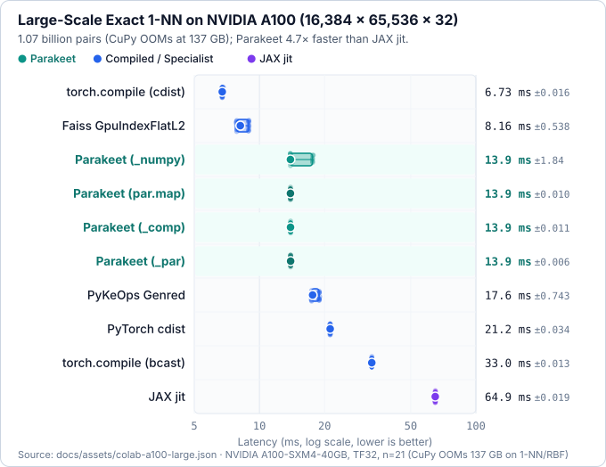
  <figcaption><strong>Figure 1.</strong> Large-scale exact 1-NN search (16,384 × 65,536 × 32; 1.07 billion pairs) on NVIDIA A100. CuPy OOMs attempting to allocate 137.4 GB; all four parallel Parakeet styles tie at 13.9 ms (4.7× faster than JAX jit).</figcaption>
</figure>

<figure markdown="span">
  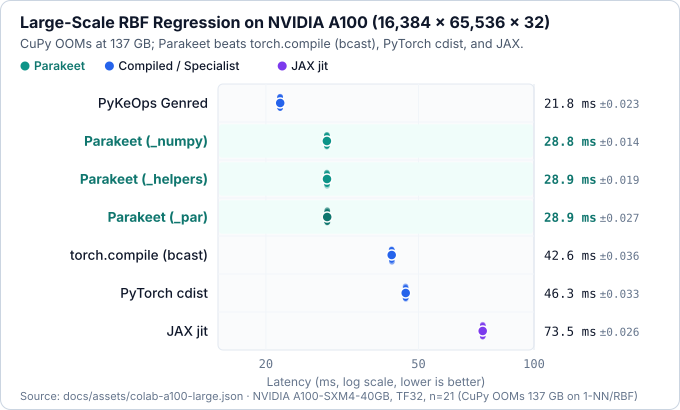
  <figcaption><strong>Figure 2.</strong> Large-scale Gaussian / RBF kernel regression (16,384 × 65,536 × 32) on NVIDIA A100. CuPy OOMs (137.4 GB) and <code>torch.compile(cdist)</code> fails the TF32 accuracy check (max abs err 0.007); Parakeet beats <code>torch.compile</code> broadcast, PyTorch <code>cdist</code>, and JAX <code>jit</code>.</figcaption>
</figure>

<figure markdown="span">
  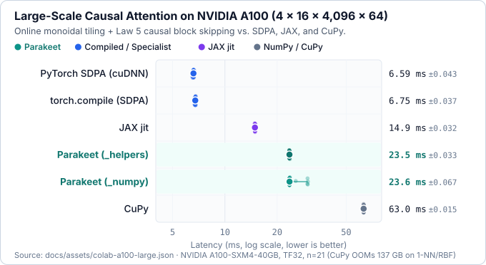
  <figcaption><strong>Figure 3.</strong> Large-scale causal self-attention (4 × 16 × 4,096 × 64, float32) on NVIDIA A100. Parakeet online monoidal tiling with Law 5 causal block skipping runs 2.68× faster than CuPy, trailing cuDNN SDPA and JAX jit.</figcaption>
</figure>

<figure markdown="span">
  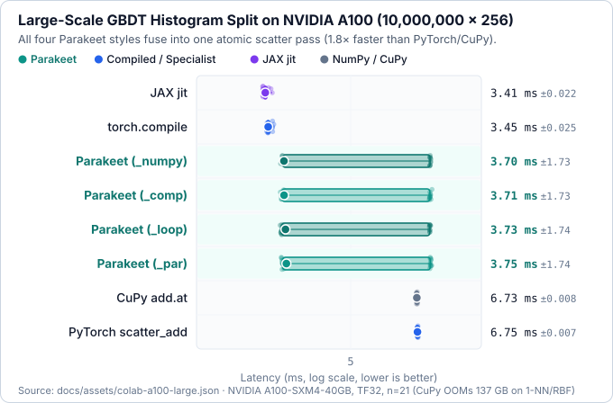
  <figcaption><strong>Figure 4.</strong> Large-scale GBDT gradient/Hessian histogram and best split (10,000,000 × 256 bins) on NVIDIA A100. All four Parakeet styles fuse into one atomic scatter pass (3.70–3.75 ms), 1.82× faster than PyTorch <code>scatter_add</code> and CuPy and within 9% of JAX and <code>torch.compile</code>.</figcaption>
</figure>

<figure markdown="span">
  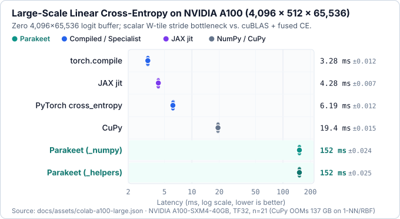
  <figcaption><strong>Figure 5.</strong> Large-scale linear cross-entropy (4,096 × 512 × 65,536) on NVIDIA A100. Parakeet avoids allocating the 1 GiB logit matrix, but currently pays for uncoalesced scalar loads along the vocabulary projection matrix compared with cuBLAS-backed PyTorch and JAX.</figcaption>
</figure>

| Workload (NVIDIA A100, TF32) | Parakeet (`_numpy` / best style) | PyTorch eager / specialist | `torch.compile` | JAX `jit` | Specialist (`Faiss` / `PyKeOps`) | CuPy |
|---|---:|---:|---:|---:|---:|---:|
| Exact 1-NN (`16,384 × 65,536 × 32`) | **13.90 ms** (all 4 styles `13.90–13.93`) | 21.22 ms (`cdist`) | 6.73 ms (`cdist`) / 33.04 ms (bcast) | 64.91 ms | 8.16 ms (`Faiss`) / 17.60 ms (`KeOps`) | OOM (`137 GB`) |
| Gaussian RBF (`16,384 × 65,536 × 32`) | **28.85 ms** (`_numpy`/`_helpers`/`_par`) | 46.28 ms (`cdist`) | 42.56 ms (bcast; `cdist` TF32 tol fail) | 73.50 ms | 21.79 ms (`PyKeOps`) | OOM (`137 GB`) |
| Causal attention (`4 × 16 × 4,096 × 64`) | **23.54 ms** (`_helpers` / `23.58` `_numpy`) | 6.59 ms (`SDPA`) | 6.75 ms (`SDPA`) | 14.89 ms | - | 62.99 ms |
| GBDT split (`10,000,000 × 256`) | **3.70 ms** (all 4 styles `3.70–3.75`) | 6.75 ms (`scatter_add`) | 3.45 ms | 3.41 ms | - | 6.73 ms |
| Linear CE (`4,096 × 512 × 65,536`) | **151.71 ms** (0 logit buffer) | 6.19 ms (`cross_entropy`) | 3.28 ms | 4.28 ms | - | 19.37 ms |

> **Note on Parakeet styles on CUDA:** On GPU, styles that fuse cleanly into
> monoidal tiles (`_numpy`, `_helpers`, `_par`, `_comp`, `par.map` where no
> per-iteration heap buffer is allocated) emit identical CUDA kernels and tie
> within noise. Explicit outer-map spellings that allocate a per-row intermediate
> buffer inside the parallel body (`rbf_regression_comp`, `causal_attention_par`,
> `cross_entropy_par`) are rejected under strict `--device cuda` dispatch rather
> than silently falling back to CPU (recorded cleanly in the JSON).

### Release-scale GPU workloads (NVIDIA A100, `1,024 × 4,096 × 32`, TF32)

<figure markdown="span">
  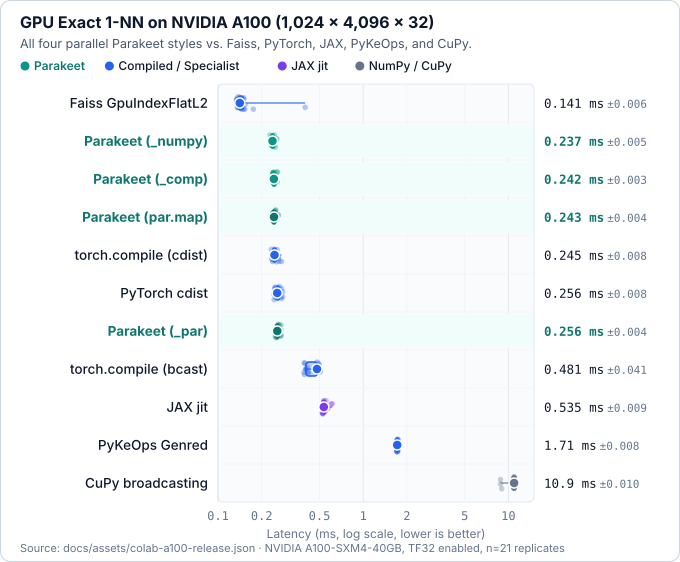
  <figcaption><strong>Figure 6.</strong> Exact 1-NN search (1,024 × 4,096 × 32, float32) on NVIDIA A100. Parakeet (<code>_numpy</code>/<code>_comp</code>/<code>par.map</code>, 0.237–0.243 ms) beats <code>torch.compile</code>, PyTorch <code>cdist</code>, JAX <code>jit</code>, PyKeOps, and CuPy (<code>_par</code> ties <code>cdist</code> at 0.256 ms), trailing only Faiss.</figcaption>
</figure>

<figure markdown="span">
  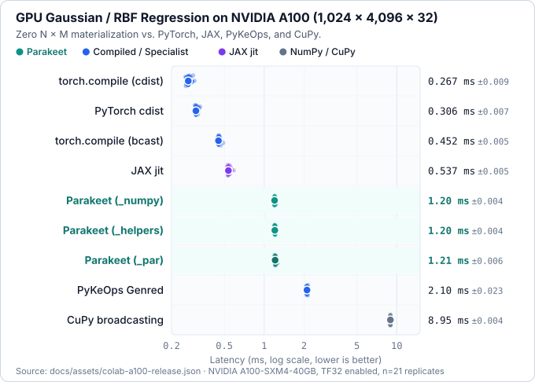
  <figcaption><strong>Figure 7.</strong> Gaussian / RBF kernel regression (1,024 × 4,096 × 32, float32) on NVIDIA A100 across Parakeet styles, PyTorch, JAX, PyKeOps, and CuPy.</figcaption>
</figure>

### Scaling exact 1-NN with reference count

Eliminating the materialized `Q × R` distance matrix changes both memory
scaling and GPU throughput. On NVIDIA A100
([raw A100 JSON](assets/colab-a100-pairwise.json)), NVIDIA L4, and NVIDIA A10G
([raw A10G JSON](assets/gpu-pairwise-fold.json)), both broadcasting NumPy and
nested [`par.map`](operators.md#map) compile to the same tiled pairwise fold
with zero host transfers and exact first-index tie/NaN semantics.

<figure markdown="span">
  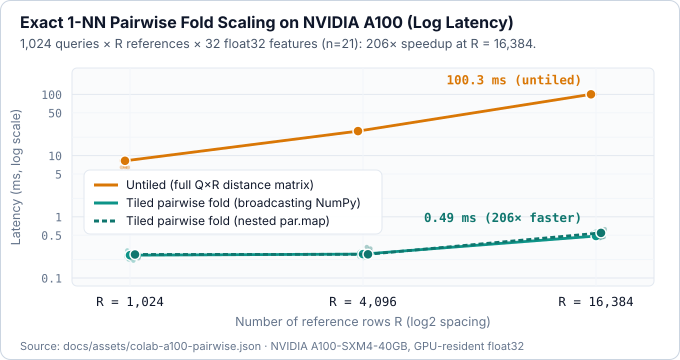
  <figcaption><strong>Figure 8.</strong> Exact 1-NN GPU latency scaling from 1,024 to 16,384 references (Q = 1,024, D = 32) on NVIDIA A100: tiled pairwise fold vs. untiled materialized baseline (206× speedup at R = 16,384).</figcaption>
</figure>

<figure markdown="span">
  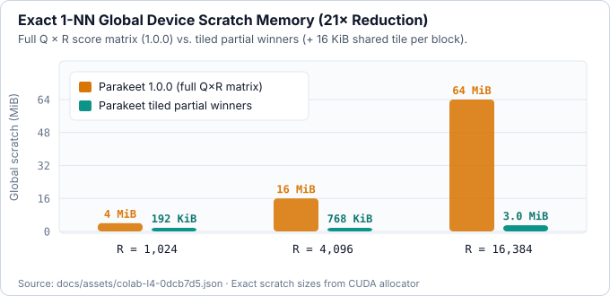
  <figcaption><strong>Figure 9.</strong> Exact 1-NN global device scratch memory scaling from 1,024 to 16,384 references: 21× reduction (64 MiB down to 3.0 MiB + 16 KiB shared memory per block).</figcaption>
</figure>

| References (`Q = 1,024, D = 32`) | A100 Untiled | A100 Tiled NumPy | A100 Tiled `par.map` | L4 `1.0.0` | L4 Tiled NumPy | A10G Tiled NumPy | Untiled Scratch | Tiled Scratch |
|---:|---:|---:|---:|---:|---:|---:|---:|---:|
| 1,024 | 8.234 ms | **0.236 ms** | **0.242 ms** | 0.361 ms | **0.197 ms** | **0.135 ms** | 4 MiB | **192 KiB** |
| 4,096 | 25.199 ms | **0.245 ms** | **0.244 ms** | 0.787 ms | **0.241 ms** | **0.190 ms** | 16 MiB | **768 KiB** |
| 16,384 | 100.270 ms | **0.486 ms** | **0.546 ms** | 2.597 ms | **0.542 ms** | **0.458 ms** | 64 MiB | **3.0 MiB** |

### End-to-end nanoGPT training (NVIDIA A100)

Each step runs the full forward pass, reverse-mode backpropagation, and Adam
update (4 attention heads, median of 20 warmed steps). Parakeet compiles every
GEMM, attention, LayerNorm, and Adam kernel natively with **zero cuBLAS calls**
and compares four implementations: functional batched TF32, Pythonic
[`par.nn.Module`](gallery/nanogpt.md) TF32, functional batched FP32, and a
host-Adam FP32 ablation showing the real round-trip penalty (56 host uploads +
54 downloads per step on `L=4`) of keeping the optimizer outside `@par.jit`.

<figure markdown="span">
  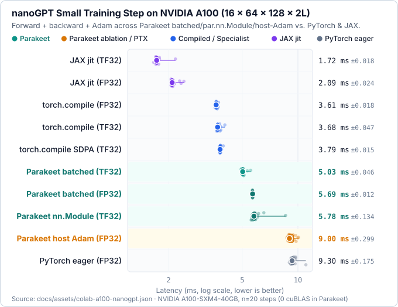
  <figcaption><strong>Figure 10.</strong> Small nanoGPT training step latency (B=16, T=64, C=128, L=2, H=4; forward + backward + Adam) on NVIDIA A100 across Parakeet implementations, PyTorch, and JAX.</figcaption>
</figure>

<figure markdown="span">
  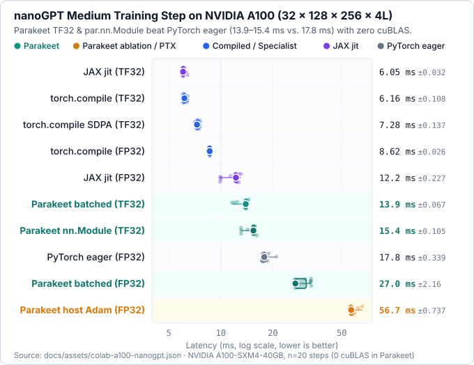
  <figcaption><strong>Figure 11.</strong> Medium nanoGPT training step latency (B=32, T=128, C=256, L=4, H=4; forward + backward + Adam) on NVIDIA A100. Parakeet batched TF32 (13.93 ms) and <code>par.nn.Module</code> TF32 (15.43 ms) beat PyTorch eager (17.82 ms) with zero cuBLAS.</figcaption>
</figure>

| Implementation (NVIDIA A100) | Small step (`L=2`) | Small cold compile | Medium step (`L=4`) | Medium cold compile |
|---|---:|---:|---:|---:|
| **Parakeet batched (TF32)** | **5.03 ms** | 8.4 s | **13.93 ms** | 19.8 s |
| **Parakeet `par.nn.Module` (TF32)** | **5.78 ms** | 12.7 s | **15.43 ms** | 27.1 s |
| **Parakeet batched (FP32)** | **5.69 ms** | 13.3 s | **26.98 ms** | 24.7 s |
| Parakeet host-Adam ablation (FP32) | 9.00 ms | 5.4 s | 56.70 ms | 16.3 s |
| PyTorch eager (FP32) | 9.30 ms | 0.6 s | 17.82 ms | 0.04 s |
| `torch.compile` (FP32) | 3.61 ms | 15.2 s | 8.62 ms | 18.7 s |
| `torch.compile` (TF32) | 3.68 ms | 5.4 s | 6.16 ms | 15.4 s |
| `torch.compile` SDPA (TF32) | 3.80 ms | 10.0 s | 7.28 ms | 14.0 s |
| JAX `jit` (FP32) | 2.09 ms | 63.4 s | 12.22 ms | 79.9 s |
| JAX `jit` (TF32) | 1.72 ms | 20.7 s | 6.05 ms | 31.4 s |

### CUDA compiler backends: Direct PTX vs. NVRTC vs. `nvcc -O3` (NVIDIA A100)

Parakeet supports three selectable CUDA code-generation pipelines via
`par.config.cuda_compiler` (or `PARAKEET_CUDA_COMPILER`): `"nvrtc"` (default),
`"nvcc"` (standalone `nvcc -O3`), and `"ptx"` (Parakeet's direct SSA PTX 7.8
emitter loaded via `cuModuleLoadDataEx`, falling back to NVRTC for libm /
tensor-core kernels). All three were timed back-to-back with a cleared disk
cache on the same NVIDIA A100 ([raw compiler JSON](assets/colab-a100-nanogpt-compilers.json)).

<figure markdown="span">
  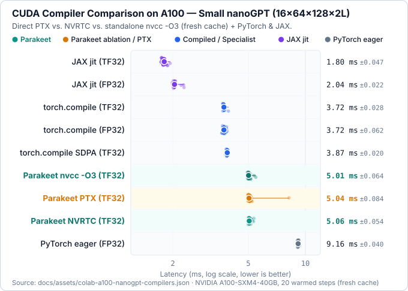
  <figcaption><strong>Figure 12.</strong> Direct PTX vs. NVRTC vs. standalone <code>nvcc -O3</code> (fresh cache, TF32) on small nanoGPT (16 × 64 × 128 × 2L) on NVIDIA A100.</figcaption>
</figure>

<figure markdown="span">
  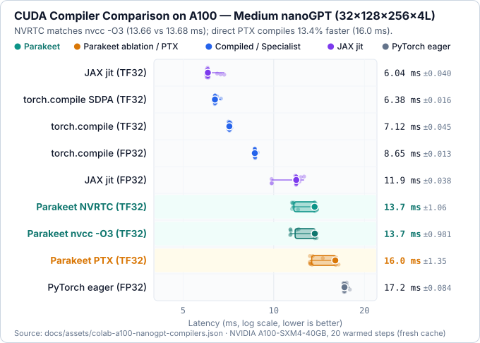
  <figcaption><strong>Figure 13.</strong> Direct PTX vs. NVRTC vs. standalone <code>nvcc -O3</code> (fresh cache, TF32) on medium nanoGPT (32 × 128 × 256 × 4L) on NVIDIA A100. NVRTC and <code>nvcc -O3</code> tie at 13.66–13.68 ms; direct PTX compiles 13.4% faster (23.4 s) at 16.00 ms steady-state.</figcaption>
</figure>

| CUDA compiler backend (`cuda_compiler=`) | Small step (`L=2`) | Small compile (`#kernels`) | Medium step (`L=4`) | Medium compile (`#kernels`) |
|---|---:|---:|---:|---:|
| **`"nvrtc"` (default)** | **5.056 ms** | 11.8 s (`41` NVRTC) | **13.661 ms** | 27.0 s (`44` NVRTC) |
| **`"nvcc"` (`nvcc -O3`)** | **5.015 ms** | 12.5 s (`41` `nvcc`) | **13.682 ms** | 26.6 s (`44` `nvcc`) |
| **`"ptx"` (direct PTX 7.8 + NVRTC fallback)** | **5.041 ms** | 14.5 s (`29` PTX / `12` NVRTC) | **15.999 ms** | **23.4 s** (`32` PTX / `12` NVRTC) |

NVRTC and `nvcc -O3` share NVIDIA's `cicc` optimizer and land within 0.2% of
each other (`13.66` vs. `13.68 ms`). Direct PTX cuts cold medium-model compile
time by **13.4%** (`27.0 → 23.4 s`) by skipping C parsing and `cicc` for 32 of
the 44 unique kernels, while giving up ~17% steady-state speed on memory-bound
elementwise/reduction kernels until vector `ld.global.v4` and loop-invariant
code motion land in the PTX emitter. Retaining all three options lets users pick
`"nvrtc"` or `"nvcc"` for peak throughput and `"ptx"` for faster cold builds.

---

## High-core CPU benchmarks (24-core AMD EPYC 7B13)

Measured on a 24-core **AMD EPYC 7B13** host (`24` OpenMP/Parakeet threads,
`n = 11` warmed replicates; [raw array JSON](assets/colab-epyc24-release.json),
[raw bio JSON](assets/colab-epyc24-bio.json)).

### Pairwise search, kernel regression, and histograms (24 cores)

<figure markdown="span">
  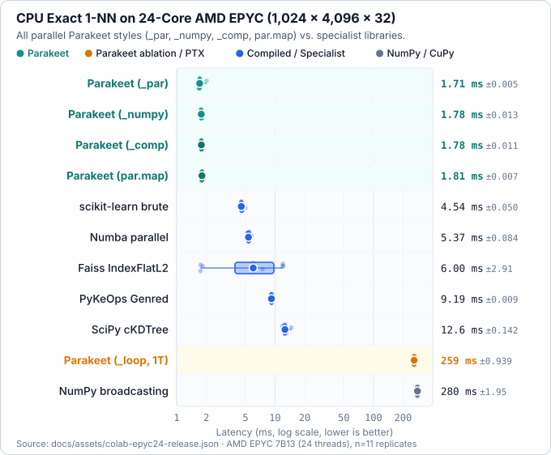
  <figcaption><strong>Figure 14.</strong> CPU exact 1-NN search (1,024 × 4,096 × 32, float32) on 24-core AMD EPYC 7B13. All four parallel Parakeet styles (1.71–1.81 ms) beat scikit-learn brute (4.54 ms), Numba parallel (5.37 ms), Faiss Flat (6.00 ms), PyKeOps (9.19 ms), SciPy <code>cKDTree</code> (12.61 ms), and NumPy (280.1 ms).</figcaption>
</figure>

<figure markdown="span">
  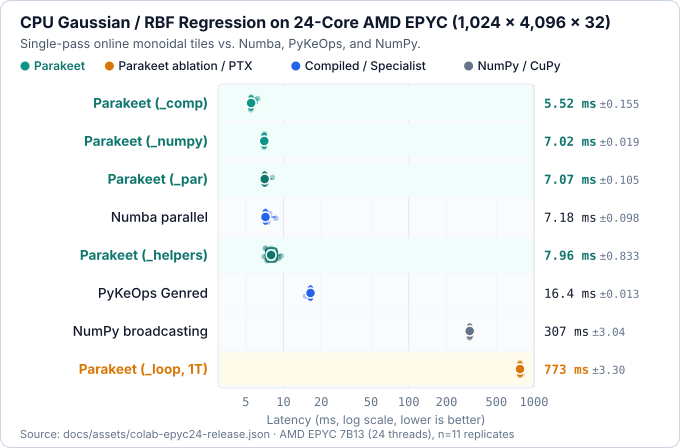
  <figcaption><strong>Figure 15.</strong> CPU Gaussian / RBF kernel regression (1,024 × 4,096 × 32, float32) on 24-core AMD EPYC 7B13. Parakeet <code>_comp</code> (5.52 ms) and <code>_numpy</code>/<code>_par</code> (7.02–7.07 ms) beat Numba parallel (7.18 ms), PyKeOps (16.42 ms), and NumPy (306.9 ms).</figcaption>
</figure>

<figure markdown="span">
  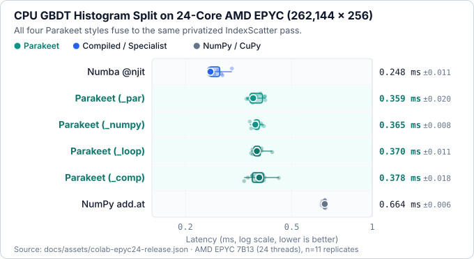
  <figcaption><strong>Figure 16.</strong> CPU GBDT gradient/Hessian histogram accumulation and best split (262,144 × 256 bins) on 24-core AMD EPYC 7B13 across all four Parakeet styles vs. Numba and NumPy.</figcaption>
</figure>

| Implementation (24-core AMD EPYC) | Exact 1-NN (`1024×4096×32`) | Gaussian RBF (`1024×4096×32`) | GBDT Split (`262,144×256`) |
|---|---:|---:|---:|
| **Parakeet `_par` (explicit operators)** | **1.713 ms** | **7.074 ms** | **0.359 ms** |
| **Parakeet `_numpy` (broadcasting)** | **1.779 ms** | **7.022 ms** | **0.365 ms** |
| **Parakeet `_comp` (comprehensions)** | **1.782 ms** | **5.516 ms** | **0.378 ms** |
| **Parakeet `par.map` / `_helpers`** | **1.808 ms** | **7.961 ms** | - |
| Parakeet `_loop` (sequential 1T / fused split) | 258.963 ms | 772.729 ms | **0.370 ms** |
| [scikit-learn brute](https://scikit-learn.org/stable/modules/generated/sklearn.neighbors.NearestNeighbors.html) | 4.543 ms | - | - |
| [Numba](https://numba.pydata.org/) `@njit(parallel=True)` | 5.369 ms | 7.179 ms | **0.248 ms** |
| [Faiss `IndexFlatL2`](https://github.com/facebookresearch/faiss) | 6.000 ms | - | - |
| [PyKeOps `Genred`](https://www.kernel-operations.io/keops/) | 9.192 ms | 16.421 ms | - |
| [SciPy `cKDTree`](https://docs.scipy.org/doc/scipy/reference/generated/scipy.spatial.cKDTree.html) (exact) | 12.613 ms | - | - |
| [NumPy](https://numpy.org/) | 280.062 ms | 306.910 ms | 0.664 ms |

### GBDT decision-tree training (24-core AMD EPYC, `50,000 × 16`, depth 6)

Running [`benchmarks/tree_models.py`](https://github.com/iskandr/parakeet/blob/master/benchmarks/tree_models.py)
on the same 24-core EPYC host compares Parakeet's compiled pure-BFS and hybrid
BFS→DFS histogram tree builders (using sibling histogram subtraction) against
scikit-learn, LightGBM, and XGBoost (single depth-6 tree, 32 bins; recorded from
`benchmarks/tree_models.py` stdout):

| Implementation (`50,000 × 16`, 32 bins, depth 6) | Balanced dataset (median) | Skewed dataset (median) |
|---|---:|---:|
| **Parakeet pure BFS (24T)** | **8.83 ms** (±0.35) | **5.94 ms** (±0.17) |
| **Parakeet BFS→DFS (24T)** | **9.75 ms** (±0.96) | **5.46 ms** (±0.18) |
| Parakeet BFS→DFS (`c`, 1T) | 22.67 ms (±0.04) | 9.85 ms (±0.06) |
| [scikit-learn `HistGradientBoosting`](https://scikit-learn.org/stable/modules/generated/sklearn.ensemble.HistGradientBoostingRegressor.html) | 28.66 ms (±0.34) | 27.70 ms (±0.53) |
| [LightGBM](https://lightgbm.readthedocs.io/) (1 tree) | 3.53 ms (±0.07) | 5.65 ms (±0.34) |
| [XGBoost `hist`](https://xgboost.readthedocs.io/) (1 tree) | 3.26 ms (±0.04) | 3.16 ms (±0.02) |

On the skewed dataset, Parakeet's BFS→DFS schedule (**5.46 ms**) beats both pure
BFS (`5.94 ms`) and LightGBM (`5.65 ms`) and runs **5.07× faster** than
scikit-learn's Cython `HistGradientBoosting` (`27.70 ms`), while XGBoost leads
at `3.16 ms`.

### Bioinformatics and structural biology (24-core AMD EPYC)

<figure markdown="span">
  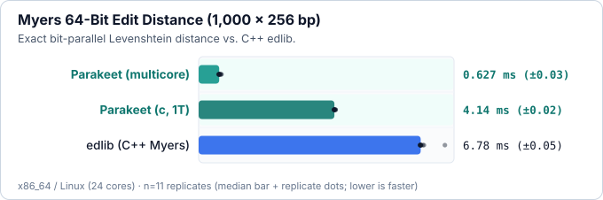
  <figcaption><strong>Figure 17.</strong> Myers 64-bit bit-vector edit distance (1,000 × 256 bp) on 24-core AMD EPYC 7B13: Parakeet multicore (0.627 ms) is 10.8× faster than C++ edlib (6.78 ms).</figcaption>
</figure>

<figure markdown="span">
  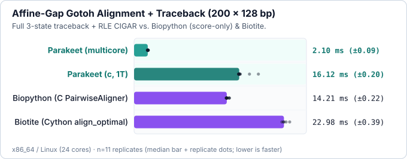
  <figcaption><strong>Figure 18.</strong> Affine-gap Gotoh global alignment with full traceback and RLE CIGAR (200 × 128 bp) on 24-core AMD EPYC 7B13: Parakeet multicore (2.10 ms) is 6.8× faster than Biopython C (score-only) and 10.9× faster than Biotite.</figcaption>
</figure>

<figure markdown="span">
  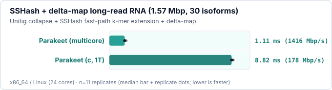
  <figcaption><strong>Figure 19.</strong> SSHash + delta-map long-read RNA mapping on 24-core AMD EPYC 7B13: 1.107 ms (1,416 Mbp/s; 8.0× multicore scaling over 1 thread).</figcaption>
</figure>

<figure markdown="span">
  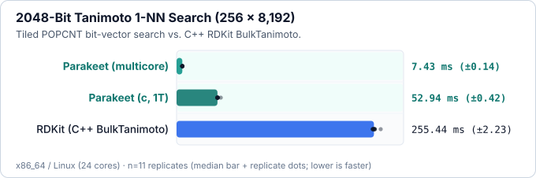
  <figcaption><strong>Figure 20.</strong> 2048-bit Morgan fingerprint Tanimoto 1-NN search (256 × 8,192 compounds) on 24-core AMD EPYC 7B13: Parakeet multicore (7.43 ms) is 34.4× faster than C++ RDKit (255.4 ms).</figcaption>
</figure>

<figure markdown="span">
  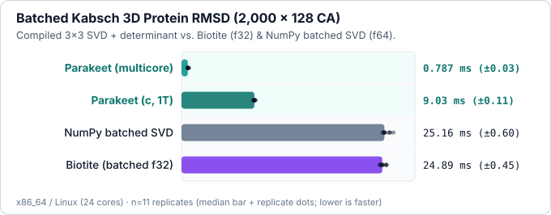
  <figcaption><strong>Figure 21.</strong> Batched Kabsch 3D protein superposition and RMSD (2,000 × 128 CA atoms) on 24-core AMD EPYC 7B13: Parakeet multicore (0.787 ms) is 31.6× faster than Biotite and 32.0× faster than NumPy.</figcaption>
</figure>

<figure markdown="span">
  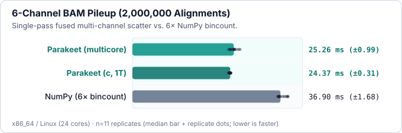
  <figcaption><strong>Figure 22.</strong> Single-pass 6-channel BAM alignment pileup (2M alignments) on 24-core AMD EPYC 7B13: Parakeet fused scatter (24.37–25.26 ms) vs. NumPy 6× <code>bincount</code> (36.90 ms).</figcaption>
</figure>

| Workload (24-core AMD EPYC) | Parakeet (24T) | Parakeet (`c`, 1T) | Specialist / Baseline | Speedup vs. Baseline | Implementation |
|---|---:|---:|---:|---:|---|
| Edit distance (`1,000 × 256 bp`, Myers) | **0.627 ms** | 4.144 ms | [edlib](https://github.com/Martinsos/edlib) (C++ Myers): 6.780 ms | **10.8×** (1.6× at 1T) | [`examples/bio_algorithms.py`](https://github.com/iskandr/parakeet/blob/master/examples/bio_algorithms.py) |
| Affine-gap Gotoh + traceback (`200 × 128 bp`) | **2.104 ms** | 16.117 ms | [Biopython](https://biopython.org/) C (score-only): 14.214 ms; [Biotite](https://www.biotite-python.org/): 22.977 ms | **6.8×** vs Biopython, **10.9×** vs Biotite | [`examples/bio_algorithms.py`](https://github.com/iskandr/parakeet/blob/master/examples/bio_algorithms.py) |
| 2048-bit Tanimoto 1-NN (`256 × 8,192`) | **7.434 ms** | 52.941 ms | [RDKit](https://www.rdkit.org/) (`BulkTanimoto`): 255.444 ms | **34.4×** (4.8× at 1T) | [`examples/bio_gallery.py`](https://github.com/iskandr/parakeet/blob/master/examples/bio_gallery.py) |
| Batched Kabsch 3D RMSD (`2,000 × 128` CA) | **0.787 ms** | 9.033 ms | [Biotite](https://www.biotite-python.org/) (f32): 24.895 ms; [NumPy](https://numpy.org/) (f64): 25.161 ms | **31.6×** vs Biotite, **32.0×** vs NumPy | [`examples/bio_algorithms.py`](https://github.com/iskandr/parakeet/blob/master/examples/bio_algorithms.py) |
| 6-channel BAM pileup (`2M` alignments) | **25.260 ms** | **24.375 ms** | [NumPy](https://numpy.org/) (6× `bincount`): 36.904 ms | **1.5×** | [`examples/bio_gallery.py`](https://github.com/iskandr/parakeet/blob/master/examples/bio_gallery.py) |
| [SSHash](https://github.com/jermp/sshash) + delta-map RNA (`1.57 Mbp`, 30 isoforms) | **1.107 ms** (**1,416 Mbp/s**) | 8.819 ms (178 Mbp/s) | 8.0× multicore scaling | - | [`examples/patro_longread_rna.py`](https://github.com/iskandr/parakeet/blob/master/examples/patro_longread_rna.py) |

Notes on fairness:

* On single-threaded Gotoh alignment, Biopython's C `PairwiseAligner.score()`
  computes scores only whereas Parakeet's `gotoh_global_align` populates full
  traceback tables and builds run-length-encoded CIGAR arrays.
* On Kabsch 3D RMSD, Biotite internally converts coordinates to `float32`, while
  both Parakeet (compiled `np.linalg.svd` + `det`) and NumPy compute in `float64`.
* On `edlib` and `RDKit`, part of Parakeet's advantage comes from batching the
  entire query set inside one GIL-free compiled loop instead of crossing the
  Python-to-C boundary once per read or fingerprint.

---

## Benchmark implementations and reproduction

Every figure on this page is backed by runnable repository code and committed
raw JSON samples (and the GBDT decision-tree table is reproduced directly from
`benchmarks/tree_models.py`):

| Suite / Workload | Runnable code | Repro command |
|---|---|---|
| Unified Colab A100 & high-core CPU runner | [`tools/colab_full_bench.py`](https://github.com/iskandr/parakeet/blob/master/tools/colab_full_bench.py) | `PK_BENCH_MODE=gpu runplz colab tools/colab_full_bench.py` |
| Release & large-scale cross-framework suite | [`benchmarks/release_comparison.py`](https://github.com/iskandr/parakeet/blob/master/benchmarks/release_comparison.py) | `python -m benchmarks.release_comparison array out.json --scale large --tensor-cores` |
| nanoGPT GPU & CUDA compiler suite | [`benchmarks/nanogpt_bench.py`](https://github.com/iskandr/parakeet/blob/master/benchmarks/nanogpt_bench.py) | `python -m benchmarks.nanogpt_bench --device cuda --compare-cuda-compilers` |
| Bioinformatics head-to-head suite | [`benchmarks/bio_head_to_head.py`](https://github.com/iskandr/parakeet/blob/master/benchmarks/bio_head_to_head.py) | `python -m benchmarks.bio_head_to_head` |
| GBDT decision-tree benchmark | [`benchmarks/tree_models.py`](https://github.com/iskandr/parakeet/blob/master/benchmarks/tree_models.py) | `python -m benchmarks.tree_models` |
| GPU exact 1-NN pairwise fold scaling | [`benchmarks/gpu_pairwise_fold.py`](https://github.com/iskandr/parakeet/blob/master/benchmarks/gpu_pairwise_fold.py) | `python -m benchmarks.gpu_pairwise_fold` |
| Regenerate all single-panel SVG figures | [`tools/gen_benchmark_figures.py`](https://github.com/iskandr/parakeet/blob/master/tools/gen_benchmark_figures.py) | `python tools/gen_benchmark_figures.py` |

---

## Earlier hardware baselines (NVIDIA L4, Apple M1 Pro, and 1.0.0 A10)

Earlier measurements from **NVIDIA L4 + 4-thread CPU**, **Apple M1 Pro (10
cores)**, and the historical **1.0.0 Modal NVIDIA A10** release are preserved
below for longitudinal continuity.

### NVIDIA L4 & 4-thread CPU

Raw JSON downloads:
[L4 forward suite (`0dcb7d5`)](assets/colab-l4-0dcb7d5.json) ·
[L4 nanoGPT (`7bb1dcc`)](assets/colab-l4-nanogpt.json).

<figure markdown="span">
  
  <figcaption><strong>Figure 23.</strong> GPU exact 1-NN search latency (1,024 × 4,096 × 32, float32) on NVIDIA L4 across 21 warmed replicates.</figcaption>
</figure>

<figure markdown="span">
  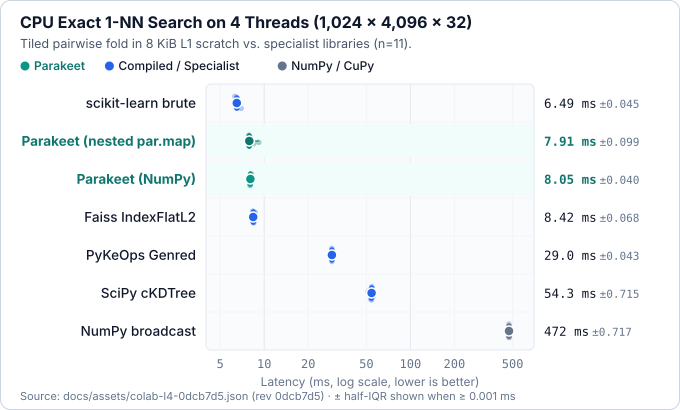
  <figcaption><strong>Figure 24.</strong> CPU exact 1-NN search latency (1,024 × 4,096 × 32, float32) on 4 threads across 11 warmed replicates.</figcaption>
</figure>

<figure markdown="span">
  
  <figcaption><strong>Figure 25.</strong> GPU Gaussian / RBF kernel regression latency (1,024 × 4,096 × 32, float32) on NVIDIA L4 across 21 warmed replicates.</figcaption>
</figure>

<figure markdown="span">
  
  <figcaption><strong>Figure 26.</strong> CPU Gaussian / RBF kernel regression latency (1,024 × 4,096 × 32, float32) on 4 threads across 11 warmed replicates.</figcaption>
</figure>

<figure markdown="span">
  
  <figcaption><strong>Figure 27.</strong> Exact 1-NN GPU latency scaling from 1,024 to 16,384 references (Q = 1,024, D = 32) on NVIDIA L4: tiled pairwise fold vs. 1.0.0 materialized baseline.</figcaption>
</figure>

<figure markdown="span">
  
  <figcaption><strong>Figure 28.</strong> GBDT gradient/Hessian histogram accumulation and best-split latency (262,144 × 256 bins) on NVIDIA L4.</figcaption>
</figure>

<figure markdown="span">
  
  <figcaption><strong>Figure 29.</strong> Causal self-attention latency (4 × 512 × 64, float32) on NVIDIA L4.</figcaption>
</figure>

<figure markdown="span">
  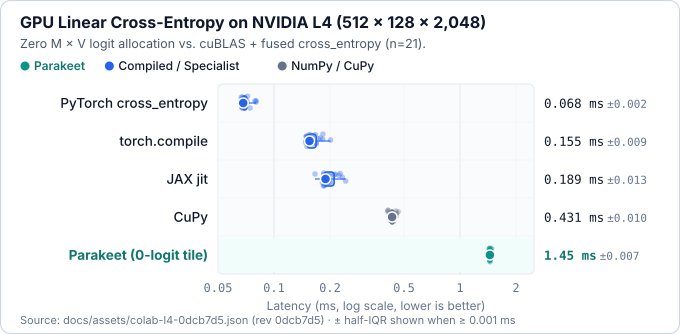
  <figcaption><strong>Figure 30.</strong> Linear cross-entropy latency (512 × 128 × 2,048, float32) on NVIDIA L4.</figcaption>
</figure>

#### End-to-end nanoGPT training (NVIDIA L4)

<figure markdown="span">
  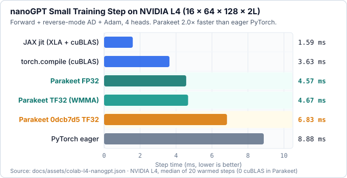
  <figcaption><strong>Figure 31.</strong> Small nanoGPT training step latency (B=16, T=64, C=128, L=2, H=4; forward + backward + Adam) on NVIDIA L4.</figcaption>
</figure>

<figure markdown="span">
  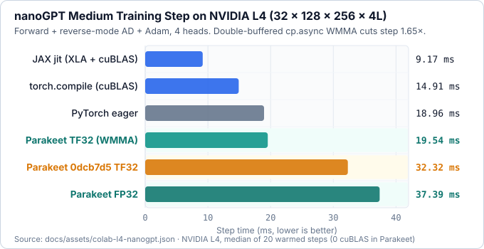
  <figcaption><strong>Figure 32.</strong> Medium nanoGPT training step latency (B=32, T=128, C=256, L=4, H=4; forward + backward + Adam) on NVIDIA L4.</figcaption>
</figure>

### Bioinformatics and structural biology (Apple M1 Pro, 10 cores)

[Download Apple M1 Pro bio JSON](assets/bio-benchmarks-m1pro.json).

<figure markdown="span">
  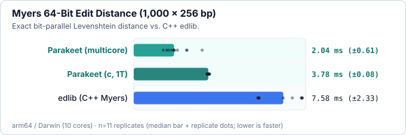
  <figcaption><strong>Figure 33.</strong> Myers 64-bit bit-vector edit distance (1,000 × 256 bp) on Apple M1 Pro (10 cores): Parakeet vs. edlib C++.</figcaption>
</figure>

<figure markdown="span">
  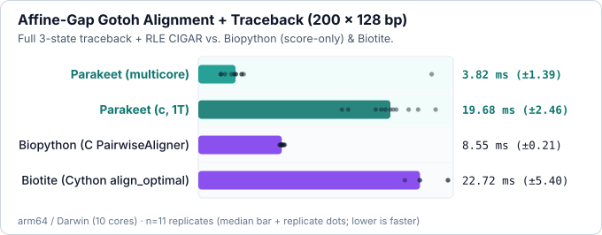
  <figcaption><strong>Figure 34.</strong> Affine-gap Gotoh global alignment with full traceback (200 × 128 bp) on Apple M1 Pro: Parakeet vs. Biopython C and Biotite Cython.</figcaption>
</figure>

<figure markdown="span">
  
  <figcaption><strong>Figure 35.</strong> SSHash + delta-map long-read RNA mapping (3.01 Mbp across 80 human Ensembl isoforms) on Apple M1 Pro.</figcaption>
</figure>

<figure markdown="span">
  
  <figcaption><strong>Figure 36.</strong> 2048-bit Morgan fingerprint Tanimoto 1-NN search (256 × 8,192 compounds) on Apple M1 Pro: Parakeet vs. RDKit C++.</figcaption>
</figure>

<figure markdown="span">
  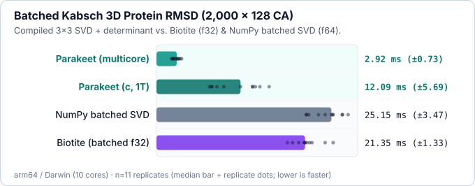
  <figcaption><strong>Figure 37.</strong> Batched Kabsch 3D protein superposition and RMSD (2,000 × 128 CA atoms) on Apple M1 Pro: Parakeet vs. Biotite and NumPy.</figcaption>
</figure>

<figure markdown="span">
  
  <figcaption><strong>Figure 38.</strong> Single-pass 6-channel BAM alignment pileup (2M observations) on Apple M1 Pro: Parakeet fused IndexScatter vs. NumPy 6× bincount.</figcaption>
</figure>

### Historical 1.0.0 baseline (Modal NVIDIA A10 & 4-vCPU)

For continuity with the original `1.0.0` release (compiler revision
`0345559f`, NVIDIA A10 24 GiB, driver `620.70.06`, 4-vCPU worker), the initial
pre-pairwise-fold measurements are archived in
[Download raw 1.0.0 Modal JSON](assets/modal-alpha-comparison.json).

### Methodology notes

* Every benchmark arm is checked against a reference implementation (exact
  index equality for 1-NN and split finding; tight floating-point tolerance for
  reductions, attention, and training losses).
* GPU arms time GPU-resident inputs with explicit CUDA synchronization before
  and after each replicate; first-call compilation times are recorded
  separately in the JSON downloads and excluded from warmed medians.
* On CPU, Parakeet's pairwise fold allocates an `8 KiB` (`16 × 128` float32)
  score tile plus `192 B` of row summaries per active strip; on GPU, it uses a
  `16 KiB` shared-memory score tile per block and `O(Q · #tiles)` global
  partial winners rather than an `O(Q · R)` distance matrix.
