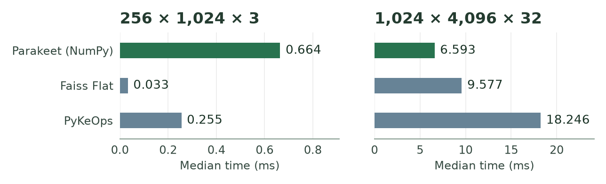

# Release benchmarks

[Google Colab measurements for the post-release compiler](#google-colab-after-100) include exact search, Gaussian regression, nanoGPT training and first-call costs.

Five forward workloads compare Parakeet with general-purpose array compilers and specialist libraries. The tables report warmed median latency. Smaller values are faster. [Download all timing samples and validation results (JSON)](assets/modal-alpha-comparison.json).



Four CPU threads, exact 1-NN, float32. Panels show queries × references × features, with independent time scales. At the small shape Faiss took **0.033 ms**. At the large shape Parakeet's NumPy function took **6.593 ms** and its nested-map DSL took **6.132 ms**.

On the NVIDIA A10, Faiss led large exact search and compiled PyTorch led Gaussian regression. Parakeet beat PyKeOps for both at the large shape. All GPU comparisons ran on the same physical card.

## Pairwise workloads

Warmed median latency in milliseconds. Small is 256 × 1,024 × 3 and large is 1,024 × 4,096 × 32, in query × reference × feature order. Gaussian regression returns four normalized weighted sums per query.

### Four-vCPU worker

| Four-vCPU implementation | Small 1-NN | Large 1-NN | Small Gaussian | Large Gaussian |
|---|---:|---:|---:|---:|
| Parakeet, broadcasting NumPy | 0.664 | 6.593 | 2.971 | 28.951 |
| Parakeet, nested-map DSL | 0.638 | 6.132 | — | — |
| PyKeOps Genred | 0.255 | 18.246 | 1.087 | 38.038 |
| Faiss IndexFlatL2 | 0.033 | 9.577 | — | — |
| SciPy cKDTree, exact query | 1.441 | 51.846 | — | — |
| scikit-learn brute-force neighbors | 1.042 | 6.647 | — | — |
| NumPy broadcasting | 9.899 | 326.690 | 10.915 | 359.939 |

### NVIDIA A10

| NVIDIA A10 implementation | Small 1-NN | Large 1-NN | Small Gaussian | Large Gaussian |
|---|---:|---:|---:|---:|
| Parakeet, broadcasting NumPy | 0.261 | 0.796 | 0.226 | 1.130 |
| PyKeOps Genred | 0.262 | 0.962 | 0.295 | 1.289 |
| Faiss GpuIndexFlatL2 | 0.079 | 0.154 | — | — |
| PyTorch cdist | 0.128 | 0.323 | 0.166 | 0.568 |
| torch.compile over cdist | 0.089 | 0.208 | 0.106 | 0.294 |
| torch.compile over broadcasting | 0.053 | 0.416 | 0.074 | 0.487 |
| JAX jit, broadcasting | 0.115 | 0.424 | 0.098 | 0.663 |
| CuPy, broadcasting | 0.483 | 12.359 | 0.527 | 12.736 |

### Memory and dispatch

The CPU IR allocates a 16 × 128 float32 score tile (8 KiB) and 192 bytes of row summaries per active query strip. The CUDA broadcast form allocates a float32 query-by-reference matrix (16 MiB at the large shape) and runs two kernels. The nested DSL form allocates one reference-length row inside the query loop. Strict CUDA execution rejected it at both sizes. On Metal we also verified the fallback diagnostic for the DSL and two launches for broadcasting. These are IR allocations and dispatch counts. Peak process memory was not measured.

## Attention, linear cross-entropy and split finding

All three workloads run forward on the A10. Attention has one batch, four heads, 512 tokens and head width 64. Cross-entropy includes projecting 512 vectors of width 128 to 2,048 logits and taking the mean target loss. Split finding includes two weighted histograms over 262,144 rows and 256 bins, prefix sums and the best-bin and gain return.

| NVIDIA A10 implementation | Causal attention | Linear cross-entropy | GBDT split |
|---|---:|---:|---:|
| Parakeet | 0.386 | 1.604 | 0.276 |
| PyTorch SDPA / cross_entropy / scatter_add | 0.090 | 0.069 | 0.225 |
| torch.compile over the same PyTorch functions | 0.116 | 0.088 | 0.175 |
| JAX jit | 0.217 | 0.133 | 0.188 |
| CuPy | 0.326 | 0.255 | 0.420 |

Parakeet issued one launch and zero transfers for attention and Gaussian regression. Linear cross-entropy issued two launches and one download per call. Split finding issued six launches, two uploads and six downloads. Two clear follow-ups are a GPU schedule for ordered pairwise folds and keeping the histogram-to-split computation resident. The cross-entropy result calls for a measured choice between materializing logits and recomputing them at this shape.

## How to reproduce and interpret the numbers

Run from a checkout with the Modal client configured.

```bash
modal run tools/modal_release_bench.py --output comparison.json
```

- The measured compiler revision was `0345559f4b2d3c59a07ce8c1a71bfb619f690063`. The subsequent NumPy scalar compatibility fix concerns `count_nonzero`, which none of these workloads calls. The GPU reported 23,028 MiB and driver 620.70.06. The CPU reservation was four vCPUs with four library threads, and Modal hid the CPU model.
- Inputs were generated once per provider from the same fixed seed, using float32 values and integer indices. The oracle used float64 NumPy, exact nearest-neighbor and split indices, and tolerances of `rtol=5e-4, atol=3e-5` for floating outputs. SciPy's tree uses double precision internally. All published timings passed their checks.
- GPU inputs were uploaded before timing. The comparison includes dispatch, output production, internal transfers and synchronization for every call. Faiss database insertion, tree construction, sklearn fitting, imports and initial input upload were outside query timing. This measures repeated queries against a prepared reference set.
- Each method ran once for first-call timing and validation, then three warmups, then 21 synchronized GPU samples or 11 CPU samples. Providers ran sequentially in separate processes on the same GPU. JAX used its own Python environment. PyTorch used highest float32 matmul precision with TF32 disabled, JAX used highest precision, and Parakeet used strict device fallback, a threshold of one and tensor cores disabled. PyTorch SDPA selected its own float32 backend.
- First-call time includes execution and any lazy compilation. The large shape follows the small shape, so first calls can reuse specializations. For causal attention, Parakeet's first call took 1.692 s and its warmed median was 0.386 ms. The raw file includes first-call times, every sample, versions, validation error and the two strict-dispatch rejections. [Download the measurements](assets/modal-alpha-comparison.json).

## GPU pairwise fold after 1.0.0

The follow-up compiler evaluates each score tile in shared memory, writes one
structured partial per query and reference tile, and merges consecutive partials
in order. Both source forms use the same two CUDA launches. Tests also cover L1
argmax, first-index ties, first NaNs and partial tiles on CUDA and Metal.

On one Modal NVIDIA A10G, we compared release compiler `7ddd90a` with follow-up
`defe1d8`. The workload used 1,024 queries and 32 features. All timings are
warmed, synchronized medians from 21 calls with float32 data resident on device,
TF32 disabled and fallback disabled. The release DSL required fallback. Both
follow-up variants returned the exact reference indices with zero host transfers.

| References | 1.0.0 NumPy (ms) | Follow-up NumPy (ms) | Follow-up DSL (ms) | 1.0.0 score matrix | Follow-up global summaries |
|---:|---:|---:|---:|---:|---:|
| 1,024 | 0.296 | 0.135 | 0.139 | 4 MiB | 192 KiB |
| 4,096 | 0.853 | 0.190 | 0.180 | 16 MiB | 768 KiB |
| 16,384 | 2.898 | 0.458 | 0.470 | 64 MiB | 3 MiB |

Each active follow-up block also uses a 16 KiB shared score tile. Run
`modal run tools/modal_pairwise_fold.py --output pairwise.json` from the
follow-up checkout to reproduce this comparison. [Raw samples, allocations and device counters](assets/gpu-pairwise-fold.json).

## Google Colab after 1.0.0

These measurements use one NVIDIA L4 and the CPU on the same Colab VM. The compiler revision is `0dcb7d5`. The release comparison uses GPU-resident inputs, explicit synchronization and numerical checks. CPU comparisons use four threads. GPU medians use 21 warmed calls and CPU medians use 11. [Download the samples, first-call times, allocation sizes and training results](assets/colab-l4-0dcb7d5.json).

### Exact search and Gaussian regression

At 1,024 queries × 4,096 references × 32 float32 features, the following methods return exact indices or four normalized weighted values per query. Faiss and scikit-learn times exclude index construction. All entries are milliseconds.

| Implementation | CPU 1-NN | GPU 1-NN | CPU Gaussian | GPU Gaussian |
|---|---:|---:|---:|---:|
| Parakeet broadcasting | 8.050 | 0.223 | 42.990 | 1.053 |
| Parakeet nested maps | 7.907 | 0.225 | — | — |
| PyKeOps | 29.027 | 0.953 | 66.769 | 1.254 |
| Faiss Flat | 8.417 | 0.150 | — | — |
| scikit-learn brute | 6.492 | — | — | — |
| Compiled PyTorch with cdist | — | 0.257 | — | 0.308 |
| JAX JIT | — | 0.500 | — | 0.602 |

At the large shape, Parakeet beat PyKeOps on both workloads on both devices. GPU Faiss led exact search, and compiled PyTorch with cdist led Gaussian regression among the measured GPU methods. GPU Faiss used its CUDA 12 wheel on the same L4. Scikit-learn brute search led this CPU nearest-neighbor comparison at 6.492 ms. At the small shape (256 × 1,024 × 3), CPU PyKeOps took 0.241 ms in the independent, interleaved KeOps sweep, versus 0.701 ms for Parakeet broadcasting.

### Other GPU workloads

The same reference-checked suite measured the following forward computations. The PyTorch baselines use scaled dot-product attention, cross-entropy over a linear projection, and a compiled scatter-based tree split respectively.

| Workload | Parakeet | PyTorch | JAX JIT | CuPy |
|---|---:|---:|---:|---:|
| Causal attention, 4 heads × 512 × 64 | 0.493 | 0.104 | 0.145 | 0.490 |
| Linear cross-entropy, 512 × 128 × 2,048 | 1.447 | 0.068 | 0.189 | 0.431 |
| GBDT split, 262,144 rows and 256 bins | 0.370 | 0.208 | 0.244 | 0.647 |

For the large Gaussian workload, JAX took 672 s on the first call and 0.602 ms once warm. The table excludes compilation for every method.

### Scaling exact search

The GPU NumPy 1-NN form took 0.542 ms at 16,384 references, compared with 2.597 ms on 1.0.0. The earlier compiler allocated a 64 MiB distance matrix. The current compiler used 3 MiB of global partial winners and a 16 KiB shared score tile per block. The detailed run checks equal-distance ties, first NaNs, and partially filled tiles.

### Structured state

At 1,024 × 4,096 × 32, the explicit ordered fold and broadcasting NumPy took 0.235 and 0.222 ms for nearest neighbor. For inverse-distance smoothing they took 0.270 and 0.275 ms. The explicit smoother used two kernel launches per call and the NumPy smoother used three. All four ran with strict CUDA dispatch and zero timed host transfers. [Read the two programs](gallery.md#inverse-distance-smoothing).

### nanoGPT training

Each step includes the forward pass, backpropagation and Adam. Both configurations use four attention heads. Parakeet and JAX compile the optimizer into the step. The PyTorch compiled column wraps the loss in `torch.compile` and calls the optimizer separately. Times are medians of 20 warmed steps in milliseconds. The download also includes first-call times and initial and final losses. [Run the smaller character-level training example](gallery/nanogpt.md).

| Batch × context × width × layers | Parakeet FP32 | Parakeet TF32 | PyTorch eager | Compiled PyTorch | JAX JIT |
|---|---:|---:|---:|---:|---:|
| 16 × 64 × 128 × 2 | 8.439 | 6.833 | 9.217 | 3.515 | 1.619 |
| 32 × 128 × 256 × 4 | 45.499 | 32.317 | 18.554 | 14.480 | 9.411 |
