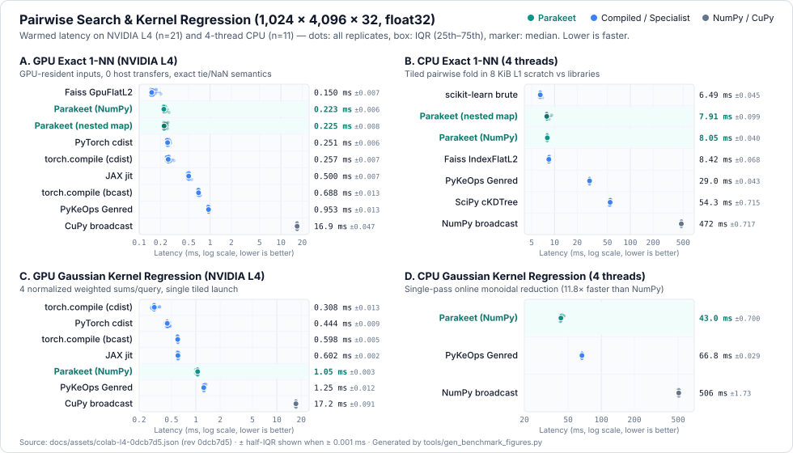
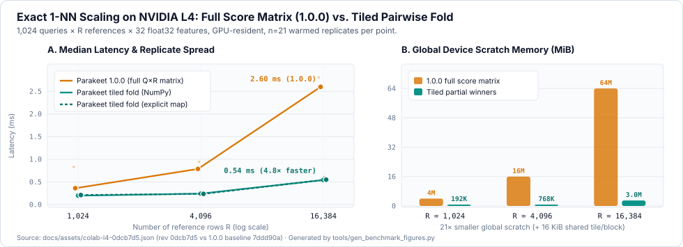
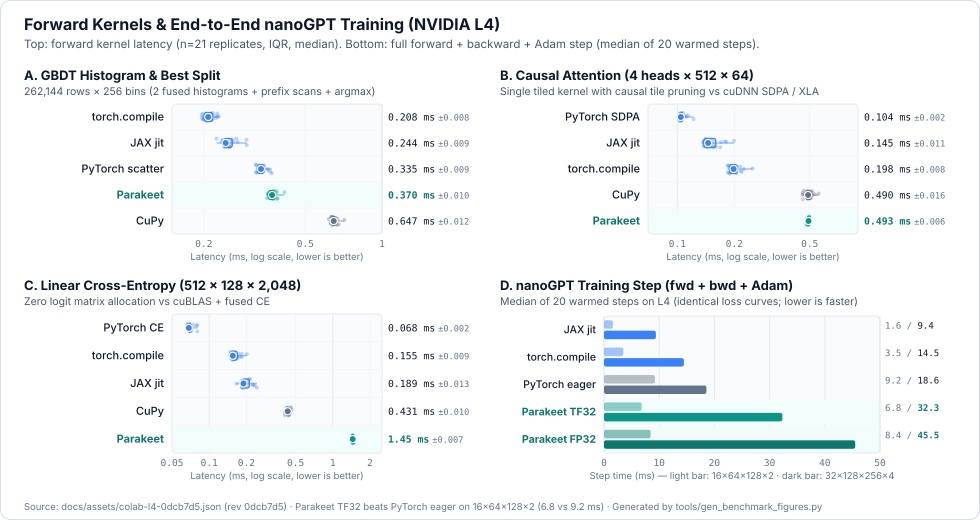

# Benchmarks

Parakeet is benchmarked head-to-head against general array compilers
(`torch.compile`, `JAX jit`, `CuPy`, `NumPy`) and specialist libraries
(`Faiss`, `PyKeOps`, `scikit-learn`, `SciPy`, `PyTorch SDPA / cross_entropy`).
Every figure plots **all individual warmed replicates**, the **interquartile
range (IQR, 25th–75th percentile)**, and the **median** directly from the
committed raw JSON logs — and every workload links to its runnable source code.

## At a glance (NVIDIA L4 & 4-thread CPU)

Latest measurements come from one Google Colab VM with an **NVIDIA L4** GPU and
a **4-thread CPU** at compiler revision `0dcb7d5` (`float32`, GPU inputs
resident on device, explicit synchronization, reference-checked outputs,
`n = 21` GPU replicates / `n = 11` CPU replicates).
[Download full raw JSON (samples, compile times, allocations, training logs)](assets/colab-l4-0dcb7d5.json).

**Key takeaways:**

* **Exact 1-NN (`1,024 × 4,096 × 32`):** On the L4 GPU, Parakeet's ordinary
  broadcasting NumPy (**0.223 ms**) and nested-map form (**0.225 ms**) both
  beat `torch.compile(cdist)` (**0.257 ms**), `PyTorch cdist` (**0.251 ms**),
  `JAX jit` (**0.500 ms**), `PyKeOps` (**0.953 ms**), and `CuPy` (**16.93 ms**),
  trailing only `Faiss GpuIndexFlatL2` (**0.150 ms**). On 4 CPU threads,
  Parakeet (**7.91 ms**) beats `Faiss Flat` (**8.42 ms**), `PyKeOps`
  (**29.03 ms**), `SciPy cKDTree` (**54.27 ms**), and `NumPy` (**472.3 ms**),
  just behind `scikit-learn` brute (**6.49 ms**).
* **Scaling to 16,384 references:** Tiled GPU pairwise folds cut latency by
  **4.8×** (`2.597 ms → 0.542 ms` on L4) and cut global scratch memory by
  **21×** (`64 MiB → 3 MiB`, plus a `16 KiB` shared-memory tile per block).
* **Gaussian kernel regression:** On 4 CPU threads, Parakeet (**42.99 ms**)
  beats `PyKeOps` (**66.77 ms**) and `NumPy` (**505.8 ms**, **11.8× faster**).
  On GPU, Parakeet (**1.053 ms**) beats `PyKeOps` (**1.254 ms**) and `CuPy`
  (**17.18 ms**), while `torch.compile(cdist)` (**0.308 ms**) and `JAX jit`
  (**0.602 ms**) lead.
* **End-to-end nanoGPT training (`16 × 64 × 128 × 2`):** Parakeet with TF32
  WMMA (**6.83 ms/step**) and FP32 (**8.44 ms/step**) both beat eager PyTorch
  (**9.22 ms/step**) with identical loss curves, while `torch.compile`
  (**3.52 ms**) and `JAX jit` (**1.62 ms**) lead on larger dense transformer
  blocks.

---

## Pairwise search and kernel regression

### NVIDIA L4 GPU and 4-thread CPU (`1,024 × 4,096 × 32`, `float32`)

Warmed medians in milliseconds (lower is faster). Faiss and scikit-learn times
exclude index construction. Implementations:
[`nearest_numpy`](gallery.md#exact-nearest-neighbor),
[`exact_1nn`](gallery.md#exact-nearest-neighbor),
[`rbf_kernel_regression`](gallery.md#gaussian-kernel-regression).

| Implementation | CPU 1-NN (ms) | GPU 1-NN (ms) | CPU Gaussian (ms) | GPU Gaussian (ms) |
|---|---:|---:|---:|---:|
| **Parakeet (broadcasting NumPy)** | **8.050** | **0.223** | **42.990** | **1.053** |
| **Parakeet (nested `pk.map`)** | **7.907** | **0.225** | — | — |
| Faiss Flat (`IndexFlatL2` / `GpuIndexFlatL2`) | 8.417 | 0.150 | — | — |
| scikit-learn brute | 6.492 | — | — | — |
| `torch.compile` over `cdist` | — | 0.257 | — | 0.308 |
| PyTorch `cdist` | — | 0.251 | — | 0.444 |
| `torch.compile` over broadcasting | — | 0.688 | — | 0.598 |
| JAX `jit` | — | 0.500 | — | 0.602 |
| PyKeOps `Genred` | 29.027 | 0.953 | 66.769 | 1.254 |
| SciPy `cKDTree` (exact) | 54.266 | — | — | — |
| NumPy / CuPy broadcasting | 472.283 | 16.932 | 505.780 | 17.177 |

At the smaller `256 × 1,024 × 3` shape, CPU PyKeOps led at `0.219 ms`
(interleaved sweep: `0.241 ms`) vs. `0.559 ms` for Parakeet broadcasting, and
GPU `JAX jit` led at `0.079 ms` vs. `0.179 ms` for Parakeet broadcasting. Note
that on the large Gaussian workload, JAX's first-call compilation took `672 s`
before reaching its `0.602 ms` warmed median (all tables report warmed
execution times).

### Scaling exact 1-NN with reference count

Eliminating the materialized `Q × R` distance matrix changes both memory
scaling and GPU throughput. On both NVIDIA L4 (`0dcb7d5` vs. `1.0.0` baseline
`7ddd90a`) and NVIDIA A10G ([raw A10G JSON](assets/gpu-pairwise-fold.json)),
both the broadcasting NumPy form and the explicit operator form compile to the
same tiled pairwise fold with zero host transfers and exact first-index
tie/NaN semantics.

| References (`Q = 1,024, D = 32`) | L4 `1.0.0` NumPy | L4 Tiled NumPy | L4 Tiled `pk.map` | A10G `1.0.0` NumPy | A10G Tiled NumPy | A10G Tiled `pk.map` | `1.0.0` Global Scratch | Tiled Global Scratch |
|---:|---:|---:|---:|---:|---:|---:|---:|---:|
| 1,024 | 0.361 ms | **0.197 ms** | **0.210 ms** | 0.296 ms | **0.135 ms** | **0.139 ms** | 4 MiB | **192 KiB** |
| 4,096 | 0.787 ms | **0.241 ms** | **0.236 ms** | 0.853 ms | **0.190 ms** | **0.180 ms** | 16 MiB | **768 KiB** |
| 16,384 | 2.597 ms | **0.542 ms** | **0.550 ms** | 2.898 ms | **0.458 ms** | **0.470 ms** | 64 MiB | **3.0 MiB** |

Each active tiled threadblock also uses a `16 KiB` shared-memory score tile.
The `1.0.0` nested-map form was not GPU-eligible (it required CPU fallback);
the tiled pairwise fold executes both spellings strictly on CUDA with zero
fallbacks.

### Structured state (`pk.fold` vs. NumPy)

At `1,024 × 4,096 × 32` on the L4 with strict CUDA dispatch and zero timed host
transfers ([browse both programs](gallery.md#inverse-distance-smoothing)):

* **Exact 1-NN:** explicit `pk.fold` (`nearest_fold`) took **0.235 ms** vs.
  broadcasting NumPy (`nearest_numpy`) at **0.222 ms**.
* **Inverse-distance smoothing:** explicit `pk.fold` (`smooth_fold`) took
  **0.270 ms** (2 kernel launches) vs. broadcasting NumPy (`smooth_numpy`) at
  **0.275 ms** (3 kernel launches).

---

## Forward GPU kernels and nanoGPT training

### Forward GPU workloads (NVIDIA L4, `n = 21` warmed calls)

| Workload | Parakeet | PyTorch | `torch.compile` | JAX `jit` | CuPy | Implementation |
|---|---:|---:|---:|---:|---:|---|
| GBDT split (`262,144 × 256` bins) | **0.370 ms** | 0.335 ms | 0.208 ms | 0.244 ms | 0.647 ms | [`gbdt_best_split`](gallery.md#histograms-and-tree-splits) |
| Causal attention (`4 × 512 × 64`) | **0.493 ms** | 0.104 ms (SDPA) | 0.198 ms | 0.145 ms | 0.490 ms | [`causal_flash_attention`](gallery.md#causal-attention) |
| Linear cross-entropy (`512 × 128 × 2,048`) | **1.447 ms** | 0.068 ms | 0.155 ms | 0.189 ms | 0.431 ms | [`cut_cross_entropy`](gallery.md#linear-cross-entropy) |

### End-to-end nanoGPT training (NVIDIA L4)

Each step runs the full forward pass, reverse-mode backpropagation, and Adam
update (4 attention heads, median of 20 warmed steps in milliseconds). Parakeet
and JAX compile the optimizer directly into the training step; `torch.compile`
wraps the forward/loss and runs the optimizer separately. Initial and final
losses match across all arms (`4.200 → 1.426` on the smaller configuration).
[Follow the complete nanoGPT walkthrough](gallery/nanogpt.md).

| Batch × context × width × layers | Parakeet FP32 | Parakeet TF32 (WMMA) | PyTorch eager | `torch.compile` | JAX `jit` |
|---|---:|---:|---:|---:|---:|
| `16 × 64 × 128 × 2` | **8.439 ms** | **6.833 ms** | 9.217 ms | 3.515 ms | 1.619 ms |
| `32 × 128 × 256 × 4` | 45.499 ms | 32.317 ms | 18.554 ms | 14.480 ms | 9.411 ms |

---

## Benchmark implementations and reproduction

Every table and figure on this page is backed by runnable repository code and
raw JSON samples:

| Suite / Workload | Runnable code | Repro command |
|---|---|---|
| Release cross-framework suite (CPU & GPU) | [`benchmarks/release_comparison.py`](https://github.com/iskandr/parakeet/blob/master/benchmarks/release_comparison.py) | `python benchmarks/release_comparison.py` / `modal run tools/modal_release_bench.py` |
| GPU exact 1-NN pairwise fold scaling | [`benchmarks/gpu_pairwise_fold.py`](https://github.com/iskandr/parakeet/blob/master/benchmarks/gpu_pairwise_fold.py) | `python benchmarks/gpu_pairwise_fold.py` / `modal run tools/modal_pairwise_fold.py` |
| Gallery kernels (1-NN, smoothing, RBF, attention, CCE, MLA, GQA, Mamba-2, tropical, GBDT) | [`examples/algebraic_gallery.py`](https://github.com/iskandr/parakeet/blob/master/examples/algebraic_gallery.py) | `python -m examples.algebraic_gallery` |
| Character-level nanoGPT training | [`examples/nanogpt.py`](https://github.com/iskandr/parakeet/blob/master/examples/nanogpt.py) | `python examples/nanogpt.py` |
| Bioinformatics workloads | [`benchmarks/bio_workloads.py`](https://github.com/iskandr/parakeet/blob/master/benchmarks/bio_workloads.py) | `python benchmarks/bio_workloads.py` |
| Local CPU micro-benchmarks (NumPy vs. 1/N threads) | [`benchmarks/run.py`](https://github.com/iskandr/parakeet/blob/master/benchmarks/run.py) | `python benchmarks/run.py` |
| Regenerate all SVG figures on this page | [`tools/gen_benchmark_figures.py`](https://github.com/iskandr/parakeet/blob/master/tools/gen_benchmark_figures.py) | `python tools/gen_benchmark_figures.py` |

---

## Historical 1.0.0 baseline (Modal NVIDIA A10 & 4-vCPU)

For continuity with the original `1.0.0` release (compiler revision
`0345559f`, NVIDIA A10 24 GiB, driver `620.70.06`, 4-vCPU worker), the initial
pre-pairwise-fold release measurements are archived below.
[Download raw 1.0.0 Modal JSON](assets/modal-alpha-comparison.json).

### 1.0.0 Four-vCPU worker (warmed median, ms)

| Implementation | Small 1-NN (`256×1024×3`) | Large 1-NN (`1024×4096×32`) | Small Gaussian | Large Gaussian |
|---|---:|---:|---:|---:|
| Parakeet, broadcasting NumPy | 0.664 | 6.593 | 2.971 | 28.951 |
| Parakeet, nested `pk.map` | 0.638 | 6.132 | — | — |
| PyKeOps `Genred` | 0.255 | 18.246 | 1.087 | 38.038 |
| Faiss `IndexFlatL2` | 0.033 | 9.577 | — | — |
| SciPy `cKDTree` (exact) | 1.441 | 51.846 | — | — |
| scikit-learn brute | 1.042 | 6.647 | — | — |
| NumPy broadcasting | 9.899 | 326.690 | 10.915 | 359.939 |

### 1.0.0 NVIDIA A10 (warmed median, ms — prior to GPU pairwise-fold tiling)

| Implementation | Small 1-NN | Large 1-NN | Small Gaussian | Large Gaussian | Causal Attn | Linear CE | GBDT Split |
|---|---:|---:|---:|---:|---:|---:|---:|
| Parakeet `1.0.0` | 0.261 | 0.796 | 0.226 | 1.130 | 0.386 | 1.604 | 0.276 |
| PyTorch eager / specialist | 0.128 | 0.323 | 0.166 | 0.568 | 0.090 | 0.069 | 0.225 |
| `torch.compile` | 0.089 | 0.208 | 0.106 | 0.294 | 0.116 | 0.088 | 0.175 |
| JAX `jit` | 0.115 | 0.424 | 0.098 | 0.663 | 0.217 | 0.133 | 0.188 |
| PyKeOps `Genred` | 0.262 | 0.962 | 0.295 | 1.289 | — | — | — |
| Faiss `GpuIndexFlatL2` | 0.079 | 0.154 | — | — | — | — | — |
| CuPy | 0.483 | 12.359 | 0.527 | 12.736 | 0.326 | 0.255 | 0.420 |

### Methodology notes

* Every benchmark arm is checked against a reference implementation (exact
  index equality for 1-NN and split finding; tight floating-point tolerance for
  reductions, attention, and training losses).
* GPU arms time GPU-resident inputs with explicit CUDA synchronization before
  and after each replicate; first-call compilation times are recorded
  separately in the JSON downloads and excluded from warmed medians.
* On CPU, Parakeet's pairwise fold allocates an `8 KiB` (`16 × 128` float32)
  score tile plus `192 B` of row summaries per active strip; on GPU, it uses a
  `16 KiB` shared-memory score tile per block and `O(Q · #tiles)` global
  partial winners rather than an `O(Q · R)` distance matrix.
