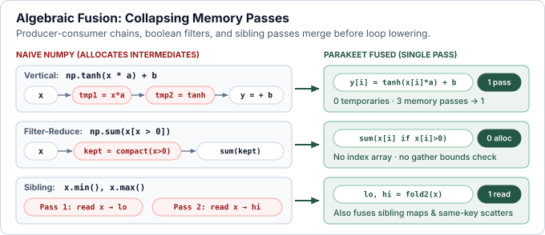

# Rewrite rules & thesis lineage

This reference maps each algebraic rewrite to its compiler pass and shows how
Parakeet 1.x builds on the two NYU PhD theses behind the original compiler:

* **[R]** [Alex Rubinsteyn](https://rubinsteyn.com/),
  [*Runtime Compilation of Array-Oriented Python Programs*](https://cs.nyu.edu/media/publications/rubinsteyn_alex.pdf)
  (NYU, 2014) — type specialization, data-parallel operators, and fusion rules.
* **[H]** [Eric Hielscher](https://github.com/hielscher),
  [*Locality Optimization for Data Parallel Programs*](https://cs.nyu.edu/media/publications/eric_h.pdf)
  (NYU, 2013; [arXiv:1304.1835](https://arxiv.org/abs/1304.1835)) — cache/register
  tiling and loop interchange over operator trees.

*(For the cohesive conceptual story behind these passes, read
[Operators & compilation walkthrough](primitives.md) and
[Algebraic optimization](algebra.md) first.)*

---

## Where rewrites run

1. **During elaboration:** array expressions stay *delayed* (index-to-value
   functions), so simple producer-consumer chains fuse on construction.
2. **In the middle end:** 12 passes in `parakeet.transforms.pipeline.PASSES`
   rewrite the emitted operator IR (`IndexMap`, `IndexReduce`, `IndexScan`,
   `IndexFilter`, `IndexExpand`, `IndexScatter`, `IndexWavefront`) before loop
   lowering. Inspect what fired on any function with
   `par.show_rewrite(fn, *args).summary()`.

---

## Fusion rules {#fusion}

<figure markdown="span">
  
  <figcaption><strong>Figure 1.</strong> Vertical, filter-reduce, and sibling fusion eliminate intermediate arrays and redundant DRAM passes before loop lowering.</figcaption>
</figure>

### Producer-consumer (vertical) fusion (`[R]` Fig. 6.1)

<div class="pk-xform" markdown>
<div class="pk-xform-col pk-xform-col--before" markdown>
<div class="pk-xform-title">Chained operators <span class="pk-xform-badge">separate passes</span></div>

```python
Map(g, Map(f, X))  # np.tanh(x * a) + b
Reduce(g, +, Map(f, X))  # np.sum(x * x)
Scatter(+, idx, Map(f, X))  # np.bincount(idx, weights=w * s)
Map(g, Scan(f, +, X))  # np.cumsum(x) * 2 + 1
Reduce(g, +, Filter(p, X))  # np.sum(x[x > 0])
Filter(q, Filter(p, X))  # x[x > 0][x[x > 0] < 1]
```
</div>
<div class="pk-xform-col pk-xform-col--after" markdown>
<div class="pk-xform-title">Fused operator <span class="pk-xform-badge">1 pass · 0 temporaries</span></div>

```python
Map(g ∘ f, X)  # + affine inversion for transpose/slices
Reduce(g ∘ f, +, X)
IndexScatter(+, idx, f)
IndexScan(f, +, emit=g)  # fused into scan's emit block
FilterReduce(g, +, p, X)  # guarded loop, no index buffer
Filter(p ∧ q, X)  # single short-circuit compaction
```
</div>
</div>

**Safety guards added in 1.x (extending `[R]`):**

* **Alias safety:** every delayed array snapshots the store counter; a
  potentially aliasing store before consumption restarts elaboration with that
  array materialized eagerly.
* **Multi-use duplication guard:** `[R]` had no cost guard; 1.x fuses an
  expensive delayed array at most once so repeated uses or loop bodies never
  recompute it.
* **Empty-mask semantics:** `FilterReduce` requires single use of compacted
  indices and an explicit identity `init` (so `np.min(x[mask])` still raises
  `ValueError` on an empty mask).

### Nested and sibling (horizontal) fusion (`[R]` Figs. 6.2–6.3)

<div class="pk-xform" markdown>
<div class="pk-xform-col pk-xform-col--before" markdown>
<div class="pk-xform-title">Separate or nested passes</div>

```python
# Nested independent maps
[[f(x, y) for y in Y] for x in X]

# Sibling maps / reductions / scatters
a, b = np.sin(x), np.cos(x)
lo, hi = np.min(x), np.max(x)
gh = par.scatter_add(B, idx, g)
hh = par.scatter_add(B, idx, h)

# Two-pass logsumexp / softmax
m = np.max(x)
s = np.sum(np.exp(x - m))
```
</div>
<div class="pk-xform-col pk-xform-col--after" markdown>
<div class="pk-xform-title">Merged operator</div>

```python
# Single flattened N-D IndexMap (full parallelism)
IndexMap(f, shape=(len(X), len(Y)))

# Single traversal over x (or idx)
a, b = IndexMap2(sin, cos, x)
lo, hi = IndexReduce2(min, max, x)
gh, hh = IndexScatter2(B, idx, g, h)

# Single-pass online (m, s) carry fold
m, s = OnlineLogSumExp(x)
```
</div>
</div>

On CUDA, independent contiguous elementwise maps of differing sizes (such as
updating dozens of parameter tensors in an Adam step) also batch horizontally
into one disjoint-union kernel to cut launch overhead.

---

## Tiling, locality, and shape specialization (`[H]` & `[R]` §6.4)

<div class="pk-prim-grid" markdown>

<div class="pk-prim-card" markdown>
<div class="pk-prim-head"><strong>Generalized <code>IndexTile</code> + <code>TileStage</code></strong></div>

Extends `[H]`'s `TiledMap` to any rank `≥ 2` `IndexMap` wrapping one
`IndexReduce` (arbitrary folds, `Carry` states, and prologues/epilogues) —
driving CPU L1/L2 cache tiles, `2×4` register jamming, GPU `__shared__` /
`threadgroup` staging, Metal `simdgroup_matrix`, and CUDA TF32 `mma.sync` from
one IR.
</div>

<div class="pk-prim-card" markdown>
<div class="pk-prim-head"><strong>Target-aware reduction interchange</strong></div>

Implements `[H]`'s `PermuteReductions` selectively via `TargetProfile`: on CPU,
hoists strided associative inner reductions (`np.sum(X, axis=0)`) outside
L1-sized output strips; skipped on GPU so warps stay coalesced across columns.
Stencils are never tiled (matching `[H]`'s finding that tiling slows blur
stencils).
</div>

<div class="pk-prim-card" markdown>
<div class="pk-prim-head"><strong>Associativity &amp; linear algebra</strong></div>

Reductions parallelize and vectorize only when the combiner is provably
associative (`+`, `*`, `min`, `max`, `and`, `or`, `&`, `|`, `^`); arbitrary
user folds keep strict left-to-right order. `a @ b` lowers to `Map(Reduce(+))`
so prologues/epilogues fuse, while standalone CPU float `a @ b` dispatches to
NumPy's `cblas_?gemm` unless `config.blas = False`.
</div>

<div class="pk-prim-card" markdown>
<div class="pk-prim-head"><strong>Value &amp; shape-bucket specialization</strong></div>

Extends `[R]` §6.4: size-1 broadcast dimensions are always static constants,
compile-time arguments (`axis`, `keepdims`, tuple lengths) specialize
automatically, and tiled/GPU passes propagate finite power-of-2 shape buckets
and divisibility (`DimInfo(lo, hi, align)`) so aligned sizes
(`128, 256, 512, 1024, 4096`) share one branchless fast-path binary.
</div>

</div>

Scalar algebraic simplifications (`x + 0`, `x * 1`, `x ** 2 → x * x`, zero-copy
view arithmetic, and redundant broadcast/bounds check elimination) happen on
the fly during IR construction, delegating low-level CSE, LICM, unrolling, and
SIMD codegen to `clang`/`gcc`/NVRTC/Metal.

---

## Operator differentiation rules

`par.grad` attaches one reverse rule per algebraic operator (rather than
differentiating flattened loops). See [Automatic differentiation](autodiff.md)
and [Law 2: Algebraic rematerialization](algebra.md#law-2-algebraic-rematerialization-in-reverse-mode-ad).

<div class="pk-xform" markdown>
<div class="pk-xform-col pk-xform-col--before" markdown>
<div class="pk-xform-title">Forward operator</div>

```python
Map(f, X)  # elementwise
Reduce(+, X)  # sum reduction
Reduce(max, X)  # max reduction
Reduce(*, X)  # product reduction
Scan(+, X)  # prefix sum
A @ B  # matrix product
X[idx]  # gather
par.scatter_add(n, idx, v)  # scatter-add
np.sort(X)  # sort
```
</div>
<div class="pk-xform-col pk-xform-col--after" markdown>
<div class="pk-xform-title">Reverse adjoint given output cotangent <code>ȳ</code></div>

```python
Map(∂f / ∂x * ȳ, X)  # summed over broadcast axes
broadcast(ȳ, X.shape)
ȳ * (X == result) / tie_count
zero_safe(ȳ * result / X)
ReverseScan(+, ȳ)
ȳ @ B.T, A.T @ ȳ
par.scatter_add(len(X), idx, ȳ)
ȳ[idx]  # gather
scatter(ȳ, inverse_permutation)
```
</div>
</div>

Arbitrary non-elementary reductions use `O(√N)` checkpointed reverse replay,
general `par.map` bodies differentiate per element with thread-privatized
adjoints, and runtime `if c: A else: B` evaluates both pure branches and
selects values and adjoints by `c`.

---

## Evolution from the 2013–2014 NYU theses

<div class="pk-xform" markdown>
<div class="pk-xform-col pk-xform-col--after" markdown>
<div class="pk-xform-title">Added in Parakeet 1.x <span class="pk-xform-badge">new capabilities</span></div>

* **Composable AD + Law 2 rematerialization:** forward (`jvp`), reverse
  (`grad`/`vjp`), higher-order (`hvp`/`hessian`), and zero-tape attention/CCE
  adjoints.
* **Algebraic Laws 1–6:** rescaled-monoid tiling (attention, CCE, RBF),
  contraction reassociation (MLA/GQA), chunkwise state-space scans (IIR,
  Mamba-2), `TileInterval` mask pruning, and ordered pairwise folds / fused
  histograms.
* **Soundness &amp; specialization:** alias and multi-use duplication guards on
  fusion, static size-1 broadcasts, `DimInfo` shape-bucket specialization, and
  checked runtime `IndexError`/`ValueError` exceptions.
* **Modern targets &amp; surface:** unified multi-core CPU, Apple Metal
  (`simdgroup_matrix`), and NVIDIA CUDA (TF32 `mma.sync`, NVRTC/PTX/`nvcc`,
  device residency), plus `RaggedArray`, wavefront DP, `einsum`, `par.nn`, and
  `par.Alphabet`/`par.Vocab`.
</div>
<div class="pk-xform-col pk-xform-col--before" markdown>
<div class="pk-xform-title">In <code>[R]</code> / <code>[H]</code> only <span class="pk-xform-badge">deliberately replaced or omitted</span></div>

* **IR-to-IR loop AD:** replaced by an operator-level algebraic tape during
  elaboration so adjoints undergo full fusion and tiling.
* **Recursive arbitrary-depth tiling &amp; general `TiledScan`:** 1.x focuses
  `IndexTile` on rank `≥ 2` map-of-reduce nests and `TileScan` on affine and
  bilinear recurrences.
* **Online runtime tile-size autotuning:** replaced by analytical compile-time
  sizing from `TargetProfile` and `config.tile_bytes`.
* **Custom low-level scalar optimizer:** delegated to `clang`/`gcc`, NVRTC,
  `nvcc`, and the Metal compiler.
</div>
</div>

---

**Next:** [Compiler architecture](internals.md) walks through specialization,
elaboration, all 12 middle-end passes, lowered loop IR, and C/Metal/CUDA
codegen.
